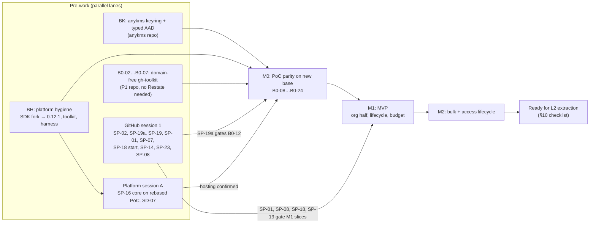

# P1 GitHub Invite: build plan

| Field | Value |
|---|---|
| Project | P1 GitHub Invite (priority 1; `PLAN.md` §6, §9 planning sequence step 2) |
| Status | Draft, 2026-10-15. Planning output (`PLAN.md` §9: "Outputs go to … `plans/`") |
| Builds | `specs/projects/P1-github-invite.md` (revision 2, cited as **spec §n**) and `specs/components/anykms-local-keyring.md` (revision 2, cited as **keyring §n**). The toolkit lane builds toward `specs/components/L2-github-app-toolkit.md` (cited as **L2 §n**; deltas `D-nn` are its §17, folded into B0-03…B0-07 and B1-01/B1-02 on 2026-10-16) |
| Decisions | ADR 0001–0005 (Accepted). ADR 0006–0010 (**Proposed**; this plan uses their recommended options, as the spec does). PD-A…PD-O (spec §16.2) |
| Baseline | The PoC `sagikazarmark/ghinvite2.orig` at `89a67fa`, extended in place (ADR 0006). Called **the P1 repo** below |
| Evidence read for this plan | The PoC at `89a67fa` (`Cargo.toml`, `.github/workflows/ci.yml`, `crates/`, `scripts/`, `tests/`); `sagikazarmark/restate-toolkit` (`Cargo.toml`, `crates/restate-e2e-harness/README.md`, `crates/restate-ext/src/`); `sagikazarmark/restate-worker` (`Cargo.toml`, `README.md`); `sagikazarmark/anykms` (`crates/`); branches of `sagikazarmark/restate-sdk-rust`; releases of `restatedev/sdk-rust`. All read 2026-10-15 |

**Conventions.**
- Build task IDs are `BK-nn` (anykms keyring), `BH-nn` (platform hygiene), `B0-nn` / `B1-nn` / `B2-nn` (milestones M0 / M1 / M2) and `BX-nn` (L2 readiness). They are deliberately different from the spec's "M0 step N" numbering (spec §17, §18.2) and from the test-layer IDs `T1`–`T6` (spec §19) and keyring tests `T1`–`T15` (keyring §11). §2.3 maps tasks to spec steps.
- `AC-…`, `REQ-…`, `PD-…` and `OQ-…` are spec IDs. `KR-…`, `CX-…` and "keyring OQ-n" are keyring-spec IDs. `R-…` are rows of `analysis/risks.md`. `SP-…`/`SD-…` are spikes in `analysis/spikes-pending.md`; **SP-19a** is the spike the spec added (spec §16.1).
- **UNVERIFIED** marks a claim with no primary source or spike behind it yet.
- Every task is sized for **one agent session and one PR**: one crate or one vertical slice, with its tests, and nothing left half-wired. A task that grows past that is split before it starts, not during.

---

## 1. Facts this plan rests on (verified while planning)

These change the ordering compared with spec §17, so they are stated up front.

| # | Fact | Source | Consequence for the plan |
|---|---|---|---|
| F-1 | The P1 repo pins `restate-sdk = "0.12"` and patches it to the fork `sagikazarmark/restate-sdk-rust` rev `e882e9e` (comment: "Wasm clocks and input draining", PR #128) | PoC `Cargo.toml` L44, L87–89 | The 0.12.1 rebase (ADR 0010) changes one `[patch]` line, but every Restate CI gate must re-run (BH-05) |
| F-2 | Upstream's latest release is `v0.12.1`. The fork has branches `main`, `wasm`, `protocol-mode`, `service-name-option`, `terminal`, `id`. There is no per-release branch yet | `gh api repos/restatedev/sdk-rust/releases`; `gh api repos/sagikazarmark/restate-sdk-rust/branches` | BH-01 creates the first per-release branch (ADR 0010 decision 2) |
| F-3 | The P1 repo does **not** use the `restate-worker` crate. Its Workers adapter is inline in `crates/ghinvite-workflows-worker/src/lib.rs` (`ProtocolMode`, `HandleOptions`) | PoC `crates/ghinvite-workflows-worker/src/lib.rs` L14 | Fork-sensitive glue lives in two places. BH-03/BH-06 consolidate it (optional) |
| F-4 | `restate-worker` `main` depends on `restate-sdk = "0.8"` and `worker = "0.7"` | `restate-worker` `Cargo.toml` L13–14 | It is behind the P1 repo. BH-03 bumps it before anyone adopts it |
| F-5 | `restate-toolkit` (v0.3.0, MSRV 1.92) depends on `restate-sdk = "0.12.0"` and contains `restate-config`, `restate-e2e-harness`, `restate-ext` (`clock.rs` = `ContextClockExt`, `poll.rs`, `shutdown.rs`, `errors.rs`) | `restate-toolkit` `Cargo.toml` L6–19; `crates/` listing | A `[patch.crates-io]` in the P1 workspace also patches the toolkit's SDK. Whether `restate-ext` builds for wasm32 is **UNVERIFIED** (BH-04) |
| F-6 | The P1 repo does **not** use `restate-e2e-harness` or `restate-ext`. Its Restate integration tests run through `scripts/test-restate.sh <suite>` against a local `restate-server` (compose), behind the `integration` feature of `ghinvite-workflows` | PoC `crates/ghinvite-workflows/Cargo.toml` L9–17; `.github/workflows/ci.yml` "Restate approval and delivery gate" | The spec's T3 layer and `ContextClockExt` references (spec §5.1, §9.2, §19.1) are adoption work: BH-07, BH-08 |
| F-7 | The PoC CI already has: `cargo test --workspace`; fmt and clippy `-D warnings`; a wasm32 build of every Worker crate; Worker/D1 runtime suites (`npm test … --prefix tests/worker`, incl. storage conformance on actual D1); production packaging (`worker-build@0.8.1`); island bundle + Playwright; the Restate gate (8 suites) | PoC `.github/workflows/ci.yml` | These are the "PoC CI gates" every task keeps green. New gates are added, never swapped for old ones |
| F-8 | anykms has crates `anykms-core`, `-recipes`, `-local`, `-conformance`, `-testkit`, `-http`, `-transit`, `-aws`, `-azure`, `-gcp` and the facade `anykms`. There is no `anykms-keyring` yet | `gh api repos/sagikazarmark/anykms/contents/crates` | BK creates `anykms-keyring` and `anykms-keyring-cli` (keyring §4, default of keyring OQ-1) |

---

## 2. Ordering and milestones

### 2.1 Phases

1. **BK — anykms local keyring + typed AAD** (anykms repo). Prerequisite for P1 (`PLAN.md` §9; ADR 0001; spec §17 step 1). Only B0-19 (sessions and continuations) consumes it, so it runs **in parallel** with BH and the toolkit lane. It blocks M0 exit, not M0 start.
2. **BH — platform hygiene.** SDK fork rebase onto 0.12.1 and its CI (ADR 0010), `restate-worker` and `restate-toolkit` on the rebased SDK, the P1 repo on the rebased fork with every PoC gate green, and adoption of `restate-e2e-harness` and `restate-ext`. Spec §17 lists the rebase as M0 step 4; this plan moves it **before** M0 workflow changes, so that the M0 workflow tasks are tested once, on the final SDK, through the harness.
3. **M0 — PoC parity on the new base** (spec §3.1, §17). Toolkit lane first (no Restate dependency), then storage and domain, the Delivery rewrite, sign-in split, authority, Link Secret, Reconciler, envelope sessions, gates, deploy.
4. **M1 — MVP** (org half and lifecycle).
5. **M2 — bulk invite and access lifecycle.**
6. **Ready for L2 extraction** (§10). Not a build milestone; the gate into `PLAN.md` §9 step 3.

### 2.2 Critical path and lanes

- **Critical path:** BH-01 → BH-05 → BH-07 → B0-08 → B0-10 → B0-11 → B0-18 → B0-20 → B0-22 → B0-23 → B0-24 (M0 launch). A second chain joins at B0-23: BK-01 → BK-03 → BK-04 → BK-05 → BK-06 → BK-13 → B0-19.
- **Lanes that can run as separate agents at the same time:** (A) BK in anykms; (B) BH in the fork, `restate-worker`, `restate-toolkit`; (C) toolkit tasks B0-02…B0-07 in the P1 repo; (D) the human-run account spikes (§4). Inside M0, after B0-09: B0-10/B0-11 (delivery), B0-12…B0-14 (identity and authority) and B0-15…B0-17 (links) are independent until B0-20.
- **WIP rule:** at most one open PR per crate at a time in the P1 repo, because migrations (B0-08) and the core domain (B0-09) are shared by everything after them.

### 2.3 Crosswalk to spec §17 steps

| Spec §17 M0 step | Build tasks |
|---|---|
| 1 anykms keyring + AAD | BK-00…BK-13 |
| 2 toolkit domain-free, broker, profiles | B0-02…B0-05 |
| 3 role precedence on the repo path | B0-08…B0-11 |
| 4 SDK fork rebase to 0.12.1 | BH-01, BH-02, BH-05 (moved earlier, §2.1) |
| 5 token size and redaction | B0-06 |
| 6 `docs/adr.bak/` removed | B0-01 |
| 7 SP-19a, then the sign-in app split | SP-19a, B0-07, B0-12 |
| 8 repo app manifest, Installing Owner, delegation, authority cost model | B0-13, B0-14 |
| 9 Link Secret | B0-15, B0-16 (and guardrail rules B0-17) |
| 10 Reconciler scheduling | B0-18 |
| 11 envelope sessions and continuations | B0-19 |
| 12 SP-16, then production deploy | SP-16 core (early, §4), B0-22, B0-23, B0-24 |

### 2.4 Decisions needed, and the task that waits on each

Building starts on the Proposed ADRs' recommended options. A user decision that differs re-plans only the tasks listed.

| Decision | Needed before | Default used | If decided differently |
|---|---|---|---|
| ADR 0006 extend the PoC | B0-01 | Extend in place | Whole M0 re-planned (restart = new repo; BK and BH unaffected) |
| ADR 0007 own sign-in app, no Clerk | B0-12 | Yes | B0-12, B0-14 re-planned |
| ADR 0008 two acting apps | B0-13 | Yes | Option B: B0-13 registers one app with webhooks; B0-18 cadence relaxes; B1-03 drops |
| ADR 0009 exclude EMU | B1-12 | Yes | B1-12 grows an EMU desk check first |
| ADR 0010 Workers + fork + native fallback | BH-01 | Yes | Option B (native host only): BH-02/BH-03/BH-06 drop, SP-16 not needed, B0-22 targets a container |
| keyring OQ-1 crate placement, OQ-2 wrap algorithm | BK-01 / BK-05 | New crates; AES-256-GCM wrap | BK-04/BK-05 change shape; L1 spec names change (keyring §12) |
| keyring OQ-9 one keyring per product | BK-13 | One per product | Descriptor naming only |
| spec OQ-1 show URL once vs sealed copy | B0-15 | Show once (hash only) | B0-15 adds `purpose=link-secret` (register in keyring §6.5 first) |
| spec OQ-11 repo ceiling for delegation | B0-14 | 5,000 repos | Constant only |
| spec OQ-12 Installing Owner recovery | B0-13 | Re-install records new sender | B0-13 copy and docs |
| spec OQ-7 envelope review vs M0 launch | B0-24 | Not a blocker for sessions | B0-24 waits for the anykms review |
| spec OQ-3 "allow upgrades" guardrail | B1-04 | Upgrades allowed | B1-04 adds a guardrail field + AC |
| spec OQ-6 bulk review UI | B2-01 | Native forms, no island | B2-01 needs an ADR for a second island or the SPA escape hatch |

---

## 3. Milestones and tasks

Every task's acceptance includes, implicitly: CI green on all existing gates (F-7, plus gates added by earlier tasks); `cargo clippy -D warnings`; the wasm32 build of the Worker crates; no new secret in logs, errors, journal or state (REQ-SEC-2); new `CONTEXT.md` terms added with the task that introduces them (spec §18.2 last row); `UNVERIFIED` items the task touches either resolved or left marked.

### 3.1 BK — anykms local keyring and typed encryption context (prerequisite)

**Goal.** Ship ADR 0001 decisions 2–3 in the anykms repo: a production local KEK backend loaded from configuration, and a typed, non-empty encryption context that is the only route from keyring material to the envelope. Spec: keyring §4–§11.

**Exit criteria (testable).**
- The four ADR 0001 acceptance checks pass in anykms CI (keyring T1).
- Keyring T1b, T2, T3 (vectors reproduced by an independent implementation), T4, T5 (`ANYKMS_FAIL_ON_SKIP=1`), T6, T7, T7b, T8 (with `RUSTFLAGS` unset), T9, T10 (local workerd), T13 (native part), T14, T15 pass.
- KR-01 dependency check passes for `wasm32-unknown-unknown`.
- A tagged anykms commit exposes `anykms::keyring` through the facade feature `keyring` without `raw-kek`, and the P1 repo can depend on it by tag.
- Not required for BK exit: T11 (= SD-07, account spike, §4), T12 (only if `Sealed<T>` is ever built; P1 builds none, spec §9.3).

| ID | Title | Repo / crate | Depends on | Acceptance criteria | Tests |
|---|---|---|---|---|---|
| BK-00 | Record keyring OQ-1, OQ-2, OQ-9 answers | anykms (`docs/`) | user decision | A short decision note in anykms docs; keyring spec §4/§6.2 edited if an answer differs from the default | — |
| BK-01 | `EncryptionContext`, field and purpose rules, canonical encoding | anykms / `anykms-recipes` feature `context` | BK-00 | CX-01, CX-02, CX-03 implemented; `EncryptionContext` has no `Default` and no constructor without `purpose`; violations are `InvalidArgument` before any crypto | T4 proptest (injective, order-independent, 10^6 cases); T3(c) golden bytes incl. ambiguity pairs |
| BK-02 | `purpose!` macro and registry v1 declarations | anykms / `anykms-recipes` | BK-01 | Grammar of keyring §6.5; `TryFrom` only (no infallible `From`); const assertion on field count; the v1 purposes `user-token`, `installation-token-cache`, `session`, `attempt-continuation`, `restate-sealed` declared exactly as the registry table, all keys required | T4 macro cases (`"007"`, empty, 256-byte, wrong kind, absent `Option`); every registry purpose builds |
| BK-03 | `ContextEnvelope` with sealed `EnvelopeBackend` and padding | anykms / `anykms-recipes` | BK-01 | CX-04 (no raw-AAD method, not `Aead`, no `inner()`, sealed backend), CX-06 padding mismatch → `InvalidArgument`; `rewrap_current`/`rewrap_verified` route to local commitment-checked rewrap | T1b cases (a), (b), (f) as trybuild compile-fail; T14 |
| BK-04 | `anykms-keyring` crate: descriptor `akr1` parser, KCV, fingerprint, builder | anykms / `anykms-keyring` (new) | BK-00 | KR-02 (every rule, fixed error strings, no `source` chain), §6.1 KCV, KR-05, KR-18 fingerprint, `Zeroizing` key bytes; no I/O and no async on the key path (KR-03) | T2 parser cases + `cargo fuzz` target + leak check; T15 |
| BK-05 | `KeyringKek`: wrapped-DEK format, `KeyWrap` + `Describe`, sealed `ReadyKek`, no `Rewrap` | anykms / `anykms-keyring` | BK-04 | Keyring §6.2 slot format; KR-06, KR-07 check order (UnknownKeyVersion with retry hint, KeyVersionUnusable, KCV `Configuration`, before any AES call), KR-08, KR-21; `KeyringKek` not constructible without `raw-kek` | T3(a)(b) JSON vectors + an independent reproduction script (Python `cryptography` or Node); T1b (c)(d)(e) |
| BK-06 | `Keyring::context_envelope`, `needs_rewrap`, rotation and removal | anykms / `anykms-keyring` | BK-03, BK-05 | KR-17; rewrap only via local commitment-checked path; the §7.2 scheduled-rotation procedure works end to end on SQLite with conditional writes | T1 (ADR 0001 acceptance), T7, T7b |
| BK-07 | Synchronous path and global install | anykms / `anykms-keyring` features `global` | BK-06 | KR-13 (`encrypt_sync`/`decrypt_sync`/`rewrap_current_sync`, one poll with `Waker::noop()`, `Pending` → `Backend`); KR-15 (`install` idempotent on equal fingerprint, `Configuration` otherwise; `get` before install → `Unavailable`, no panic) | T6; T13 native part |
| BK-08 | Loaders and Workers loading guidance | anykms / `anykms-keyring` feature `std-loaders` + docs | BK-04 | Worker-secret and Secrets-Store-value parse paths; `from_env`, `from_file` (refuses group/other-readable on unix unless overridden); a `docs/` page with the KR-04 per-isolate `OnceLock`, fail-closed, redeploy-to-change pattern | Unit tests per loader; doc example compiles |
| BK-09 | Provisioning CLI `akr` | anykms / `anykms-keyring-cli` (new, native only) | BK-04 | Commands `new`, `add`, `promote`, `remove`, `show`, `diff` per keyring §5.5 and KR-16; stdin → stdout; `show` never prints key bytes | T2 CLI round trips; `akr diff` refuses each KR-16 violation |
| BK-10 | Conformance fixture under `raw-kek` | anykms / `anykms-keyring` tests | BK-06 | Keyring §11.1 fixture and `FixtureCaps`; the `DisableVersion` pre-implementation check done and its declaration chosen accordingly | T5 with `ANYKMS_FAIL_ON_SKIP=1`; `conformance::declarations` trial |
| BK-11 | wasm CI | anykms `.github/` | BK-07 | KR-01 banned-crate check on `cargo tree --target wasm32-unknown-unknown`; consumer crate built with `env -u RUSTFLAGS` and `getrandom/wasm_js` (settles the keyring §6.7 UNVERIFIED claim) | T8, T9 (`wasm-bindgen-test` under Node running T1 and T6) |
| BK-12 | `examples/worker` in workerd (= SD-06 extended, keyring T10) | anykms `examples/worker` | BK-08, BK-11 | `wrangler dev --local` Worker loads the descriptor from a Worker secret per KR-04, installs it, round-trips a context-bound envelope, rejects a wrong context, serves the fingerprint route | T10: HTTP 200 `ok=true wrong_ctx_fails=true`; fingerprint equals `akr show` |
| BK-13 | Facade feature, docs, release | anykms / `anykms` facade | BK-02, BK-06, BK-07, BK-09, BK-10, BK-11 | `anykms` feature `keyring` re-exports without `raw-kek`; guide section; registry table published in anykms docs (keyring §6.5 note); tag cut | `cargo tree -e features -i anykms-keyring` from a consumer shows no `raw-kek` |

Not in BK: the anykms envelope external review (ADR 0001; keyring OQ-6; spec OQ-7). It is tracked as an ops gate (§7) and owned by the anykms repo.

### 3.2 BH — platform hygiene

**Goal.** Every Restate-touching crate (fork, `restate-worker`, `restate-toolkit`, the P1 repo) is on restate-sdk 0.12.1 plus the carried wasm patch, with fork CI that would catch a broken rebase, and P1's workflow tests run through `restate-e2e-harness`.

**Exit criteria (testable).**
- Fork branch for 0.12.1 exists; its CI runs the PR #128 wasm32 checks and a workerd smoke test (`ctx.run`, `ctx.sleep`, `send_after`) and is green; the same smoke test fails on unpatched upstream 0.12.1 (negative control, = SD-02).
- The P1 repo's `[patch.crates-io]` points at the new fork rev, and every PoC CI gate (F-7) is green unchanged.
- One P1 Restate suite (`authoritative_admission`) runs through `restate-e2e-harness` in CI with `CI` set, so a missing server fails instead of skipping.
- SP-16 core (§4) has been run on the rebased PoC, or a dated decision to run it with B0-23 is recorded.

| ID | Title | Repo / crate | Depends on | Acceptance criteria | Tests |
|---|---|---|---|---|---|
| BH-01 | Rebase the wasm patch onto upstream v0.12.1 (= SD-02) | `restate-sdk-rust` fork, new branch `wasm-0.12.1` | ADR 0010 | Diff vs `v0.12.1` limited to the PR #128 scope (clock injection and input draining, F-1); the patch scope is written into the branch README; PR #128 stays open upstream | SD-02: upstream 0.12.1 panics with "time not implemented" for `ctx.run`/`ctx.sleep`/`send_after` on wasm32; the fork completes |
| BH-02 | Fork CI | `restate-sdk-rust` fork `.github/` | BH-01 | Job 1: `cargo check --target wasm32-unknown-unknown` matrix from PR #128. Job 2: a smoke Worker under `wrangler dev --local` against a `restate-server` container runs `ctx.run`, `ctx.sleep(1s)`, `send_after` to completion. Runs on every push to `wasm-*` branches | Job 2 run against upstream is a documented failing control |
| BH-03 | `restate-worker` on 0.12.1 | `restate-worker` | BH-01 | Bumps `restate-sdk` 0.8 → 0.12.1 (F-4) and `worker` to the version the P1 repo uses; `[patch.crates-io]` to the fork for its own CI; README states the fork requirement | Its CI builds for wasm32; a request/response round trip test (or example) passes under `wrangler dev --local` |
| BH-04 | `restate-toolkit` on the rebased SDK | `restate-toolkit` | BH-01 | Workspace builds and tests with `[patch]` to `wasm-0.12.1`; `restate-ext` builds for wasm32 (**UNVERIFIED** today, F-5), or the non-wasm parts are feature-gated so `ContextClockExt` does; a release cut | Toolkit test suite green; `cargo build -p restate-ext --target wasm32-unknown-unknown` |
| BH-05 | P1 repo on the rebased fork | P1 repo, workspace `Cargo.toml` | BH-01 | `restate-sdk = "0.12.1"`; `[patch]` rev = `wasm-0.12.1` head; no handler code changes needed, or changes listed in the PR | All PoC CI gates (F-7) green, including the 8 `scripts/test-restate.sh` suites and the Worker/D1 runtime suites |
| BH-06 | (Optional) Use `restate-worker` instead of the inline adapter | P1 repo / `ghinvite-workflows-worker` | BH-03, BH-05 | Inline adapter (F-3) replaced; same `ProtocolMode::RequestResponse` and identity-key verification; no behaviour change. Skip if BH-03 slips; record why | `tests/worker` suites and "Production-feature Worker packaging" job green |
| BH-07 | Adopt `restate-e2e-harness` for the T3 layer | P1 repo / new dev crate `ghinvite-e2e` (test-only) | BH-04, BH-05 | Harness `ServerSpec` + in-process endpoint deployment + `Call` ingress + SQL introspection wrapped in a P1 harness type with the GitHub stub and stub clock; CI sets `RESTATE_SERVER_BIN` and `CI`; `authoritative_admission` ported; a **step-name table** (`RunPath` per handler, `Table::check`) for every handler of `InvitationLink` and `RepositoryDelivery`. `scripts/test-restate.sh` stays until every suite is ported (each later task ports the suites it touches) | Ported suite green in CI; deleting the server binary makes CI fail (not skip) |
| BH-08 | Journaled clock via `restate-ext` `ContextClockExt` | P1 repo / `ghinvite-workflows` | BH-04, BH-07 | Deadlines, expiry and window computations read the clock only through `ContextClockExt` (spec §5.1, §9.2); the PoC's existing clock helper is read first and replaced or wrapped (which helper exists is **UNVERIFIED**, F-6) | Stub-clock test: a decision deadline computed on replay equals the first execution's value |

### 3.3 M0 — PoC parity on the new base

**Goal** (spec §3.1). The PoC's repo-collaborator product, on: the domain-free toolkit with the ADR 0003 broker; the repo app (zero org permissions) plus the sign-in app; Link Secrets; envelope-encrypted sessions; role precedence on the repo path; the scheduled Reconciler; the rebased SDK; a production deployment that passed SP-16.

**Exit criteria (testable)** — spec §17 "M0 exit", plus this plan's additions:
- AC-LINK-2, AC-LINK-4 (first clause), AC-LINK-5 (repo clauses), AC-LINK-6, AC-LINK-7, AC-LINK-8, AC-REQ-2, AC-DLV-1, AC-DLV-3, AC-DLV-4, AC-DLV-5, AC-ROLE-1, AC-ROLE-2, AC-ROLE-4, AC-ROLE-5, AC-ROLE-6 (without `reserve`), AC-FLOW-1 (both variants), AC-FLOW-6, AC-SEC-1…4, AC-JRN-1, AC-AUTH-1, AC-AUTH-3, AC-AUTH-4, AC-ONB-2, AC-ACC-1…4, AC-APP-1, AC-BRK-1…5, AC-SES-1 pass.
- The spec §18.5 "stay green" suites pass with only renames; "change" suites pass in their amended form.
- The spec §18.3 PoC ADR amendments for M0 are merged (B0-21).
- AC-LIVE-1: one real repo invitation delivered via `/i#secret`, sign-in app and approval, accepted on the deployed stack, and settled `Accepted` by the Reconciler within 1 h.
- **Added:** the toolkit boundary check (BX rules, §6) is a required CI job and green; the `raw-kek` app-side check (keyring T8) is green; every handler changed in M0 has a step-name table entry (BH-07).

| ID | Title | Repo / crate | Depends on | Acceptance criteria | Tests |
|---|---|---|---|---|---|
| B0-01 | Housekeeping | P1 repo `docs/`, `CONTEXT.md` | — | `docs/adr.bak/` deleted (spec §17 step 6); `CONTEXT.md` gets a "P1 terms (pending)" section listing spec §2 new terms, each filled by the task that introduces it | Docs-only; CI green |
| B0-02 | Toolkit made domain-free | P1 repo / `ghinvite-github` → package `gh-toolkit` | — | Package renamed; dependency on `ghinvite-core` (`Permission`) removed in favour of the toolkit's own `RepoRole` (spec §10.1); boundary CI job added (§6 rules R1–R3) | `scripts/check-toolkit-boundary.sh` fails when a `ghinvite-*` dep is injected (negative test in CI); `transport_deadlines.rs` green |
| B0-03 | Multi-app config and App JWT signer | `gh-toolkit` | B0-02 | Per-app `AppId`, client ID, several active PKCS#8 keys (`kid:<pem>;…` list, first signs; spec §20.1), webhook secret list; JWT `iat = now−60`, `exp ≤ 9 min`, cached ~8 min. **L2 target (L2 §17):** `AppRegistry`/`AppConfig` keyed by `AppSlot` (L2 §5.1); `user-agent` from `AppConfig.user_agent`, not hard-coded `ghinvite` (D-08); `JwtSigner` trait + `AppJwtSource` instead of `AppJwtSigner` (D-19) | Unit: claims, key-list parsing (malformed list → error without key bytes), signer cache reuse; wasm32 build |
| B0-04 | Installation token broker | `gh-toolkit` | B0-03 | Spec §10.2: `TokenKey`, `ScopeProfile` type, `ensure`/`call`/`invalidate`/`with_token`; isolate-scope static cache refreshed at < 60 s using mint `expires_at`; mint errors 401 (re-sign once), 404 `InstallationGone`, 403 `InstallationSuspended`, 422 `PermissionsNotGranted`; pre-mint permission check through a toolkit trait (no D1 type); `Broker::read_only()` as a separate type that cannot mint write profiles; `InstallationToken` has no `Serialize`, no `Display`, redacted `Debug`. **L2 target (L2 §6, §17):** `TokenKey.app: AppSlot`, `ReadKey`, `ScopeProfile::read`/`write` constructors with `ReadOnlyBroker` accepting `ReadKey` only (D-02); isolate-wide static `TokenCache` keyed by `(AppId, InstallationId, cache_scope)` as the default, `with_cache` for tests, `invalidate(key, generation)`/`invalidate_key`/`invalidate_installation`/`ensure_fresh`, negative entries voided by snapshot version (D-04); closures receive an owned `InstallationRest`, `call` returns `BrokerError<E>` and invalidates on 401 itself (D-17); mint 403 split into `InstallationSuspended` (confirmed by `GET /app/installations/{id}`) vs `MintForbidden{reason}` (L2 §6.6); no `Serialize` on the PoC's `GhInstallationToken` (D-07) | AC-BRK-1, AC-BRK-2, AC-BRK-4 (toolkit part), AC-BRK-5 (trybuild); compile-fail test: `Broker::read_only()` with a write profile |
| B0-05 | Endpoint enum and typed roles | `gh-toolkit`; P1 profile constants in `ghinvite-workflows` | B0-04 | Spec §7.2 repo, installation, user and token rows as typed endpoints; exhaustive `Link` pagination (partial walk = error); `RepoRole` with `rank()`, `role_name` parsing, `RepoRole::Custom(String)` unrankable; `pull`/`push` mapping; no variant for `DELETE`/`PATCH /repos/{o}/{r}`. P1's `REPO_READ`/`REPO_INVITE` constants live in app code (spec §10.1 table). **L2 target:** typed endpoints take `&Rest<'_>` over the sealed `Credential` trait, not an installation token (D-01); `Method::Patch` (D-03); `EndpointMeta.retry_safe` (D-20) | AC-BRK-3 (table test over the endpoint enum, in the app crate); AC-SEC-3 + CI grep; pagination unit tests with `MockTransport` |
| B0-06 | Error classification and redaction (spec §17 step 5) | `gh-toolkit` | B0-02 | Spec §10.1 error enum with **no upstream text**, in the L2 §13 shapes: enum named `ApiError`, enumerated codes in typed fields and no summary string (D-06), `Ambiguous` vs `NotSent`, `MintError`, `CallError<E>`, `BrokerError<E>` (D-18), `is_transient_for(&EndpointMeta)` (D-20); redaction patterns for `ghs_`/`ghu_`/`ghr_` with 600+ char tokens, the `/i/` segment, OAuth `code`/`state` query params; PoC `credential_disclosure.rs` lifted into the toolkit | AC-SEC-4 (toolkit part); redaction unit tests with a 640-char `ghs_` token |
| B0-07 | Webhook verification and sign-in OAuth primitives | `gh-toolkit` | B0-03 | HMAC-SHA256 constant-time verify against any secret in the per-app list; typed `installation` and `installation_repositories` events; sign-in OAuth web flow (authorize URL, code exchange), `GET /user`, `GET /user/emails`, `DELETE /applications/{client_id}/token` (Basic auth). **L2 target:** PKCE S256 and no `scope` in the authorize URL (D-10, L2 OA-02/OA-03); `OAuthConfig<SignIn>` built with `from_registry` (D-14) | Signature vectors (good, bad, rotated secret); `oauth_url.rs` amended; stubbed exchange/revoke round trip |
| B0-08 | Fresh migrations and core SQL for M0 | `ghinvite-core` `storage/`, `migrations/` | BH-05 | Spec §12 M0 tables: `installations` (+`app` PK part, `permissions_json`, `installed_by_*`, `suspended_at`), `account_settings`, `invitation_links` (M0 columns), `link_secrets`, `invitation_link_targets` (repo kind), `invitation_requests`, `deliveries`, `delivery_attempts` PK `(delivery_key, step)` with `attempt_generation` column, `delivery_outcomes`, `webhook_receipts`, `audit_events`, `attempt_continuations`, `projection_assertions`; core still owns all SQL (PoC ADR 0005); integers > 2^53 refused | T2: shared conformance suite on SQLx (SQLite) and on actual D1 (`tests/worker` storage suite); `pending_queue.rs` green; `projection.rs`, `settlement.rs`, `sqlx_suite.rs` amended |
| B0-09 | Core domain types for M0 | `ghinvite-core` | B0-08 | Repo `Targets`; `LinkState` (Active, Revoked in M0); create outcomes and settlement of spec §5.3 (incl. `AlreadyPending`, `Upgraded`, `SkippedCustomRole`, `Blocked{reason}` M0 reasons); request states; `secret_generation`/`delivery_generation`/`attempt_generation` naming; M0 audit types (spec §14.1) | T1 unit tests on transitions (a terminal create outcome is never replaced) |
| B0-10 | Repository Delivery two-run step table (spec §17 step 3) | `ghinvite-workflows` `delivery.rs` | B0-04, B0-05, B0-09, BH-07 | Spec §7.3 S0–S5 exactly: `ctx.run#1` pre-read (access, identity, `role_name`, pending invitations with full pagination); handler decisions; S3 no-op in M0; `ctx.run#2` `ensure` → re-read → fence claim `(delivery_key, repo)` → one write; 401-on-write releases the attempt generation and retries once (spec §9.4); PATCH raise of a lower pending invitation; journaled results are enums only. Soft gate: SP-07 report read before merge (steps 6, 8) | T3 via harness: AC-DLV-1, AC-DLV-3 (property over stub sequences), AC-DLV-4, AC-DLV-5, AC-ROLE-1, AC-ROLE-2, AC-ROLE-4, AC-ROLE-5, AC-ROLE-6 (trace order without `reserve`); `retained_delivery.rs` green with renames only; `approved_delivery.rs` amended and ported to the harness |
| B0-11 | Settlement, `reconcile(evidence)`, Accepted rule | `ghinvite-workflows` `settlement.rs` | B0-10 | `Evidence` enum (spec Appendix A.2); `OutcomeUnknown` resolved only by presence; repo `Accepted` requires `rank(role_name) ≥ target`, plus `affiliation=direct` presence behind a flag that stays off until SP-07 step 8 confirms the read; tracked `AlreadyPending` never cancelled | T3: AC-ACC-2, AC-ACC-4; settlement table tests (T1) |
| B0-12 | Sign-in app split (spec §17 step 7) | `ghinvite-web` `routes/oauth.rs`, `session.rs`; `gh-toolkit` | **SP-19a PASS**, B0-07 | `/login` and `/oauth/callback` via the sign-in app; `GET /user` only (email evidence is M1); token revoked then discarded; failed revoke logged as redacted kind; session payload of spec §11.3 with no tokens; `signin_starts` limit 5 per 10 min; token-limit error page (error text from SP-19a); user-token reads deleted (`oauth.rs` L282–300) | AC-FLOW-6; `oauth_flow.rs`, `session_protection.rs` amended; T4 test: session holds no `gh?_` string after callback |
| B0-13 | Per-app installations, repo app manifest, Installing Owner | `ghinvite-web` `routes/setup.rs`, `routes/webhook.rs`; `ghinvite-workflows` `installation.rs`, `availability.rs`; `deploy/github-apps/` | B0-07, B0-08 | `deploy/github-apps/signin.manifest.json` and `repo.manifest.json` per spec §20.2; `/setup/{app}`, `/webhooks/{app}` (unknown app → 404); `Installation`/`AccountInstallation` keyed by app; `onboard_webhook` records `installed_by` from the signed `installation.created` sender; `recheck_permissions` refreshes `permissions_json`; `set_delegation` (off by default, audited); `member` webhook handling deleted | AC-APP-1, AC-ONB-2; `installation_availability.rs`, `installation_audit_replay.rs` green; `setup_flow.rs` amended |
| B0-14 | Authority on installation tokens | `ghinvite-web` `middleware/auth.rs`, `link_authority.rs` | B0-04, B0-13, OQ-11 | Spec §7.6: personal owner, Installing Owner (+ `role_name = admin` on every repo Target), Repository Admin only with delegation; `AUTHZ_CACHE` 5-min KV cache; `AUTHZ_RL` (10/60 s per installation); links list reads only distinct link-target repos, ≤ 50 uncached reads per view; search-first repo picker backed by cached `GET /installation/repositories`; 404 concealment; `Broker::read_only()` on `p1-web` | AC-AUTH-1, AC-AUTH-3, AC-AUTH-4; `console_flow*`, `link_authority.rs` amended; `FakeLinkAuthority` extended (PoC ADR 0008) |
| B0-15 | Link Secret, object and storage side | `ghinvite-workflows` `admission.rs`; `ghinvite-web` `link_authority.rs`; core SQL | B0-08, B0-09, OQ-1 | `create` takes `secret_sha256`; `rotate_secret`; web Worker generates 32 bytes with `getrandom` and inserts the `link_secrets` row after `Ok` (through core SQL); projection sets `retired_at`; constant-time hash compare in `admit`; ULID no longer accepted as a code; "URL not ready — rotate" path when the insert fails | AC-LINK-2, AC-SEC-2 (projection paused in test); `canonical_link.rs` amended |
| B0-16 | Link Secret, public surface | `ghinvite-web` `routes/invitation.rs`, `/static/i.js` | B0-15 | `GET /i` fragment-reader page (`history.replaceState`, POST `{secret, csrf}`), `POST /i`, `GET/POST /code`, 303 to `/join`; neutral 404 for unknown/rotated/revoked/expired/exhausted; spec §11.2 headers; `RL_IP`, `RL_USER` bindings; legacy `/i/<x>` → 404, logged redacted | AC-SEC-1 (getrandom marker hook), AC-FLOW-1 (local variant); Playwright: JS path and no-JS code-form path |
| B0-17 | Guardrail rules and admission additions (M0 part) | `ghinvite-core` `invitation_link.rs`; `ghinvite-workflows` `admission.rs` | B0-15 | REQ-LINK-3 (`NoGuardrail`), REQ-LINK-4 (default +14 d; "never" only when ticked, with warning), `InvalidTargets` (repo clauses), `update_metadata` input with no guardrail field, `scope_evidence` input rejected only when ≤ 5 min old (spec §5.1). Admission contract unchanged (spec §18.1) | AC-LINK-4 (first clause), AC-LINK-5 (repo), AC-LINK-6, AC-LINK-7 (compile-time), AC-LINK-8, AC-REQ-2; `authoritative_admission.rs` green with renames only |
| B0-18 | Reconciler scheduling (spec §17 step 10) | `ghinvite-workflows` `reconcile.rs` + new `SweepSchedule` VO | B0-11, B0-13 | Spec §7.7: `SweepSchedule` state is the sweep set (`track`/`untrack` from Deliveries), schedule token, 1 h / 24 h cadence, pull-forward on `track`, one chain per (app, account); `Reconcile.sweep` with full pagination and same-sweep availability check, fan-out by one-way `reconcile` sends (no loop over many Deliveries in one invocation, R-ALL-rr-mode); `/requests/{id}/refresh` deferred to M1 | AC-ACC-1, AC-ACC-3 (exactly one chain afterwards), REQ-OBS-1; step-name table entries for `SweepSchedule.run` |
| B0-19 | Sessions and attempt continuations on the anykms envelope (spec §17 step 11) | `ghinvite-web` `session_store.rs`, `attempt_continuations.rs` | **BK-13**, B0-12 | `P1_KEYRING` (`akr1` descriptor) loaded once per isolate, fail-closed (KR-04); `ContextEnvelope` with purposes `session` (`session_id` from the KV key) and `attempt-continuation` (`scope`, `binding` from plaintext columns, CX-05); every session KV write sets `expiration_ttl` ≤ 30 days (keyring §7.2 table); error mapping per keyring §6.2 table and spec §11.3 (`UnknownKeyVersion` → 503 "try again", `Configuration` → 500 + alert, `KeyVersionUnusable`/`DecryptFailed` → "session invalid, sign in again"); fingerprint diagnostic route `GET /console/keyring` (KR-18), operator-only via `P1_OPERATOR_IDS` (spec A.4, PD-P); XChaCha20-Poly1305 stack removed | AC-SES-1; keyring T8 app-side `raw-kek` check in P1 CI; `session_protection.rs` amended; continuation round trip on D1 |
| B0-20 | Journal and disclosure gates | `ghinvite-e2e`; `gh-toolkit` tests | B0-10, B0-12, B0-16, B0-18 | Marker scan via harness SQL introspection over every `sys_*` table and journal entry, after a forced retry, with a stub issuing `ghs_MARKER…`; disclosure test extended to OAuth `code`, user token and Link Secret | AC-JRN-1 (M0 repo Delivery), AC-SEC-4 (full); both required CI jobs |
| B0-21 | PoC ADR amendments and `CONTEXT.md` for M0 | P1 repo `docs/adr/`, `CONTEXT.md` | B0-12…B0-19 | Spec §18.3 rows 0002, 0004, 0007, 0008 amended and 0009 (canonical link identity) superseded in part; 0003 amended for revoke defaults only (pause and cascade come in B1-14); `CONTEXT.md` M0 terms complete; spec §18.4 changed behaviours listed in `PRODUCT.md` | Docs review; link check |
| B0-22 | Deployment contract and staging | P1 repo `wrangler/`, `deploy/`, CI | B0-13, B0-19 | `p1-web` and `p1-restate` Worker configs with exactly the spec §20.1 bindings per Worker; startup validation of every secret format (error names the variable, never the value); native `ghinvite-*-server` fallback built in CI (ADR 0010 decision 3); a **staging** environment (own Workers, D1, KV, Restate Cloud env, test App registrations from the same manifests); deploy doc keeps old Worker versions alive while invocations are pinned (PoC `docs/deploy.md`) | "Production-feature Worker packaging" job green; a staging deploy from CI; config-validation unit tests |
| B0-23 | SP-16 full on staging | `spikes/sp16-p1/` (throwaway) + staging | B0-22, B0-20 | Spec §16.1 SP-16 row: a deployed Delivery completes; CPU and subrequests within Paid limits; App-JWT CPU < 10 ms (pure `rsa` and WebCrypto); round trips vs the local 7; keyring CPU per operation with N = 10,000 (keyring §6.7); `/i#<marker>` flow then marker scan of Workers Logs, traces and a Logpush HTTP-requests sample | AC-FLOW-1 (deployed variant). FAIL → ADR 0010 switch criteria (§4) |
| B0-24 | M0 production launch (PoC #61) | P1 repo, production accounts | B0-23, OQ-7, §7 checklist | Production deploy via CI; the three production Apps registered from the manifests; §7 checklist signed off; spec §14.2 M0 alerts live | AC-LIVE-1 |

### 3.4 M1 — MVP

**Goal** (spec §3.1). The org half and the lifecycle controls: Organization and Team Targets, the org app, per-target permission, combined links, pause and Auto-pause, the Revoke Cascade, own expiry, the email-domain restriction, the onboarding chooser, the Invite Budget, Eligibility Warnings.

**Exit criteria (testable)** — spec §17 "M1 exit":
- AC-LINK-1, AC-LINK-3, AC-LINK-4 (org clause), AC-LINK-5 (org/team), AC-REQ-1, AC-REQ-3…5, AC-DLV-2, AC-ROLE-3, AC-ROLE-6 (with `reserve`), AC-ROLE-7, AC-ROLE-8, AC-ROLE-9, AC-EXP-1, AC-REV-1…5, AC-PAUSE-1, AC-PAUSE-2, AC-ONB-1, AC-FLOW-2…5, AC-AUTH-2, AC-GOV-1…3, AC-ACC-5, AC-DUP-1, and AC-JRN-1 extended to an org Delivery pass.
- SP-01, SP-07 (with spec-added steps 5–8), SP-08, SP-18 (incl. the 7-day follow-up) and SP-19 have run, and the spec §16.1 changes for their outcomes are merged.
- SD-04 run: zero admissions after `pause`/`revoke` under 500 concurrent `admit` calls (REQ-ADM-1).
- AC-LIVE-2: a combined org + team + repo link delivered end to end on a test org; the org invitation accepted; webhook and Reconciler agree.
- **If SP-01 fails:** M1 is re-scoped to the repo-only product (spec §16.1 SP-01 row; `analysis/risks.md` §4). B1-03 and B1-06 are replaced by an "owner-forwarded request" task, and B1-07 drops its org parts.

| ID | Title | Repo / crate | Depends on | Acceptance criteria | Tests |
|---|---|---|---|---|---|
| B1-01 | Toolkit: org/team endpoints and governor primitives | `gh-toolkit`; P1 `ORG_READ`/`ORG_INVITE` constants | M0 | Spec §7.2 org rows typed (`OrgRole`, `TeamRole`, `MembershipState`, `failed_invitations`); governor primitives in the toolkit (rate-limit header parsing, 422 "spammed" detection, sliding-window calculator, GitHub's published caps as constants, spec §7.5 last paragraph). **L2 target:** the primitive is `WriteLedger` with `upsert_bucket`, tagged idempotent `reserve`, `hold`/`commit`/`release_hold`, `release`, atomic subset `refund_buckets`, `record_limit`, `count_tagged`, `snapshot` (D-05, L2 §8.3) | AC-BRK-3 extended to org profiles; T1 window arithmetic and header parsing |
| B1-02 | `InviteBudget` VO | `ghinvite-workflows` `throttle.rs` → `InviteBudget` | B1-01, **SP-08** | `reserve`/`release`/`refund_invitation_after_put204`/`record_limit`/`snapshot` (Appendix A.2); the distinct PUT204 refund binds the original slot/input and preserves content counts/spacing while fencing later all-bucket release, idempotent `request_key`, implemented over the toolkit `WriteLedger` (D-05); org cap 50 until confirmed, raised by `upsert_bucket` (PD-I); per-link share via `count_tagged` before `reserve` (PD-L; L2 RL-07); ≥ 1 s spacing; 422 "spammed" closes the bucket; S3 wired in the repo step table; `invite_budget_snapshot` projection | AC-GOV-1, AC-GOV-2, AC-GOV-3, AC-DLV-2, AC-ROLE-6 (with `reserve`), AC-ROLE-7 |
| B1-03 | Org app and Account Admin authority | `ghinvite-web` setup/webhook/auth; `deploy/github-apps/org.manifest.json` | B1-01 | Org manifest per spec §20.2; `/setup/org`, `/webhooks/org`; Account Admin = `role=admin` **and** `state=active` via the org app token; delegation toggle by Account Admin; `GET /app/installation-requests` listing; onboarding chooser (copy from SP-02 screenshots; non-blocking) | AC-AUTH-2; AC-APP-1 extended to the org manifest |
| B1-04 | Organization and Team Targets in the link model | `ghinvite-core`; `admission.rs`; migrations (+`invitation_link_targets` kinds) | B1-03, OQ-3 | REQ-LINK-1 (team only within the org target, one account), REQ-LINK-3 org clause; per-repo permission; link creation checks both apps are installed for org + repo links (ADR 0008 decision 4) | AC-LINK-4 (org clause), AC-LINK-5 (org/team clauses) |
| B1-05 | New-link island and Duplicate | `ghinvite-island`, `ghinvite-ui` | B1-04 | Org toggle, role fixed to Member, team multi-select, per-repo permission + "set all", eligibility panel slot, "Install the org app" prompt; **Duplicate as new link**; extending the existing island only (PoC ADR 0001) | AC-ONB-1, AC-DUP-1; `parity.rs` amended; Playwright |
| B1-06 | `OrganizationDelivery` VO | `ghinvite-workflows` (new `org_delivery.rs`); migrations (`delivery_steps`) | B1-02, B1-04, **SP-01 PASS** | Spec §7.3 org step table incl. team sub-steps and per-step fences (`org`, `team:<id>`); `Blocked{NoSeat, IdpSyncedTeam, ManagedEnterprise}` with texts recorded by SP-01/SP-07; `AlreadyPending` for org `state=pending` | AC-ROLE-3, AC-ROLE-8, AC-ROLE-9; AC-JRN-1 extended to an org Delivery; step-name table entries |
| B1-07 | Org acceptance: webhooks and org sweep | `ghinvite-web` `routes/webhook.rs`; `reconcile.rs` | B1-06, **SP-18** | `organization.member_added`/`membership.added` routed by `(target_kind, target_id, requester_id, settlement=Sent)`; `payload_sha256` dedupe; no-match receipts kept; Reconciler reads `GET /orgs/{org}/invitations` and `/failed_invitations`; expiry evidence per SP-18 outcome (spec §16.1) | AC-ACC-5 |
| B1-08 | Pause, Resume, Auto-pause with holds | `admission.rs`, `request_owner.rs`, `delivery.rs` | B1-06 | Spec §5.1 rules; `admission_times` sliding 1 h window on the journaled clock; auto-pause in the same `admit` invocation; `hold`/`release_hold` through request to Deliveries; `Held` before the fence | AC-PAUSE-1, AC-PAUSE-2, AC-LINK-1, AC-LINK-3; **SD-04** load run (500 admits + pause/revoke) |
| B1-09 | Revoke Cascade | `admission.rs`, `request_owner.rs`, Delivery VOs; console revoke page | B1-08 | Per-state table of spec §5.1 (abort flag, `cascade_intent`, `cancel_on_resolve`, invitee lookup for `OutcomeUnknown`, never DELETE an `AlreadyPending`); `decline_pending_requests`; progress denominator fixed at revoke; type-to-confirm page | AC-REV-1, AC-REV-2, AC-REV-3, AC-REV-4, AC-REV-5 |
| B1-10 | Own expiry and Lapsed | Delivery VOs, `request_owner.rs` | B1-07 | `tick_own_expiry` (live read → Accepted / DELETE + `Cancelled{OwnExpiry}` / defer); final-result classes and `on_delivery_settled`; Lapsed truth table; re-request limit (one per 7 days; `Pending` if lifetime < 7 d) | AC-EXP-1, AC-REQ-1, AC-REQ-3, AC-REQ-4, AC-REQ-5 |
| B1-11 | Email-domain restriction | `ghinvite-web` oauth, join; `admission.rs` | B0-12, **SP-19** | Callback collects `domain_evidence` (verified, non-noreply, lowercase + IDNA UTS #46, trailing dot stripped; `Exact` vs `Subdomains`); stores only matched domains; `admit` checks freshness (≤ 10 min, same `link_id`); "Confirm email domain" re-auth; page states | AC-FLOW-2, AC-FLOW-3, AC-FLOW-4, AC-FLOW-5 |
| B1-12 | Eligibility warnings and org facts | `ghinvite-workflows`, console | B1-06 | Desk check recorded (EMU, 2FA, base permission, seat fields visible to the org app token; spec §16.1 last row); warnings cached 1 h and refreshed on `installation` events; delivery-time error mapping per spec §7.4 | T1 mapping table; T3 stub cases per `Blocked` reason |
| B1-13 | Console and requester surfaces for M1 | `ghinvite-web`, `ghinvite-ui` | B1-02, B1-08, B1-09, B1-10 | Invite Budget panel; pending count; link page banners (paused, auto-paused), cascade progress `done / addressed` + "waiting on GitHub"; requester states (Lapsed, Domain mismatch, Confirm, Request limit, Paused); `/requests/{id}/refresh` (≤ 1 per 60 s per Delivery) | T4 route tests; Playwright for each new page state |
| B1-14 | Audit and docs for M1 | `ghinvite-core` `audit.rs`; `docs/adr/`; `CONTEXT.md` | B1-08…B1-11 | Spec §14.1 M1 event types; PoC ADR 0003 (pause, cascade) and ADR 0009 "unified repository delivery" amendments; spec §14.2 signals for budget and auto-pause | `installation_audit_replay.rs`-style replay test for new events |
| B1-15 | M1 live verification and release | staging → production | B1-01…B1-14 | Staging deploy; AC-LIVE-2 on test org L (§5.4); production deploy | AC-LIVE-2 |

### 3.5 M2 — bulk invite and access lifecycle

**Goal** (spec §3.1). Bulk invite with a mandatory review, access expiry with automatic removal, removal on revoke, admin Re-issue.

**Exit criteria (testable)** — spec §17 "M2 exit": AC-BULK-1…4, AC-REM-1, AC-REM-2, AC-REISSUE-1 pass; AC-LIVE-3 on a fresh free org (51-row batch sends 50, holds 1 as `Throttled`, no 422 "spammed"; access-expiry removal deletes exactly the P1 grant; Re-issue cancels and re-creates).

| ID | Title | Repo / crate | Depends on | Acceptance criteria | Tests |
|---|---|---|---|---|---|
| B2-01 | Bulk batch: create, resolve, review | new `BulkInviteBatch` VO; console bulk pages (native forms) | M1, OQ-6 | Cap 200 rows; handle resolution via `GET /users/{login}`; statuses of spec §6.6 step 3; row removal; budget ETA from `InviteBudget.snapshot`; nothing written before Submit | AC-BULK-2 |
| B2-02 | Bulk submit, pacing, progress, cancel | `BulkInviteBatch`; `request_owner.rs` | B2-01 | Admin-issued requests (`Approved`, no use, no `link_id`, unshared budget remainder); progress page; `cancel_remaining` → `Aborted{BatchCancelled}` | AC-BULK-1, AC-BULK-4 |
| B2-03 | Email Invite Delivery and personal links | new `EmailInviteDelivery` VO; web Worker | B2-02, SP-07 step 7, SP-18 email payload | Spec §6.6 step 2: org email invite with fence `org-email`, settlement by `upstream_id` via the Reconciler; email + repo rows get single-use personal links generated in the web Worker and shown once; audited without URLs | AC-BULK-3 |
| B2-04 | `AccessGrant` and access expiry | new `AccessGrant` VO; migrations (`access_grants`) | M1 | `access_lifetime` guardrail; schedule on `Accepted` only (never `Upgraded`/`AlreadySatisfied`, PD-J); `ctx.run#1` re-read, `ctx.run#2` fence `remove:<target>` + DELETE; `RemovalSkipped{RoleChanged}`; removal caveats in the UI | AC-REM-1, AC-REM-2 |
| B2-05 | Remove on revoke | Revoke Cascade; console revoke page | B2-04, B1-09 | `remove_granted_access` option with a preview list equal to the link's `Accepted` Deliveries; same re-read rules as B2-04 | T3: preview = removal set; promoted user skipped |
| B2-06 | Re-issue | `InvitationRequest.reissue`; Delivery VOs | M1 | Bumps `current_delivery_generation`; cancels the old invitation if pending (fence `cancel`); new Delivery runs the normal table; costs budget, no use; `DeliveryReissued` audit; webhook/reconcile routes to the current generation | AC-REISSUE-1 |
| B2-07 | M2 audit, docs, live verification | P1 repo; staging → production | B2-01…B2-06 | Spec §14.1 M2 events; docs; staging then production deploy | AC-LIVE-3 |

---

## 4. Account spikes: where they slot in and what they gate

All of these need real accounts and run interactively (`analysis/spikes-pending.md` §1). Each spike's README states its yes/no question before the run. Setup per `analysis/spikes-pending.md` §1 "Accounts and resources needed overall" (org A new and free, base permission Write; org B paid; T-full, T-repo, T-org; users 2 and 3; smee).

**Session plan.** GitHub session 1 runs **during BK/BH**, because it needs no P1 code and its answers shape M0 merges and the whole of M1. SP-14 moves into it from session 2 (it uses the same T-full and user 2 and affects P1 sign-in). SP-19a is added (it needs a fourth test app, "T-signin": only Email addresses: read, user-token expiration on). Order: SP-02 (while installing apps) → SP-19a → SP-19 → SP-01 → SP-07 (with spec steps 5–8) → SP-18 start → SP-14 → SP-23 → SP-08 last (it burns the day's invite budget).

| Spike | When | Gates (task) | Risks | PASS → | FAIL → plan change |
|---|---|---|---|---|---|
| **SP-02** install screens, repo-admin self-install | Session 1, first | B1-03 onboarding copy (non-blocking, adoption only) | R-P1-install-consent, R-P1-two-apps | Copy from screenshots; "Request" handling kept | Repo admins can self-install: B1-03 drops the owner-request detour. No other change |
| **SP-19a** permission-less sign-in app | Session 1 | **B0-12 (hard gate)** | R-P1-email-domain, R-C5-token-cap | B0-12 as specced | `/user` fails → ADR 0007 alternative D (plain OAuth App for sign-in): B0-07 and B0-12 swap the OAuth flavour. Consent screen every time → B1-11 copy explains it |
| **SP-19** `/user/emails` via user token | Session 1 | **B1-11 (hard gate)** | R-P1-email-domain | B1-11 as specced | P1-F05 dropped (B1-11 removed) or reduced to "org email invitations only" |
| **SP-01** org invite with role + `team_ids`; no-seat; seat fields | Session 1 | **B1-03, B1-04, B1-06 (hard gate)**; B1-12 seat check | R-P1-org-invite, R-P1-org-eligibility | Org half as specced; no-seat text feeds `Blocked{NoSeat}` | Kill criterion → repo-only P1 (§3.4 note). Only `team_ids` fails → teams added on `member_added` by team PUT (B1-07 grows) |
| **SP-07** role precedence, + spec steps 5–8 | Session 1 | B0-10 merge (soft), B0-11 `affiliation=direct` flag, B1-06, B2-03 (step 7) | R-P1-role-downgrade, R-P1-org-eligibility | §7.3 stands; flag turned on if step 8 works | `role_name` unreliable → B0-05/B0-10 fall back to `permission` with collapsed roles and links offer only read/write/admin (spec §5.1 change) |
| **SP-18** acceptance webhooks, pending lifecycle, `failed_invitations` (7-day follow-up) | Session 1 start; follow-up +7 days | **B1-07 (hard gate)**, B1-10 expiry evidence, B2-03 email matching | R-P1-acceptance, R-P1-pending-revoke | B1-07 as specced | No matchable acceptance event → org app also relies on the Reconciler; `on_webhook` becomes "sweep now". No expired entries in `failed_invitations` → infer from `created_at + 7 d` |
| **SP-14** ten-token cap | Session 1 | B0-24 launch readiness (sign-in limit page) | R-C5-token-cap | Sign-in limit can be relaxed later | Keep revoke-after-callback and the 5/10 min limit; the limit page is mandatory (already in B0-12) |
| **SP-23** revoke a stateless installation token | Session 1 | None (informational for the broker) | R-C1-token-limits | Optional revoke stays undone | No change (broker doesn't revoke) |
| **SP-08** invite bucket sharing | Session 1, last | **B1-02 (hard gate for cap constants)**, AC-LIVE-3 | R-P1-ratelimit | One shared bucket; cap 50 until confirmed; UI note "invites made in GitHub also count" | Separate buckets: note removed. Cancelled invites count: Re-issue and own expiry show the budget cost |
| **SP-16 core** deployed Restate-on-Workers on the **rebased PoC** | Platform session A, right after BH-05 | M0 workflow work (confidence), B0-22 hosting target | R-ALL-restate-workers, R-ALL-rr-mode, R-WASM-crypto (JWT) | Workers-first confirmed | ADR 0010 switch criteria: B0-22 targets the native `*-server` host for `p1-restate`; the web Worker stays. Spec unchanged |
| **SP-16 full** (= B0-23) incl. telemetry marker scan and keyring CPU | After B0-22 on staging | **B0-24 (hard gate)** | R-P1-link-secrecy, R-ALL-rr-mode | Launch | Marker found in telemetry → B0-16 changes before launch; CPU failures → switch criteria |
| **SD-07** (= keyring T11) Secrets Store / `secret_key` / deploy semantics | Platform session A | BK-08 docs; B0-19 key source | R-C2-storage, R-C4-cf-kms | Keyring may move to a Secrets Store binding | Plain Worker secret stays (spec §11.3 default) |
| **SD-04** 500 admits + 1 revoke/pause | Local, with B1-08 | M1 exit (REQ-ADM-1) | R-P1-link-race | AC-LINK-1 | Admission authority moves to a D1 transaction: major re-plan of B0-17/B1-08 |
| Desk: EMU / 2FA / org facts visibility | With B1-12 | B1-12 | R-P1-org-eligibility | Up-front warnings | Delivery-time detection only |

Not P1 spikes: SP-03/04/05/09/10/13/15/17/22 (P2 or Clerk), SP-06a/b/11/12/20/21/24 (P6).

---

## 5. Test strategy

### 5.1 Layers and tools

| Layer (spec §19.1) | Tool and location | Runs | Notes |
|---|---|---|---|
| **T1 unit / property** | `cargo test`, `proptest`, `trybuild` in each crate | Every push | Toolkit tests use only `MockTransport` and toolkit fixtures, never P1 fixtures (§6 rule R6) |
| **T2 storage conformance** | One suite over core SQL: SQLx/SQLite natively, and actual D1 via the PoC `tests/worker` npm suites (`wrangler dev --local` / Miniflare) | Every push | Each migration task (B0-08, B1-04, B1-06, B2-*) extends the shared suite, never one adapter only |
| **T3 Restate workflow** | `restate-e2e-harness` (BH-07): real `restate-server` from `RESTATE_SERVER_BIN`, in-process native endpoint, `Call` ingress, SQL introspection, `Watch` for retries, kill/cancel for forced retries; GitHub through a recorded **stub contract** extended per task (PoC `mocks.rs`/`stub.rs`); stub clock through `ContextClockExt` (BH-08) | Every push; `CI` set so a missing server fails | **Step-name tables** (`Table::check`) per handler are the deployment-review artefact for journal compatibility: a change to a run-name sequence of a handler with in-flight invocations needs a versioning note in the PR |
| **T4 web** | Native web Worker crate against `FakeLinkAuthority` (PoC ADR 0008) extended to every Appendix A ingress path; session store fake; marker scans of responses and logs | Every push | |
| **T5 wasm smoke** | Both Workers under workerd (`wrangler dev --local`) via the PoC `tests/worker` suites; Playwright browser regressions | Every push (nightly if slow) | Fragment URL flow (B0-16) is a Playwright test |
| **T6 deployed / live** | Staging environment (B0-22) on Cloudflare Paid + Restate Cloud + the GitHub test org L (§5.4); AC-LIVE-1…3, AC-FLOW-1 deployed variant, SP-16 | Before each milestone exit; manual, scripted where possible | |

### 5.2 Cross-cutting gates (required CI jobs, added by the named task)

| Gate | Added by | Fails when |
|---|---|---|
| Toolkit boundary (§6) | B0-02 | Any rule R1–R5 is violated |
| `raw-kek` absent from app targets (keyring T8 app side) | B0-19 | `cargo tree -e features -i anykms-keyring` shows `raw-kek` outside dev/test |
| Journal marker scan (AC-JRN-1) | B0-20 | Any `ghs_MARKER` in introspection tables, admin views or Worker logs |
| Credential disclosure (AC-SEC-4) | B0-06, B0-20 | Any secret text in an error, log or response |
| No repo DELETE/PATCH (AC-SEC-3) | B0-05 | A matching endpoint variant or string literal. At L2 extraction this becomes: `cargo tree -e features -i gh-toolkit` shows no `repo-admin` feature (L2 D-12) plus L2's TR-18 runtime deny-list test |
| Manifest check (AC-APP-1) | B0-13, B1-03 | The repo manifest declares an org permission or event; the sign-in manifest declares more than `emails: read` |
| Fork wasm smoke | BH-02 (fork repo) | `ctx.run`/`ctx.sleep`/`send_after` fail under workerd |

### 5.3 Test data and fixtures

- **GitHub stub contract:** every endpoint of spec §7.2 that a task uses gets recorded request/response pairs (status, headers incl. rate-limit headers, body shape) in the toolkit's stub. Responses observed in spikes (SP-01 no-seat text, SP-07 errors, SP-08 "spammed" body, SP-18 payloads) are copied into the stub with the spike as the source comment.
- **Stub clock** for every timer AC (AC-EXP-1, AC-ACC-1/3, AC-GOV-1/2, AC-PAUSE-2, AC-REM-2).
- **Forced retries** for fence ACs: kill the invocation mid-`ctx.run` with the harness, or fail the closure once with a test hook.

### 5.4 GitHub test org and apps for live tests

- **Org L** ("live"): a dedicated free org for AC-LIVE-1/2 and staging, **separate from spike org A** so SP-08's budget burn and spike leftovers don't interfere. Teams `t-live-1`, `t-live-2`; three repos; base permission Read.
- **Fresh free org** (≤ 1 month old) created just before AC-LIVE-3, because the 51-row check needs the new-org 50/24 h cap.
- **Test App registrations** "P1-staging-signin/-repo/-org" created from the checked-in manifests with staging URLs. Never the production Apps; never T-full.
- Users: owner (user 1), invitee (user 2, noreply-only email), user 3 (verified custom-domain email for AC-FLOW tests on staging).

---

## 6. Domain-free GitHub toolkit: boundary rules (so L2 extraction is a move)

ADR 0005 requires the toolkit to be domain-free from day one so that extracting **L2** later is a crate move plus a P1 dependency switch, not a rewrite. The crate is `gh-toolkit` in the P1 workspace (spec §10). Rules R1–R5 are enforced in CI by `scripts/check-toolkit-boundary.sh` (B0-02); R6–R10 are review rules with a checklist in the PR template.

| # | Rule | Check |
|---|---|---|
| R1 | No dependency on any P1 crate (`ghinvite-*`), normal or build | `cargo tree -p gh-toolkit -e normal,build --prefix none` has no `ghinvite-` line |
| R2 | Production feature sets have no dependency on `restate-sdk`, `restate-*` toolkit crates, `worker`, `sqlx`, D1 or KV crates, `dioxus`, `axum`, `tower-sessions`. Native-only `test-stub` may depend on `axum` to serve the L2 fixture contract; consumer release feature trees MUST exclude `test-stub`. The broker runs **inside** `ctx.run` but knows nothing about Restate (ADR 0003 item 2); caches and permission lookups go through toolkit-defined traits | Same `cargo tree`, deny-list grep |
| R3 | Builds for `wasm32-unknown-unknown` and native with the same public API; wasm-only code is behind `cfg(target_arch)` inside the transport, not in the API | CI builds both targets |
| R4 | No P1 domain vocabulary in public items: no invitation-link/request/delivery/target/guardrail/admission or Ghinvite product types. Exact HTTP wire `Request` (L2 §7.1), HTTP `Link` header parsing, GitHub pull/installation request types and documented GraphQL request types are allowed; this is not a wildcard exception for product types | `cargo public-api` (or `rustdoc` JSON) listing checked with exact qualified wire-type exceptions, documented in the script; commit the listing as a snapshot so API changes show in diffs |
| R5 | No secret-bearing `Serialize`/`Display`: `InstallationToken`, user tokens, private keys and webhook secrets implement neither, and `Debug` is redacted. `unsafe` only in the existing, documented wasm `Send` wrapper (`WasmSendFut`, PoC `crates/ghinvite-github/src/transport.rs` L283–293), nowhere else | trybuild (AC-BRK-5); a grep for `impl .*Serialize for InstallationToken`; a grep that `unsafe` appears only in `transport.rs` |
| R6 | Toolkit tests use only toolkit fixtures (`MockTransport`, stub contract); no test imports a P1 crate | Covered by R1 (dev-dependencies included in the check) |
| R7 | **Policy stays in P1**: scope-profile constants, precedence policy (skip custom roles, never grant owner), domain matching, availability state machine, `InviteBudget` VO and its buckets, error → Delivery-outcome mapping, the sign-in session (spec §10.1 table, right column) | PR review checklist |
| R8 | Public enums that GitHub may extend (`errors`, endpoints, events, roles) are `#[non_exhaustive]`; GitHub numeric IDs are newtypes over `u64` | Review + clippy lint config |
| R9 | Multi-app from the start: caches are keyed by `AppId`, and every token, JWT, webhook and OAuth call addresses its app by `AppSlot` (L2 §5.1, BR-09); nothing assumes one app (ADR 0007, ADR 0008 consequences; P2 needs viewer and merger apps) | Unit tests construct ≥ 2 apps |
| R10 | The toolkit has its own `README.md`, `CHANGELOG.md` and crate-level docs, and every public item is documented (`#![deny(missing_docs)]`) | Compiler lint |

Known P2 needs the API must not preclude (ADR 0005 consequences; `analysis/feasibility.md` §2.2), checked at extraction, not built in P1: user-token actions and the L1 refresher adapter; viewer and merger apps; search and GraphQL; the 500/h content-write governor.

---

## 7. Deployment and operations checklist

Ticked for staging at B0-22 and for production at B0-24; re-checked at B1-15 and B2-07.

**Accounts and infrastructure**
- [ ] Cloudflare account on Workers Paid; Workers `p1-web` and `p1-restate` (ADR 0010); D1 database `p1`; KV namespaces `SESSIONS`, `AUTHZ_CACHE`; Rate Limiting bindings `RL_IP`, `RL_USER`, `AUTHZ_RL` (spec §20.1).
- [ ] Restate Cloud environment; `p1-restate` deployment registered; `RESTATE_IDENTITY_KEYS` set; ingress API key with ingress-only scope as `RESTATE_INGRESS_TOKEN` on `p1-web`.
- [ ] Short journal retention on GitHub-touching handlers (PoC `journal_retention(2s)`; spec §9.3).
- [ ] Native fallback artefact (`*-server`) built by CI for the release commit (ADR 0010 decision 3).

**GitHub Apps**
- [ ] Sign-in, repo and (M1) org Apps registered from `deploy/github-apps/*.manifest.json`; the registered permissions match the files (AC-APP-1, T6).
- [ ] "Expire user authorization tokens" set **on** for the sign-in App by hand (manifest support **UNVERIFIED**, spec §20.2).
- [ ] Private keys (`GH_*_PRIVATE_KEYS`), webhook secrets (`GH_*_WEBHOOK_SECRETS`), `GH_SIGNIN_CLIENT_SECRET` set only on the Workers listed in spec §20.1.

**Keys**
- [ ] Production keyring created with `akr new p1-prod`, stored in the password manager, set as `P1_KEYRING` on `p1-web` (or a Secrets Store binding if SD-07 passes); `akr show` fingerprint equals the KR-18 diagnostic route on 20 consecutive requests (KR-18a).
- [ ] Rotation runbook from keyring §7.2 written for P1 (sessions: KV TTL gate; continuations: D1 CAS sweep); compromise runbook from keyring §7.3.
- [ ] Gate: spec OQ-7 answered (anykms envelope review before or after M0 launch).

**Data and deploys**
- [ ] Migrations applied in order to the target D1 before the Worker deploy that needs them; deploy doc updated.
- [ ] Old Worker versions kept alive while invocations are pinned to them (PoC `docs/deploy.md`; ADR 0010 consequences). Before removing a version, the harness/introspection query shows no invocation pinned to it.
- [ ] Step-name tables reviewed for every changed handler (BH-07); in-flight invocations of changed handlers drained or the change is replay-compatible.
- [ ] No gradual deployment and no rollback across a keyring Promote (KR-20).

**Observability (spec §14.2)**
- [ ] Alerts: `OutcomeUnknown` > 0 for 1 h; oldest `Sent` observation > 2 × cadence; any 422 "spammed" (M1); webhook signature failures sustained; broker re-mints > 1 %; auto-pause (M1).
- [ ] Dashboards: Blocked by reason; mints per (app, installation); admission latency and `admit` journal length vs the SP-16 baseline.
- [ ] Runbooks: delivery recovery (PoC `docs/delivery-recovery.md`), Installing Owner recovery (OQ-12), switch to native host (ADR 0010 decision 4), secret rotations (spec §20.1 "Rotation" column).

**Launch gates**
- [ ] SP-16 full PASS (B0-23), including the telemetry marker scan.
- [ ] Milestone ACs green in CI; AC-LIVE-n passed on staging and then on production.
- [ ] Onboarding requirements page lists: EMU unsupported (ADR 0009), IP allow-list orgs unsupported (ADR 0010 decision 6), 2FA and seat warnings (M1).

---

## 8. Risk burn-down

"Retired" means the risk's check is done and its residual is accepted in a spec; the task named is the one whose merged tests or spike report retire it.

| Risk | Status today (`analysis/risks.md`) | Retired by | Evidence at retirement |
|---|---|---|---|
| R-P1-org-invite | feasible-with-changes | SP-01 → B1-06 → B1-15 | SP-01 report; AC-ROLE-8/9; AC-LIVE-2 |
| R-P1-org-eligibility | feasible-with-changes | SP-01, SP-07 step 5, desk check → B1-12 | `Blocked` reason mapping tests; warnings on the link page |
| R-P1-install-consent | resolved-feasible (adoption) | SP-02 → B1-03 copy | Screenshots in onboarding copy (adoption note only) |
| R-P1-role-downgrade | feasible-with-changes | B0-10 (repo), SP-07, B1-06 (org/team), B2-04 (removal) | AC-ROLE-1…9, AC-REM-1 |
| R-P1-two-apps | feasible-with-changes | B0-13 (repo app, Installing Owner), B0-14, B1-03 (org app) | AC-APP-1, AC-AUTH-3, AC-ONB-1 |
| R-P1-ratelimit | feasible-with-changes | SP-08 → B1-02 → B2-02 | AC-GOV-1…3, AC-BULK-1, AC-LIVE-3 |
| R-P1-poc-extend | resolved-feasible | BH-05 + B0-10 + B0-17 | Spec §18.5 "stay green" suites green with renames only |
| R-P1-acceptance | feasible-with-changes | B0-18 (repo), SP-18 → B1-07 (org) | AC-ACC-1…5, AC-LIVE-1/2 |
| R-P1-pending-revoke | feasible-with-changes | B1-09, B1-10 | AC-REV-1…5, AC-EXP-1 |
| R-P1-email-domain | resolved-feasible | SP-19a → B0-12; SP-19 → B1-11 | AC-FLOW-2…6 |
| R-P1-link-race | resolved-feasible | B0-17, B1-08 + SD-04 | AC-LINK-1, AC-PAUSE-2, SD-04 report |
| R-P1-uninstall | resolved-feasible | B0-04 (mint 422), B0-13 | AC-BRK-4, AC-ACC-4 |
| R-P1-link-secrecy | feasible-with-changes | B0-15, B0-16, B0-23 | AC-LINK-2, AC-SEC-1/2, AC-FLOW-1 (deployed) |
| R-P1-access-expiry | resolved-feasible | B2-04 | AC-REM-1/2, AC-LIVE-3 |
| R-ALL-restate-workers | needs-spike (SP-16) | SP-16 core (after BH-05), B0-23 | SP-16 report; production delivery (AC-LIVE-1) |
| R-ALL-rr-mode | needs-spike (SP-16) | B0-23 | Round trips and CPU per resume recorded; within Paid limits |
| R-ALL-restate-fork | feasible-with-changes | BH-01, BH-02 (standing item, never fully retired) | Fork CI green on `wasm-0.12.1`; rebase cost recorded in the fork README |
| R-ALL-github-write-fence | resolved-feasible | B0-10, B1-06 | AC-DLV-1/4/5 |
| R-ALL-scheduling | resolved-feasible | B0-18, B1-10, B2-04 | AC-ACC-3, AC-EXP-1, AC-REM-2 |
| R-ALL-gh-terms | resolved-feasible | B1-02 (governor, stop on 422), B2-01 (mandatory review, cap 200) | AC-GOV-2, AC-BULK-2 |
| R-ALL-dioxus-fullstack | feasible-with-changes | B1-05 (island extension), B2-01 (native forms) | `parity.rs`; no second island without an ADR |
| R-ALL-org-policy | feasible-with-changes | B1-12 + §7 requirements page | Documented IP-allow-list limitation |
| R-C1-token-limits | resolved-feasible | B0-04 (isolate cache), SP-23, B0-24 mint metrics | Mints/hour per installation in production |
| R-C3-journal-secrets | resolved-feasible | B0-20 | AC-JRN-1 (repo and org) |
| R-C5-token-cap | needs-spike (SP-14) | B0-12 (sign-in split, revoke after callback), SP-14 | AC-FLOW-6; SP-14 report |
| R-WASM-crypto | feasible-with-changes | BK-11, BK-12, B0-23 (JWT and keyring CPU) | Keyring T8/T9/T10; SP-16 CPU figures |
| R-C2-storage | resolved-feasible (cryptbox basis superseded by ADR 0001) | BK (keyring and context); fully retired only by L1 (P2) | Keyring T1/T7; P1 uses it for sessions only |
| R-C4-cf-kms | feasible-with-changes | BK-08 + SD-07 | Keyring loaded from Worker secret or Secrets Store |

---

## 9. Definition of done per task (applies to every row in §3)

- The acceptance criteria and listed tests are in the PR and green in CI; no existing gate was weakened or skipped.
- Spec deviations are written into the PR description and, if they change behaviour, into the spec (new revision) or a PD/OQ entry.
- New ingress paths and refusals are in `FakeLinkAuthority`; new handlers have step-name table entries; new state changes emit audit events.
- No `UNVERIFIED` claim is silently relied on: the PR either verifies it or keeps the fallback the spec names.

---

## 10. Ready for L2 extraction (checklist)

Run after M2 (spec §17 "After M2"; `PLAN.md` §9 step 3). All items must hold before L2 planning starts.

**Local sequencing override, 2026-10-17:** the user's explicit instruction to
extract and switch now supersedes this ordering for the local source move
(ID-69). The checklist remains the readiness evidence ledger; its production
items are not marked passed by the extraction or by local tests.

**Boundary**
- [ ] Toolkit boundary CI job (§6 R1–R5) has been green on `main` since B0-02, with no allow-list exceptions.
- [ ] `gh-toolkit` public API listing contains no P1 vocabulary (R4) and every public enum GitHub can extend is `#[non_exhaustive]` (R8).
- [ ] Every P1 call into GitHub goes through `gh-toolkit`; a grep of P1 crates finds no direct `api.github.com` URL, HTTP client or HMAC code.
- [ ] The R7 policy items all live in P1 crates (scope-profile constants, precedence policy, domain matching, availability machine, `InviteBudget` VO, outcome mapping).

**Behaviour proven in production**
- [ ] Broker: isolate-scope cache, `expires_at`, 401 re-mint, 422 `PermissionsNotGranted` exercised in production (mint and re-mint metrics exist and are below the spec §14.2 thresholds).
- [ ] Multi-app: three Apps (sign-in, repo, org) run through the same toolkit configuration (R9).
- [ ] Webhook verification with secret rotation used at least once (list with two secrets).
- [ ] Governor primitives drive `InviteBudget` with no 422 "spammed" in production, or each one explained.

**Tests travel with the crate**
- [ ] Toolkit tests run with only toolkit fixtures (R6); `credential_disclosure`, `transport_deadlines`, AC-BRK-1…5 and AC-SEC-3 live in the toolkit crate.
- [ ] The GitHub stub contract lives in the toolkit and covers every endpoint P1 uses, with spike sources noted.

**Extraction mechanics**
- [ ] `CHANGELOG.md` and docs complete (R10); the crate can be published or moved to its own repo with `git filter-repo` without touching P1 files.
- [ ] A dry run: `gh-toolkit` copied to a scratch workspace builds and tests natively and for wasm32 with no path dependencies.
- [ ] A list of P2 needs checked against the API (ADR 0005: user-token actions and the L1 refresher adapter, viewer and merger apps, search and GraphQL, the 500/h content-write governor), each marked "fits", "additive" or "breaking", so L2 planning starts from known API breaks.
- [ ] The `availability.rs` question (stays in P1 or moves to L2) is listed for the L2 plan with P2's need stated (spec §10.1).
- [ ] P1's switch-over plan is one PR: replace the workspace path dependency with the extracted L2 version; no P1 code change beyond imports expected.
