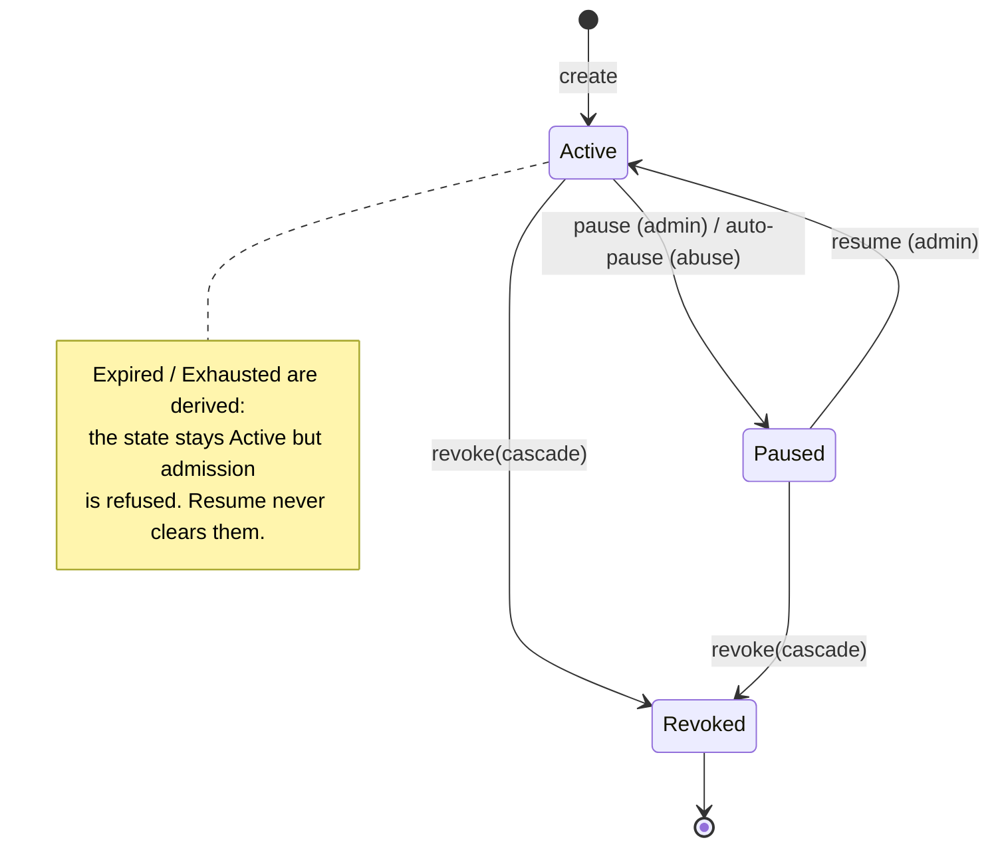
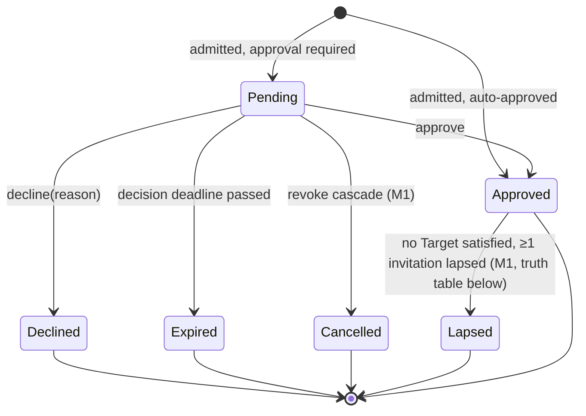

# P1 GitHub Invite: product spec

| Field | Value |
|---|---|
| Project | P1 GitHub Invite (priority 1, `PLAN.md` §6, §9) |
| Status | Draft spec, 2026-10-15, revision 2 (reviewer objections addressed; see the Review log at the end). Phase 5 output (`PLAN.md` §4), planning sequence step 1 (`PLAN.md` §9) |
| Baseline | The ghinvite PoC, `sagikazarmark/ghinvite2.orig` at `89a67fa`, extended in place (ADR 0006, **Proposed**). The ADR 0006 restart-trigger assessment and the PoC delta are in §18 |
| Inputs | `ideas/P1-github-invite.md`, `analysis/poc-ghinvite.md`, PoC `CONTEXT.md` / `PRODUCT.md` / `docs/adr/`, `research/github-invitations.md`, `research/github-app-tokens.md`, `research/link-security-and-gh-terms.md`, `research/restate.md`, `analysis/feasibility.md` §2.1, `analysis/risks.md` (P1 rows), `analysis/spikes-pending.md`, `decisions/0001`–`0010` |

> **Keyring note (2026-11-15).** References below to the `akr1` descriptor, KCVs, the
> `UnknownKeyVersion` retry and the `raw-kek` check describe the superseded keyring spec
> (`docs/specs/anykms-local-keyring.md`). The implemented keyring is kekring v1:
> `libs/kekring/docs/kekring-format.md` (rollout skew is `DecryptFailed` with code
> `VersionAboveHighWaterMark`; a wrong root is `KeyIdMismatch`, not a configuration error).

**Conventions.**
- "PoC `path`" is a path in the PoC repo. Every other path is relative to this planning repo.
- `R-…` IDs are rows in `analysis/risks.md`. `SP-…`/`SD-…` IDs are spikes in `analysis/spikes-pending.md`. `ADR NNNN` is `decisions/NNNN-*.md`. "PoC ADR NNNN" is PoC `docs/adr/NNNN-*.md`.
- **UNVERIFIED** marks a claim with no primary source or spike behind it yet.
- **[Proposed ADR]** marks a choice that rests on a Proposed ADR (0006–0010). The user hasn't confirmed it. This spec uses the ADR's recommendation as the default (`decisions/README.md`).
- **[Spec decision]** marks a choice this spec makes where no ADR exists. Each one is listed in §16.2 under a `PD-…` ID (pending spec decision) so the user can overrule it. `PD-…` IDs are distinct from the `SD-NN` desk spikes of `analysis/spikes-pending.md` §4.
- Requirements carry IDs (`REQ-…`) and acceptance checks carry IDs (`AC-…`), so the build plan and tests can cite them.

---

## 1. Problem and users

### 1.1 Problem
To give someone access to a GitHub org or repo today, an admin invites them one at a time in GitHub. P1 lets an admin create a **shareable invitation link** once. Anyone who opens it and signs in with GitHub can request access to an org (with a role and teams), to one or more repos (each with a permission), or to both. The link's guardrails apply: max uses, expiry, approval, email domain, and invitation lifetime. After the fact, admins keep control: they can pause, revoke, approve, and read an audit trail (`ideas/P1-github-invite.md` "Problem / pain"). Bulk-inviting a list of people should not mean clicking through GitHub one person at a time (P1-F29).

### 1.2 Users

| Role | Who | Authority source | Milestone |
|---|---|---|---|
| **Account Admin** | Org owner of an org account, or the owner of a personal account | Org owner: `GET /orgs/{org}/memberships/{username}` → `role=admin` **and** `state=active`, read with the **org app** installation token (a pending owner invitation grants nothing). Personal account: numeric user ID equals the account ID (§7.6) | M0 (personal accounts), M1 (orgs with the org app) |
| **Installing Owner** | On an org account with **only the repo app**: the GitHub user who installed it | `sender.id` of the signed `installation.created` webhook for the repo app, recorded at onboarding. Only org owners can install the repo app (ADR 0008; `research/github-invitations.md` §10), so the sender was an owner at install time. Re-checked as `role_name = admin` on every target repo (§7.6) | M0 |
| **Repository Admin** | A user whose effective `role_name` is `admin` on a repo | `GET /repos/{o}/{r}/collaborators/{u}/permission` with the **repo app** installation token (§7.6). On **org** accounts, Repository Admins get authority **only** when the org app is installed (M1) or the Account Admin / Installing Owner has turned on **Repository Admin Delegation** (off by default) | M0 (personal: n/a), M0 (org, delegation), M1 (org, org app) |
| **GitHub User** | A person who opened a link and hasn't requested yet (PoC term) | Signed in through the sign-in app | M0 |
| **Requester** | A GitHub User who submitted an invitation request (PoC term) | Same | M0 |
| **Approver** | An Account Admin, Installing Owner, or (where delegated) Repository Admin with authority over **every** target of the request's link | Same as above | M0 |

*Recipient* isn't a domain role (PoC `CONTEXT.md` "Requester"). In-app RBAC roles such as Admin/Manager/User (P1-F26, F27) are deferred (§3.3).

### 1.3 What success means
- An admin can go from sign-in to a working link in one session, with at most three GitHub screens: the sign-in authorization plus the installs of the repo app and/or the org app (ADR 0007 consequences).
- A requester always knows what they asked for and what happens next (PoC `PRODUCT.md`).
- No link ever lowers anyone's existing access (REQ-ROLE-1).
- Every external effect is in one of a small set of named states. A GitHub write is never silently repeated (PoC ADR 0004).

---

## 2. Glossary

PoC `CONTEXT.md` terms are reused **unchanged** unless the table says *changed* or *new*. Terms not listed here keep their PoC definitions: Account, Personal Account, Ghinvite Session, Sign Out, Global Session Invalidation, Public Surface, Invitation Request Flow, Console, Audit Log, Internal Note, Repository Access, Repository Identity, Available Repositories.

| Term | Status | Definition |
|---|---|---|
| **Invitation Link** | changed | A shareable URL, created by an admin, that lets a GitHub User request access to the link's **Targets** under its **Guardrails**. It has one concept in the UI, whatever its targets are (P1-F10). Was "repository collaborator access" only |
| **Link ID** | new | The internal ULID of a link. It is the Restate object key, the D1 primary key, and the identifier in console URLs and audit rows. It is **not** a bearer credential and is never accepted on the public surface. Was also the public code (PoC ADR 0009) |
| **Link Secret** | new | A 256-bit CSPRNG value, base64url-encoded, carried in the **fragment** of the shareable URL (`/i#{secret}`), so it never reaches the server in a request line. It is generated by the web Worker, never by a Restate handler. Only `SHA-256(secret)` is stored. It can be rotated; each rotation bumps the **Secret Generation**. §11.1 |
| **Secret Generation / Delivery Generation / Attempt Generation** | new | Three distinct counters, never called plain "generation": `secret_generation` (Link Secret rotations, §5.1), `delivery_generation` (a Re-issue creates a new Delivery for the same Target, M2, §6.4), `attempt_generation` (the fence counter, bumped when a positively rejected attempt is released, §9.4; PoC `delivery_attempts.generation`) |
| **Invitation Code** | changed | The Link Secret in the form a GitHub User can paste. It is still the "code" of PoC `CONTEXT.md`, but it is now the secret, not the Link ID. Never call it "slug" |
| **Target** | new | One access grant a link offers. Three kinds: **Organization Target** (org + role), **Team Target** (team within the org target; role is always `member`), **Repository Target** (repo + permission). A link has at most one Organization Target with zero or more Team Targets, plus zero or more Repository Targets. It has at least one Target in total |
| **Repository Scope** | kept | The set of Repository Targets on a link. It may now be empty, if the link has an Organization Target |
| **Permission Level** | changed | Was one per link. It is now per Repository Target (P1-F46). A "set all" control in the UI writes the same value to every Repository Target |
| **Organization Role** | new | The org role an Organization Target grants. M1 offers only `member` (GitHub `direct_member`). §5.1, [Spec decision] |
| **Guardrails** | changed | Max use, link expiration, Targets, Approval Policy, **Email Domain Restriction** (new), and **Invitation Lifetime** (new). They are fixed at creation (PoC rule kept, P1-Q09) |
| **Email Domain Restriction** | new | An optional set of domains. At sign-in, the requester must have at least one **verified**, non-noreply email in one of them (P1-F05). §6.3 |
| **Invitation Lifetime** | new | How long a GitHub Invitation from this link may stay pending before P1 cancels it ("own expiry", P1-F20). Range: 1 hour to 7 days. Default: 7 days, which means GitHub's own expiry applies and P1 cancels nothing |
| **Link State** | new | `Active`, `Paused` or `Revoked`, stored on the link. **Expired** (time) and **Exhausted** (uses) are derived conditions, not states. §5.1 |
| **Pause** | new | A reversible stop on new admissions. Under a manual Pause existing requests and invitations are untouched. It can be done by an admin, or automatically (**Auto-pause**, on suspected abuse). An Auto-pause additionally **holds** the Deliveries of requests admitted inside the abuse window (§5.1). P1-F15 |
| **Repository Admin Delegation** | new | A per-account switch, off by default, that an Account Admin or Installing Owner turns on to let Repository Admins create links and approve requests for repos they administer on an org account (§7.6) |
| **Revoke** | changed | A permanent stop on new admissions. It is still the canonical verb (PoC). It now takes optional **Revoke Cascade** choices: decline pending requests, cancel pending GitHub Invitations (M1), remove granted access (M2) |
| **Use / Max use** | kept | A use is a created invitation request. It is never refunded (PoC `CONTEXT.md`) |
| **Invitation Request** | changed | It gains two terminal states: `Cancelled` (by a Revoke Cascade; reserved in the PoC, PoC `crates/ghinvite-core/src/invitation_request.rs`) and `Lapsed` (approved, but no Target was satisfied and at least one invitation lapsed; exact truth table in §5.2). §5.2 |
| **Delivery** | new (generalizes PoC Repository Delivery) | The owner of P1's effect on **one Target** for one approved request: the read-before-write, the GitHub write, its receipt, and the settlement of the resulting GitHub Invitation. Kinds: **Repository Delivery** (PoC), **Organization Delivery** (new; it also owns that request's Team Target steps). §5.3 |
| **Effective Role** | new | The highest role a user currently holds on a target, read from GitHub just before a write (`role_name` for repos, membership `role` for orgs and teams). §7.3 |
| **Already Satisfied** | new | A Delivery outcome: the Effective Role is already at or above the Target's grant, so P1 made no write (P1-F21). It is a success, not a failure |
| **Upgraded** | new | A Delivery outcome: the user already had a lower direct grant, and P1 raised it with a single write. No invitation was involved |
| **Already Pending** | new | A Delivery outcome: a GitHub Invitation for this invitee and Target already exists (created outside this Delivery) at or above the Target's grant, or P1 raised a lower one. P1 makes no create write and **tracks** that invitation (it can be accepted, or expire into Lapsed), but this Delivery never cancels it (§7.3) |
| **Aborted** | new | A terminal Delivery outcome: the Delivery made no write and never will, because a Revoke Cascade or an admin cancelled it first (§5.1) |
| **Held** | new | A non-terminal Delivery state: an Auto-pause holds the Delivery before its write until an admin resumes (release) or revokes (abort) (§5.1) |
| **Blocked Delivery**, **Throttled Delivery**, **Delivery Outcome Unknown** | kept | PoC `CONTEXT.md` definitions, now applied to every Delivery kind. Blocked gains reasons for org eligibility (§7.4) |
| **GitHub Invitation** | changed | An org or repo invitation that GitHub created as the result of a Delivery. Was repository only |
| **Invite Budget** | new | P1's ledger of GitHub's invitation caps per org and per repo (50 or 500 per org per 24 h; 50 per repo per 24 h for non-members), plus secondary write limits, plus a **per-link share** of each bucket. §7.5 |
| **Reconciler** | new (PoC `Reconcile::daily_run`, now scheduled) | The scheduled sweep that reads GitHub's pending invitations and collaborators to settle Deliveries. It is the **only** acceptance signal for the repo app (ADR 0008). §7.7 |
| **Sign-in App / Org App / Repo App** | new | P1's three GitHub App registrations (ADR 0007, ADR 0008, both **[Proposed ADR]**). §7.1 |
| **Eligibility Warning** | new | A known org condition that may block delivery, shown when a link is created and on the link page: no free seat, 2FA required, outside collaborators restricted, IdP-synced team. §7.4 |
| **Bulk Invite Batch** | new (M2) | An admin-entered list of handles and emails with Targets. It goes through a mandatory **Review** step before anything is sent. §6.6 |
| **Email Invite Delivery** | new (M2) | A Delivery for a bulk email entry on an Organization Target: no requester ID, no read-before-write, settlement matched by `upstream_id` only (§6.6) |

**Vocabulary rules kept from the PoC.** Don't use standalone "Invitation"; use the precise compound noun. Don't use "slug". "Requests" in the Console means the pending queue.

---

## 3. Scope by milestone

### 3.1 Milestones

**M0: PoC parity on the new base.** This is the PoC's repo-collaborator product on the new foundations. Exit criterion: every PoC feature in `analysis/poc-ghinvite.md` §3 marked *covered* still works, now on:
- the domain-free toolkit crate (ADR 0005), with the C1 broker per ADR 0003 (§10)
- the **repo app** with zero org permissions, plus the **sign-in app** (ADR 0007, ADR 0008 **[Proposed ADR]**)
- Link Secrets (§11.1) and sessions encrypted with the anykms keyring (§11.3)
- role precedence on the repo path (§7.3)
- the scheduled Reconciler (§7.7), which replaces the `member` webhook as the repo-acceptance signal
- the rebased SDK fork (0.12.1) and a production deployment that passed SP-16 (ADR 0010 **[Proposed ADR]**)

**M1: MVP.** This adds the org half and the lifecycle controls the notes mark as must:
- Organization and Team Targets
- the org app
- per-target permission
- combined org + repo links
- pause and Auto-pause
- the Revoke Cascade
- own invite expiry
- the email-domain restriction
- the onboarding chooser
- the Invite Budget
- org Eligibility Warnings

**M2: bulk and access lifecycle.** Bulk invite with review, access expiry (automatic removal), removal on revoke, and admin re-issue.

**M3+ (deferred):** in-app RBAC and delegation beyond GitHub-derived authority, and editing guardrails.

### 3.2 Feature disposition (every P1-F*)

Tags come from `ideas/P1-github-invite.md`. "PoC" means the feature is covered in PoC §3 and is carried over.

| ID | Feature (tag) | Disposition | Milestone | Spec |
|---|---|---|---|---|
| P1-F01 | Link to one or more repos (must) | Build (PoC) | M0 | §5.1, §6.2 |
| P1-F02 | Link to an organization (must) | Build | M1 | §5.1, §7.2 |
| P1-F03 | Max uses or unlimited (must) | Build (PoC) | M0 | §5.1 |
| P1-F04 | Link expiry or never (must) | Build (PoC). New: default 14 days, warning for "never" | M0 | §5.1, §11.1 |
| P1-F05 | Email-domain restriction (unsure) | Build, gated on SP-19 | M1 | §6.3 |
| P1-F06 | Access level (must) | Build. One level per link in M0 (PoC); per Target in M1 | M0, M1 | §5.1 |
| P1-F07 | Access expiry, auto-removal (unsure) | Build, opt-in per link. Removes direct grants only, and never "restores a previous role" | M2 | §5.5 |
| P1-F08 | Org link with role + teams (must) | Build. Role is `member` only in M1 [Spec decision]; teams as `member` | M1 | §5.1, §7.2 |
| P1-F09 | Repo-level link (must) | Build (PoC) | M0 | §5.1 |
| P1-F10 | Link kinds transparent (must) | Build: one Invitation Link with Targets | M1 | §2, §6.2 |
| P1-F11 | GitHub authentication (must) | Build through the sign-in app; the token is discarded after the callback | M0 | §6.3, §11.3 |
| P1-F12 | Two GitHub Apps (must) | Build: repo app in M0, org app in M1 | M0, M1 | §7.1 |
| P1-F13 | Onboarding: choose apps and accounts (should) | Build. M0: repo-app install plus Setup URL (PoC). M1: chooser plus installation requests | M0, M1 | §6.1 |
| P1-F14 | Deactivate a link (must) | Build (PoC revoke) | M0 | §5.1 |
| P1-F15 | Pause vs permanent revoke (unsure) | Build | M1 | §5.1 |
| P1-F16 | Revoke cancels pending invites (should) | Build as an opt-in Revoke Cascade option | M1 | §5.1, §6.5 |
| P1-F17 | Revoke removes invited users (unsure) | Build as an opt-in Revoke Cascade option, with a preview | M2 | §5.5, §6.5 |
| P1-F18 | Audit log (must) | Build (PoC). New event types per milestone | M0+ | §14 |
| P1-F19 | Approval required (must) | Build (PoC) | M0 | §5.2 |
| P1-F20 | Own invite expiry (unsure) | Build as the Invitation Lifetime guardrail | M1 | §5.4 |
| P1-F21 | Higher role wins (must) | Build: read the Effective Role before every write. Repo path in M0, org/team in M1 | M0, M1 | §7.3 |
| P1-F22 | Multi-repo membership update (must) | Build: the F21 rule per Repository Delivery | M0 | §7.3 |
| P1-F23 | Authz A: GitHub admins create links (unsure) | Build. Authority is GitHub-derived, read with installation tokens | M0 | §7.6 |
| P1-F24 | Authz B: Clerk + RBAC (unsure) | **Deferred.** Clerk isn't used (ADR 0007 **[Proposed ADR]**). Revisit trigger: delegation to non-admins is wanted | M3+ | §15 |
| P1-F25 | Authz C: GitHub team/repo permission decides who creates links (unsure) | Build as **Repository Admin** authority, opt-in per org account (Repository Admin Delegation) until the org app is installed. The repo app can't read org ownership (ADR 0007/0008), so the default M0 authority on org accounts is the Installing Owner | M0 | §7.6 |
| P1-F26 | Per-user scoping, custom authz (unsure) | **Deferred.** If it's built, it uses D1 roles; OPA/Cedar is out of scope | M3+ | §15 |
| P1-F27 | Clerk, everyone sees everything; maybe Admin/Manager/User (unsure) | **Dropped.** Superseded by GitHub-derived authority (F23/F25). In-app roles are deferred with F26 | n/a | §15 |
| P1-F28 | Edit until the first request (later) | **Deferred.** Guardrails stay immutable (PoC). Substitute in M1: "Duplicate as new link" (reviewer addition) | M3+ | §6.2 |
| P1-F29 | Bulk invite (should) | Build | M2 | §6.6 |
| P1-F30 | Bulk review step (should) | Build, **mandatory** (R-ALL-gh-terms) | M2 | §6.6 |
| P1-F31 | One installation token per invite (must) | **Replaced** by the C1 broker: mint inside `ctx.run`, isolate cache (ADR 0003) | M0 | §10.2 |
| P1-F32 | Installation token caching (later) | Isolate-scope cache in M0. The shared D1/KV cache is deferred until measured mint volume calls for it (ADR 0003 §3) | M0 | §10.2 |
| P1-F33 | Restate-based flow (must) | Build (PoC) | M0 | §9 |
| P1-F34 | Encrypt tokens before the journal (should) | **Dropped for P1.** Tokens never enter the journal (ADR 0003). P1 uses no `Sealed<T>` | n/a | §9.3 |
| P1-F35 | Restate token service (unsure) | **Dropped** (ADR 0003: the broker is a library, not a service) | n/a | §10.2 |
| P1-F36 | Invitee flow: arrive, sign in, request (must) | Build (PoC) + secret-free redirect | M0 | §6.3 |
| P1-F37 | Justification field (should) | Build (PoC) | M0 | §6.3 |
| P1-F38 | Link page states (must) | Build (PoC). M1 adds the paused, domain-mismatch and lapsed states | M0, M1 | §6.3 |
| P1-F39 | Resend invite email (unsure) | **Infeasible as written**: there is no resend API (`research/github-invitations.md` §4). Alternatives: requester re-request after **Lapsed** (M1); admin **Re-issue** = cancel + re-create (M2) | M1, M2 | §5.2, §6.4 |
| P1-F40 | Check liveness on request (must) | Build (PoC admission) | M0 | §9.1 |
| P1-F41 | Revoke race (must) | Build (PoC exclusive handler). Pause in M1 | M0 | §9.1 |
| P1-F42 | Non-blocking hand-off to the processor (must) | Build (PoC: one-way send to `InvitationRequest`) | M0 | §9.1 |
| P1-F43 | Human-in-the-loop approval (must) | Build (PoC) | M0 | §5.2 |
| P1-F44 | Invites across repos/orgs (must) | Build. Repos in M0, org in M1 | M0, M1 | §5.3 |
| P1-F45 | Combined org + higher per-repo link (unsure) | Build. It falls out of the Target model | M1 | §5.1 |
| P1-F46 | Per-repo permission + set-all (unsure) | Build | M1 | §6.2 |
| P1-F47 | Reuse the invite workflow for batch (should) | Build: a batch issues ordinary requests and Deliveries | M2 | §6.6, §9.1 |
| P1-F48 | Batch into org + repos at once (unsure) | Build. Batch Targets use the same model as link Targets | M2 | §6.6 |

**Reviewer additions** (not in the notes; from the idea card's reviewer suggestions and the research):
- Link Secret rotation (M0)
- Auto-pause on abuse (M1)
- approval notifications: in-app in M1; a channel later (§16, OQ-4)
- uninstall and permission-loss handling (M0, PoC availability model)
- "Duplicate as new link" (M1)
- the Lapsed request state (M1)

### 3.3 Answers to P1-Q*

| Q | Answer | Where |
|---|---|---|
| Q01 email domain feasible? | Yes, via `GET /user/emails` with the sign-in app's user token. noreply handling pending SP-19 | §6.3, R-P1-email-domain |
| Q02 access expiry useful? | Built in M2 as opt-in. Default off | §5.5 |
| Q03 deactivate/invalidate/archive? | `Pause` (reversible) and `Revoke` (permanent). No "archive" state; the console hides revoked links by default | §5.1 |
| Q04 revoke removes invited users? | Opt-in cascade option, M2, with a preview of who is affected | §5.5 |
| Q05 default expiry? own expiry feasible? | GitHub: 7 days, fixed. Own expiry = timer + cancel + Reconciler | §5.4, R-P1-acceptance |
| Q06 org member added at a lower repo role? | GitHub rejects a grant below the org base role. Read-before-write treats it as Already Satisfied | §7.3 |
| Q07/Q08 authz model; can it be deferred? | GitHub-derived (Account Admin, Repository Admin). No Clerk. RBAC deferred | §7.6, ADR 0007 |
| Q09 link editing? | Guardrails immutable. Description and Internal Note are editable (PoC) | §5.1 |
| Q10–Q15 token minting, lifetime, invalidation, reuse, encryption, renewal | Mint inside `ctx.run`; isolate cache; 1 h lifetime; re-mint once on 401; no journaling; no scheduled renewal. Revocation of stateless tokens → SP-23 | §10.2, ADR 0003 |
| Q16 resend API? | None. Cancel + re-create | §6.4 |
| Q17 VO or Workflow for the processor? | Virtual Objects with short exclusive handlers and delayed sends (PoC ADR 0009) | §9.1 |
| Q18 combined link? | Yes, via Targets | §5.1 |
| Q19 batch org + repos? | Yes, M2 | §6.6 |
| Q20 bulk review step? | Yes, mandatory | §6.6 |
| Q21 other useful features? | Reviewer additions in §3.2 | §3.2 |
| Q22 milestones? | §3.1 | §3.1 |
| Q23 what to reuse from the PoC? | Extend in place (ADR 0006 **[Proposed ADR]**) | §17 |

---

## 4. Requirements summary (testable)

| ID | Requirement | Milestone |
|---|---|---|
| REQ-LINK-1 | A link has ≥1 Target. A link with an Organization Target can have Team Targets only within that org. Repository Targets of a link all belong to one account (the link's account) | M0 (repo), M1 |
| REQ-LINK-2 | Guardrails are immutable after creation. Description (≤120 chars, single line) and Internal Note are editable | M0 |
| REQ-LINK-3 | Link creation requires at least one of: approval required, max uses, expiry, email domain restriction. A link with no approval, unlimited uses and no expiry is refused. An **auto-approve** link with an **Organization Target** additionally requires `max_uses` [Spec decision, from `research/link-security-and-gh-terms.md` §1.4 items 3–4] | M0 (M1 for the org rule) |
| REQ-LINK-4 | Default link expiry is 14 days from creation. "Never" is allowed with a warning | M0 |
| REQ-ADM-1 | No admission happens after a Pause or Revoke has been processed by the link object. An admission that was enqueued before it completes (exclusive handler order) | M0 (revoke), M1 (pause) |
| REQ-ADM-2 | At most one `Pending` or `Approved` request per (requester, link) (PoC) | M0 |
| REQ-ROLE-1 | No Delivery issues a write that would lower the user's Effective Role on any Target | M0 (repo), M1 (org/team) |
| REQ-DLV-1 | No Delivery repeats a GitHub write whose outcome is unknown (PoC ADR 0004) | M0 |
| REQ-DLV-2 | Every Delivery ends in exactly one create outcome from §5.3 and, if an invitation was created, at most one settlement | M0 |
| REQ-SEC-1 | Link Secrets are ≥128 bits (P1 uses 256), stored only as SHA-256, never journaled, never put in an OAuth `state` or `redirect_uri`, and never sent to the server in a request line (fragment URL, §11.1), so neither application logs nor Cloudflare platform telemetry can record them | M0 |
| REQ-SEC-2 | Installation tokens, JWTs, user tokens, OAuth codes, private keys, webhook secrets and Link Secrets never appear in any Restate journal entry, state value or key, call parameter or result, run name, header, error message or log line | M0 |
| REQ-GOV-1 | P1 never exceeds GitHub's documented invitation caps or secondary write limits on purpose. A 422 "spammed" stops the bucket until its window rolls | M1 (budget), M0 (honour `retry-after`, as the PoC does) |
| REQ-OBS-1 | Repository Delivery acceptance is reflected within one Reconciler interval (≤ 1 h while pending Deliveries exist) without any webhook | M0 |
| REQ-AUTH-1 | On an org account, nobody but an active org owner (org app) or the Installing Owner (repo app only) gets link or approval authority unless Repository Admin Delegation is on. A pending owner invitation grants nothing | M0 |
| REQ-GOV-2 | One link can't consume more than its share of an Invite Budget bucket per 24 h (§7.5) | M1 |
| REQ-REV-1 | After a Revoke Cascade with `cancel_pending_invitations`, no Delivery of that link issues a new create write (POST/PUT/PATCH), and every invitation P1 created and that is still pending is cancelled, including ones that resolve later from `Submitted`/`OutcomeUnknown` | M1 |

Acceptance checks for these requirements are listed per section and collected per milestone in §17. §19.3 maps every REQ to at least one AC.

---

## 5. Domain model and state machines

### 5.1 Invitation Link

**Fields** (stored in the `InvitationLink/<link_id>` object; projected to D1):
- `link_id` (ULID), `account_id`, `account_kind` (`User` | `Organization`)
- `targets`:
  - `org: Option<{org_id, role: Member}>`
  - `teams: Vec<{team_id, slug}>`
  - `repos: Vec<{repo_id, full_name, permission: RepoRole}>`
- `guardrails`:
  - `max_uses: Option<u32>`
  - `expires_at: Option<Instant>`
  - `approval_required: bool`
  - `email_domains: Vec<DomainRule>` (`Exact(ascii_domain)` or `Subdomains(ascii_domain)`, §6.3)
  - `invitation_lifetime: Duration` (1 h ≤ x ≤ 7 d)
  - `budget_share_pct: u8` (1–100, default 50; §7.5)
  - `abuse_threshold_per_hour: u32` (default §11.2)
- `state`:
  - `Active`
  - `Paused { by: Actor, reason: Admin | AbuseSuspected { window_start }, at }`
  - `Revoked { by, at, cascade: RevokeCascade }`
- `uses: u32`; admission receipts; latest-request index per requester (PoC ADR 0009); `lapsed_rerequests: Map<requester_id, Instant>` (last re-request after Lapsed); `admission_times: VecDeque<Instant>` (sliding 1 h window, §11.2)
- `secret: { secret_generation: u32, sha256: [u8; 32] }`
- `description`, `internal_note`, `created_by`, `created_at`

`RepoRole` is `read | triage | write | maintain | admin`. The UI shows these names. The API maps them to `pull | triage | push | maintain | admin` (`research/github-invitations.md` §2). Custom repository roles as link permissions are **not offered** in M0–M2 [Spec decision]. The reasons:
- `PATCH …/invitations/{id}` can't set them.
- Ranking them needs an org-level read the repo app doesn't have (§7.3).

**Derived conditions** (computed at admission time on Restate's journaled clock, `restate-ext` `ContextClockExt`):
- `Expired`: `now ≥ expires_at`.
- `Exhausted`: `uses ≥ max_uses`.
- `ScopeUnavailable`: the installation or any target is known unavailable. A rejection must rest on a live read (PoC ADR 0004 amendment). **Mechanism:** `admit` does no GitHub I/O (§9.1). Before calling `admit`, the web Worker calls the shared handler `Installation.admission_evidence` (PoC) for each app the link needs and passes the result as `scope_evidence: Vec<{app, observed_at, available: bool, unavailable_target_ids}>`. `admit` rejects with `ScopeUnavailable` only on evidence with `available = false` **and** `now − observed_at ≤ 5 min` (journaled clock). Older or missing evidence never rejects; the Delivery's own pre-write checks catch it later (`Blocked`).

**Admissible** ⇔ `state = Active` ∧ ¬Expired ∧ ¬Exhausted ∧ ¬ScopeUnavailable ∧ the presented secret hash equals the current `secret.sha256` ∧ the requester passes the Email Domain Restriction with **fresh** evidence (§6.3: `checked_at` ≤ 10 min old) ∧ the Lapsed re-request limit allows it (§5.2) ∧ the abuse window isn't exceeded (§11.2).



**Rules.**
- **Pause** stops new admissions only. While a link is paused:
  - pending requests can still be approved or declined;
  - Deliveries continue;
  - the decision deadline isn't extended.

  [Spec decision, PD-B] A **manual** Pause is meant as a "stop the bleeding" switch that doesn't punish people already in the queue. An admin who wants to stop everything uses Revoke with a cascade.
- **Resume** returns the link to `Active`. It can't override `Expired` or `Exhausted`, because guardrails are immutable. Resuming an Auto-paused link also **releases** its Held Deliveries (one-way `release_hold` to each).
- **Auto-pause** is `Paused { reason: AbuseSuspected { window_start } }`. `admit` itself triggers it when the sliding 1 h admission count exceeds the link's threshold (§11.2); the decision and the pause happen in the same exclusive invocation, so no admission slips in between. It is resumed like a manual pause. Its audit event and console banner are distinct. Unlike a manual pause, an Auto-pause **holds** every Delivery whose request was admitted at or after `window_start` and has no `Created` outcome yet: the link sends `hold(reason: AbuseSuspected)` to each such request, which forwards it to its Deliveries; a Delivery checks its hold flag before claiming its fence (§7.3 step tables) and parks in `Held`. Requests still `Pending` stay pending (an approver can still see and decline them; an approval dispatches Deliveries that start `Held`). Release: admin **Resume**. Abort: admin **Revoke** (any cascade) moves Held Deliveries to `Aborted { LinkRevoked }`. Rationale: under auto-approve, abuse turns directly into GitHub writes and budget burn (`research/link-security-and-gh-terms.md` §1.4 item 3), so stopping admissions alone doesn't stop the damage.
- **Revoke** is terminal. It takes a `RevokeCascade` chosen in the confirmation page (§6.5):
  - `decline_pending_requests: bool` (M1). Every `Pending` request goes to `Cancelled { reason: LinkRevoked }`.
  - `cancel_pending_invitations: bool` (M1). Applies to **every Delivery of the link that P1 owns**, by its current state (P1-F16, R-P1-pending-revoke; REQ-REV-1):

    | Delivery state at cascade time | Cascade effect |
    |---|---|
    | No Delivery yet (request `Approved`, `dispatch` not run) | The request records `cascade = CancelInvitations` before dispatching; every Delivery it then creates starts with the abort flag set and ends `Aborted { LinkRevoked }` without a write |
    | `Planned`, `Throttled`, `Blocked`, `Held` (no write yet) | Set the abort flag in the Delivery's own state; the outcome becomes `Aborted { LinkRevoked }` (terminal). Pending delayed `recheck` sends become no-ops, because `create`/`recheck` check the flag before claiming the fence. The Invite Budget slot, if any, is released |
    | `Submitted` (fence claimed, write in flight) or `OutcomeUnknown` | Set `cancel_on_resolve = LinkRevoked`. When the write resolves (receipt, or read-only reconciliation finds the invitation by invitee in `GET …/invitations`) to `Created`, the Delivery immediately runs the cancel step (fence step `cancel`, `DELETE …/invitations/{id}`) and settles `Cancelled { LinkRevoked }`. If it resolves to no invitation, it settles as resolved. The cascade also starts one read-only lookup by invitee in the invitations list, so a stuck `OutcomeUnknown` gets resolved |
    | `Created` / settlement `Sent` | `DELETE …/invitations/{id}` (fence step `cancel`); settles `Cancelled { LinkRevoked }` |
    | `AlreadyPending` (someone else's invitation) | Stop tracking; settle `Cancelled { LinkRevoked }` **without** a DELETE. P1 never cancels an invitation it didn't create |
    | Terminal (`AlreadySatisfied`, `Upgraded`, `SkippedCustomRole`, `Failed`, `Aborted`, any settled invitation) | Nothing |

    The intent is stored on each Delivery (`cascade_intent`), so late resolutions and late-arriving `dispatch` calls honour it.
  - `remove_granted_access: bool` (M2). §5.5 (P1-F17).
  - Default: all `false`. That is the PoC behaviour: revoke never touches existing requests (PoC ADR 0003). With all `false`, Held Deliveries are still aborted (a revoked link can't be resumed, so a hold could never be released otherwise).
  - **Progress denominator:** the number of Deliveries and requests the cascade addressed, fixed when `revoke` runs (from the link's request index; requests then report their Deliveries). The link page shows `done / addressed`, where "done" means the Delivery reached a terminal state or `Cancelled`, plus a separate "waiting on GitHub" count for `cancel_on_resolve` Deliveries. The operation first closes admissions, then freezes the immutable admitted-request index and authoritative request target/generation manifests once. This distributed capture cut is not a simultaneous snapshot across owners. Selected request cancellation addresses every indexed request; already-terminal requests count done without changing their receipt. Later dispatch must honor the retained control without changing the captured denominator. Status reads bind the captured identity and required control revision; missing/unavailable status is never counted done. SQL counts on confirmation are previews only (ID-44).
  - Revoke requires an explicit operation ID and all three cascade fields. Exact successful and refused input replays return the original receipt; changed input under the same operation returns conflict. `revoke_status(command)` reports only that operation's receipt, never success inferred from current link state. A fresh operation on an already revoked link returns `Revoked`. Before executor activation, requesting disabled invitation cancellation or M2 access removal returns `UnsupportedCascade` before any mutation; neither option silently degrades to stop-only.
- **Rotate secret** (M0): the **web Worker** generates the new secret (§11.1) and calls `rotate_secret { new_sha256 }`. The object sets `secret_generation + 1` and the new hash; the old URL stops working immediately, because admission compares hashes in the link object. Uses and audit carry over. No Restate handler ever sees the plaintext.
- Revoked links are hidden from the default console list ("archive" by filter, P1-Q03).

AC-LINK-1. Under N concurrent `admit` calls and one `pause`, no admission whose invocation was enqueued after `pause` succeeds, and `uses ≤ max_uses` (SD-04 harness, extended to pause).
AC-LINK-2. After `rotate_secret`, an `admit` call with the old hash is rejected with the same response as an unknown link. A call with the new hash succeeds.
AC-LINK-3. `resume` on a link whose `expires_at` has passed leaves it non-admissible, and the link page shows "expired".
AC-LINK-4 (REQ-LINK-3). `create` with no approval, unlimited uses and no expiry returns `CreateLinkError::NoGuardrail`. `create` with auto-approve, an Organization Target and `max_uses = None` returns `CreateLinkError::OrgAutoApproveNeedsMaxUses`.
AC-LINK-5 (REQ-LINK-1). `create` with a Team Target outside the Organization Target's org, or Repository Targets from two accounts, or zero Targets, returns `CreateLinkError::InvalidTargets`.
AC-LINK-6 (REQ-LINK-4). A link created without an explicit expiry has `expires_at = created_at + 14 d`. "Never" is stored as `None` only when the form's "never" box is ticked, and the page shows the warning.
AC-LINK-7 (REQ-LINK-2). `update_metadata` changes Description and Internal Note; no handler accepts a guardrail change (compile-time: `update_metadata`'s input type has no guardrail field).
AC-LINK-8 (scope evidence). `admit` with `scope_evidence = {available: false, observed_at: now − 2 min}` is refused `ScopeUnavailable`; with `observed_at: now − 6 min` it admits.
AC-REV-2 (REQ-REV-1). A Delivery that is `Throttled` at revoke time with `cancel_pending_invitations` ends `Aborted{LinkRevoked}`; the GitHub stub records no POST/PUT for it afterwards, including when its delayed `recheck` fires.
AC-REV-3 (REQ-REV-1). A Delivery in `OutcomeUnknown` at revoke time later resolves (stub: the invitation is in the list) to `Created`; exactly one `DELETE` follows, and it settles `Cancelled{LinkRevoked}`.
AC-REV-4. A Delivery in `AlreadyPending` at revoke time settles `Cancelled{LinkRevoked}` and the stub records no `DELETE`.
AC-PAUSE-1. `pause` then `resume`: admissions are refused in between with the Paused page state, and Deliveries of already-approved requests keep running during the pause (manual pause holds nothing).
AC-PAUSE-2 (Auto-pause hold). On an unlimited auto-approve link with threshold 20/h, the 21st admission within 1 h is refused and the link becomes `Paused{AbuseSuspected}`; Deliveries of requests admitted since `window_start` that have no `Created` outcome end in `Held` and issue no write; `resume` releases them and they proceed.

### 5.2 Invitation Request

Owner: `InvitationRequest/<request_id>` (PoC ADR 0009). The decision deadline is `admitted_at + 7 days` (PoC `PENDING_LIFETIME`).



**Rules.**
- Admission creates the request and consumes one use. Neither is refunded (PoC `CONTEXT.md`).
- **Approve** requires an Approver with authority over **every** Target of the link (§7.6). Approval freezes an immutable **Approved Manifest**: one Delivery per Target, with the requester's numeric ID and login (PoC ADR 0004). Teams belong to the Organization Delivery.
- On approval, `dispatch` sends one-way commands to each Delivery object (§9.1). The request then aggregates Delivery progress. Its state stays `Approved` whatever the Delivery outcomes are, with one exception: `Lapsed`.
- **Final Delivery result.** Each Delivery reports one **final result** to `on_delivery_settled` (and only then):

  | Final result class | Delivery outcomes that produce it |
  |---|---|
  | **Satisfied** | settlement `Accepted`; create outcome `AlreadySatisfied` or `Upgraded`; a tracked `AlreadyPending` invitation that is later observed accepted |
  | **Lapsed-invite** | settlement `Expired`; `Cancelled { OwnExpiry }`; a tracked `AlreadyPending` invitation that disappears without the user gaining access (it expired or was cancelled/declined in GitHub) |
  | **Declined** | settlement `Declined` (the user declined, or someone cancelled in GitHub) |
  | **Unfulfillable** | `Failed`, `SkippedCustomRole`, `Aborted`, `Cancelled { LinkRevoked }` |
  | *(not final)* | `Planned`, `Submitted`, `Throttled`, `Blocked`, `Held`, `OutcomeUnknown`, settlement `Sent`, a tracked `AlreadyPending`. `Blocked` and `OutcomeUnknown` may stay non-final forever; the request then stays `Approved` with the per-Target "Waiting" / "Needs attention" status (§6.3) and the operator signals in §14.2 |

  "Every Delivery has settled" means every Delivery has reported a final result. A Delivery that never creates an invitation (`AlreadySatisfied`, `Upgraded`, `SkippedCustomRole`, `Failed`, `Aborted`) reports its final result at the moment it reaches that outcome.
- **Lapsed** (M1, new) [Spec decision, PD-C]. Request state as a function of the multiset of final results (all Deliveries final):

  | Final results | Request state | Requester action |
  |---|---|---|
  | All Satisfied | `Approved` (complete) | None; "You have access" |
  | ≥1 Lapsed-invite, **no** Satisfied | `Lapsed` | Request again (subject to the re-request limit below) |
  | ≥1 Satisfied **and** ≥1 Lapsed-invite or Declined (mixed) | `Approved` (partial) | None in M1. The page lists which Targets lapsed and says "ask an admin to re-issue" (Re-issue is M2, §6.4). [Spec decision: a new request would re-run Satisfied Targets and consume a use for nothing] |
  | Only Declined and/or Unfulfillable, no Satisfied | `Approved` (closed) | None. "Declined in GitHub" is the invitee's (or an admin's) choice; it doesn't reopen the link to the same requester. An admin can Re-issue (M2) |
  | Only Unfulfillable | `Approved` (closed) | None; admins see the reason |

  Why: the PoC rule "approved requests are never repeated" (PoC ADR 0009) would otherwise leave a requester stuck once own expiry exists. A lapsed request lets the requester submit a new request. That consumes a new use and is subject to the link's **current** admissibility. This is the requester-side substitute for "resend" (P1-F39).
- **Re-request limit after Lapsed** [Spec decision, budget protection; `research/link-security-and-gh-terms.md` §1.4 item 3]. A requester may submit at most **one** new request per link per **7 days** after a Lapsed request (tracked in the link's `lapsed_rerequests`). If the link's Invitation Lifetime is under 7 days, a re-request after Lapsed is admitted as `Pending` (approval required) even on an auto-approve link. Reason: with a 1 h lifetime, one account could otherwise trigger about 24 org invitations a day, and cancelled invitations probably still count against GitHub's cap (SP-08).
- Declined, Expired, Cancelled and Lapsed all allow a fresh request through the same link, under the current guardrails (PoC `CONTEXT.md`).
- A requester can't withdraw a request in M0–M2 (PoC deferral, PoC ADR 0003 §Cancellation scope).

AC-REQ-1. A request approved with one Repository Target, whose invitation is later cancelled by own expiry, becomes `Lapsed`. A new `admit` from the same requester then succeeds and consumes a use.
AC-REQ-2 (REQ-ADM-2). A request whose Delivery ended `Accepted` never becomes `Lapsed`. Re-admission is refused with `AdmitRefusal::AlreadyApproved`. A second `admit` while a request is `Pending` is refused with `AdmitRefusal::AlreadyPending` and consumes no use.
AC-REQ-3 (mixed). Repo A `Accepted`, repo B `Expired`: the request stays `Approved` (partial), and `admit` from the same requester is refused `AlreadyApproved`.
AC-REQ-4 (foreign invitation). The org step finds a pending invitation created by someone else (`AlreadyPending`); that invitation later disappears and the user is not a member. The Delivery reports Lapsed-invite and the request becomes `Lapsed`.
AC-REQ-5 (re-request limit). On a link with `invitation_lifetime = 1 h` and auto-approve, a requester whose request lapsed gets one new request admitted as `Pending`; a second re-request within 7 days is refused with `AdmitRefusal::RerequestLimited { retry_after }`.

### 5.3 Delivery

Owners:
- `RepositoryDelivery/<request_id>:<repo_id>:<delivery_generation>` (PoC key plus the generation suffix; `delivery_generation` starts at 1 and only a Re-issue, M2, bumps it)
- `OrganizationDelivery/<request_id>:<org_id>:<delivery_generation>` (new, M1). It holds the org step plus one sub-step per Team Target.
- `EmailInviteDelivery/<batch_id>:<row>:<org_id>` (new, M2, §6.6).

The Approved Manifest records `current_delivery_generation` per Target. `InvitationRequest`, webhook routing (D1 `deliveries` index) and the on-demand refresh always address the current generation; older generations only accept `reconcile`/`cancel` for their own invitation.

**Create outcomes** (the result of the write phase, retained for good; PoC ADR 0004):

| Outcome | Meaning | Terminal for create? |
|---|---|---|
| `Planned` | The manifest exists; nothing has been attempted | no |
| `Held { reason: AbuseSuspected }` | An Auto-pause holds the Delivery before its fence (§5.1). Released by Resume, aborted by Revoke | no |
| `Submitted` | The attempt intent is retained, and the D1 fence is claimed | no |
| `Created { upstream_id }` | GitHub returned 201 and a GitHub Invitation exists | yes → settlement |
| `AlreadySatisfied { effective_role }` | Read-before-write found the Effective Role ≥ the grant, so no write was made. Also covers a repo 204 where the user already had access with no change, and a below-base rejection. For orgs: `state=active` membership only (a pending membership is `AlreadyPending`) | yes |
| `AlreadyPending { upstream_id, permission }` | A pending GitHub Invitation for this invitee and Target already exists at or above the grant, or P1 raised a lower one with `PATCH` (§7.3). No create write. The invitation is **tracked** through settlement like `Created` (it can be accepted, expire, or disappear), but this Delivery never cancels it: it didn't create it (if another P1 Delivery did, that Delivery owns its cancellation) | no → settlement (tracked) |
| `Aborted { reason: LinkRevoked \| BatchCancelled }` | The Delivery was stopped by a cascade or a batch cancel before any write (§5.1, §6.6) | yes |
| `Upgraded { from, to }` | An existing lower **direct** grant was raised by a 204/200 write. No invitation | yes |
| `SkippedCustomRole { role_name }` | The Effective Role is a custom repository role that P1 can't rank. No write was made; this is surfaced to admins (§7.3) | yes |
| `Blocked { reason }` | A prerequisite is unavailable: installation, installation permissions (`InstallationPermissions`, §10.2), repo/org, requester identity, eligibility (no seat, outside collaborators restricted, 2FA wait not applicable here, IdP-synced team, EMU). It is rechecked on availability events and on a backoff | no |
| `Throttled { until }` | GitHub returned a rate limit (including a 401→re-mint that then hit a limit), or the Invite Budget or the link's budget share has no slot. Retried at `until` | no |
| `OutcomeUnknown` | Timeout or lost acknowledgement. Never re-written automatically. Read-only reconciliation may resolve it to `Created`/`AlreadySatisfied` (evidence), or operator repair may | no (can stay forever) |
| `Failed { reason }` | A definitive refusal on the merits (e.g. a 422 validation error not otherwise mapped) | yes |

**Settlement** (only after `Created`; the lifecycle of the GitHub Invitation):

```mermaid
stateDiagram-v2
    [*] --> Sent: Created(upstream_id)
    Sent --> Accepted: webhook (org app) / reconciler sees member or collaborator
    Sent --> Expired: GitHub 7-day expiry observed (repo: expired=true; org: failed_invitations)
    Sent --> Cancelled: our DELETE succeeded (reason: OwnExpiry | LinkRevoked | AdminReissue)
    Sent --> Declined: invitation gone, user lacks the granted role (or direct grant), not cancelled by us
    Accepted --> [*]
    Expired --> [*]
    Cancelled --> [*]
    Declined --> [*]
```



- Exactly one settlement wins (PoC `docs/invitation-settlement.md`). A missing list entry never resolves an `OutcomeUnknown` create.
- The PoC's `AdminCancel` reason is **dropped**: no M0–M2 surface lets an admin cancel a single invitation outside Revoke Cascade, own expiry or Re-issue. Single-invitation cancel would need its own handler, UI and audit value and is out of scope.
- A tracked `AlreadyPending` invitation uses the same settlement machine, except that own expiry and cascades never `DELETE` it; a cascade stops tracking it instead (§5.1, §5.4).
- `Declined` covers "gone without acceptance and not cancelled by P1". The cause could be a decline by the invitee or a cancel by someone else in GitHub. For repos the two can't be told apart without webhooks (`research/github-invitations.md` §5). The UI wording is "no longer pending (declined or cancelled in GitHub)".
- For an **Organization Delivery**, settlement covers the org invitation. Team steps for a non-member are attached through `team_ids` on the same invitation, so they settle with it. Team steps for an existing member are immediate writes, each with its own create outcome (`AlreadySatisfied`, `Created` for a pending team membership, `Blocked`, `OutcomeUnknown`).

AC-DLV-1. With the GitHub stub returning a timeout on PUT, the Delivery ends `OutcomeUnknown`, and the stub records exactly one PUT across three forced retries of the run closure (fence test, lifted from PoC `delivery.rs` tests).
AC-DLV-2. A 422 "spammed" maps to `Throttled` and marks the Invite Budget bucket closed (§7.5), never `Failed`.
AC-DLV-3 (REQ-DLV-2). Property test over stubbed GitHub response sequences (201, 204, 401, 403, 404, 422 variants, timeout, rate limit) for both Delivery kinds: every Delivery holds exactly one create outcome at any time, a terminal create outcome is never replaced, and at most one settlement is recorded.

### 5.4 Invitation tracking and own expiry

- **Signals.**
  - **Org app:** `organization.member_added` and `membership.added` webhooks, plus the Reconciler.
  - **Repo app:** the Reconciler only (ADR 0008 **[Proposed ADR]**). See §7.7.
- **Own expiry (M1).** When a Delivery reaches `Created` and the link's `invitation_lifetime < 7 d`, the Delivery object schedules a delayed `tick_own_expiry` at `created_at + invitation_lifetime` (Restate delayed send, R-ALL-scheduling). (The request's decision-deadline tick is `InvitationRequest.tick_decision_deadline`; the two are never called plain `tick_expire`.) `AlreadyPending` invitations get no own-expiry tick: P1 never cancels someone else's invitation. `tick_own_expiry`:
  1. reads live GitHub state for this invitation (PoC rule: settle only with evidence);
  2. if it is accepted, settles `Accepted`;
  3. if it is still pending, `DELETE` the invitation and settle `Cancelled { reason: OwnExpiry }`;
  4. if it is already gone, defers to the Reconciler's evidence rules.
- **Requester visibility.** The request status page shows each Target's state, and "expires at" for `Sent` invitations (`min(created_at + 7 d, own expiry)`).
- **On-demand refresh.** When a requester opens the status page while one of their Deliveries is `Sent`, the web Worker may trigger a single-Delivery `reconcile`, at most once per 60 s per Delivery. This shortens the repo-app acceptance latency for the person who cares [Spec decision].

AC-EXP-1. A link with `invitation_lifetime = 1 h`: an invitation still pending at +1 h is cancelled, and the Delivery settles `Cancelled{OwnExpiry}`. An invitation accepted at +30 min, but not yet observed, settles `Accepted` at the tick and isn't cancelled.

### 5.5 Access expiry and removal (M2)

- **Access expiry** (P1-F07), a guardrail: `access_lifetime: Option<Duration>`, set at link creation. Only when positively P1-created access settles `Accepted`, an `AccessGrant/<request_id>:<kind>:<target_id>` object retains the generation-bound grant and schedules removal at `settled_at + access_lifetime`. `Upgraded`, `AlreadySatisfied` and foreign `AlreadyPending` never create removal authority (PD-J). A missing lifetime retains accepted-grant eligibility for an explicit revoke preview but schedules no timer.
- **Removal** removes **only what P1 granted directly**:
  - an org membership P1's invitation created (`DELETE /orgs/{org}/memberships/{u}`);
  - a team membership P1 added;
  - a direct repo collaborator grant P1 created (`DELETE /repos/{o}/{r}/collaborators/{u}`).
- P1 **never** restores a previous lower role, and never removes access that was `AlreadySatisfied` [Spec decision]. Why: GitHub can't reliably tell a direct grant from an inherited one (`research/github-invitations.md` §3; SP-07), so a restore could be wrong. Upgraded grants are therefore **not** subject to expiry. The link-creation UI says so.
- **Removal caveats** shown before confirmation (`research/github-invitations.md` §7): org/team/base access can survive a repo removal; removing a repo collaborator deletes their forks; removing an org member removes all their team and repo access.
- **Re-read before removal** (REQ-ROLE-1 applied to removal). `AccessGrant.tick_remove` / `remove_now` never write blind. Inside `ctx.run#1` they read the current role (`GET /orgs/{org}/memberships/{u}`, `GET …/teams/{slug}/memberships/{u}`, or `GET …/collaborators/{u}/permission`), then in `ctx.run#2` claim fence step `remove:<target>` and `DELETE`. The removal is **skipped** and recorded as `RemovalSkipped { RoleChanged { now } }` when:
  - org: the current org `role` is `admin` (the user was promoted to owner after acceptance);
  - team: the current team role is `maintainer`;
  - repo: `rank(role_name)` is above the granted role, or `role_name` is a custom role.
  
  Removing in those cases would strip access P1 didn't grant (`research/github-invitations.md` §7: removing a member removes all their team and repo access).
- **Remove on revoke** (P1-F17): the same removal, with the same re-read, applied to every `Accepted` Delivery of the link. It is opt-in, shows a preview list, and takes effect at once.

AC-REM-1. Stub: a user accepted an org `member` invitation through P1 and was later made an owner. At `tick_remove`, no `DELETE` is issued and the grant records `RemovalSkipped{RoleChanged}`.
AC-REM-2 (M2 access expiry). A link with `access_lifetime = 1 h`: an `Accepted` repo Delivery is removed at `settled_at + 1 h` with exactly one `DELETE …/collaborators/{u}`; an `Upgraded` Delivery on the same link gets no `AccessGrant`.

---

## 6. User journeys

### 6.1 Admin onboarding and app installs

1. The admin opens P1 and signs in through the **sign-in app** authorization screen ("Verify your GitHub identity"; plus "Email addresses: read", requested from every user). The session stores the numeric user ID and login. The token is revoked and discarded (§6.3 step 3, §11.3).
2. **Onboarding chooser** (M1; M0 shows only step 3a):
   - "Invite people to repositories" → install the **repo app**.
   - "Invite people to an organization and its teams" → install the **org app**.
   - Each option shows a one-paragraph permission rationale and the exact GitHub permissions (§7.1). The texts come from SP-02's screenshots, which are adoption input (R-P1-install-consent, `analysis/risks.md` §2.8).
3. **GitHub install screen.**
   - a. For an org owner, GitHub shows **Install**. The org owner picks All or Select repositories (repo app).
   - b. A non-owner sees **Request**. P1 shows a "request sent to your org owners" page and lists pending requests from `GET /app/installation-requests` (app JWT, `research/github-app-tokens.md` Q7). Both apps are owner-install only (ADR 0008).
4. **Setup URL callback** (`/setup/{app}?installation_id=…&setup_action=install|update`, one path per app; PoC `routes/setup.rs` `/setup/github`):
   - P1 verifies the installation with the app JWT (`GET /app/installations/{id}`);
   - calls `Installation/<app>:<installation_id>.onboard`;
   - redirects to the account's Console.

   The Console header shows which apps are installed on the account and links to "add the other app".

   **Installing Owner** (org accounts, repo app). The Setup URL query is unauthenticated, so it can't establish who installed. P1 records the installer from the signed `installation` webhook (`action=created`, `sender.id`, `sender.login`) in `Installation.onboard_webhook`, and stores it as `installed_by` on `AccountInstallation`. Until that webhook has arrived the org account's Console shows "finishing setup" and grants no authority. A later `installation` event (`new_permissions_accepted`, re-install) with an owner sender may replace `installed_by`; every change is audited (`InstallationOwnerRecorded`). On the account's Settings page, the Installing Owner (or an Account Admin, once the org app is installed) can turn **Repository Admin Delegation** on or off (§7.6).
5. **Changes later**: uninstall, suspend, repo selection changes, and permission upgrades arrive as `installation` / `installation_repositories` webhooks per app. They go through the PoC availability model (`docs/installation-availability.md`, R-P1-uninstall). Links whose Targets become unavailable stop admitting (§5.1). Their Deliveries become `Blocked { reason: InstallationUnavailable }`.

AC-ONB-1. An org account with only the repo app installed can't create a link with an Organization Target. The form shows "Install the org app" with a link (ADR 0008 decision 4).
AC-ONB-2. A forged `/setup/repo?installation_id=…&setup_action=install` from a signed-in user who is not the webhook `sender` grants that user no authority on the account.

### 6.2 Create a link

1. The Console has a **New link** form. This is the PoC island, extended in M1 for Targets and per-repo permission. Per PoC ADR 0001, extending the existing island needs no new ADR; a second island would.
2. **Targets.**
   - Org section (M1, if the org app is installed): a toggle, role fixed to "Member", and a team multi-select. Teams come from `GET /orgs/{org}/teams`, org app, Members read; **UNVERIFIED** which permission lists teams.
   - Repo section: a repo picker with a permission per repo and a "set all" dropdown. **Cost model** (no user token exists after ADR 0007, so the PoC's `/user/installations/{id}/repositories` read, PoC `crates/ghinvite-github/src/oauth.rs:282–300`, is gone):
     - Account Admin / Installing Owner / personal owner: the picker lists the installation's repos from `GET /installation/repositories` (paginated, cached per installation for 5 min; it is the same list for every viewer). No per-repo permission reads.
     - Repository Admin (delegation on): the picker is **search-first**. The admin types a repo name; P1 matches against the cached installation repo list and shows at most 20 candidates without any permission read. The permission check (`role_name = admin`) runs only for repos the admin **selects**, and again at `create` (authority is re-checked in the web Worker before the call).
     - **Picker shape (#111, 2026-11-24).** The form never lists the whole installation. It lists one page of 50 repositories, filtered server-side by a name filter (case-insensitive substring of `owner/name`) over the cached installation list above; GitHub's search API is not used (it is not scoped to the installation's repository selection, has its own rate limit and index lag, and would cost a GitHub read per search instead of reusing the 5-minute list every viewer shares). Searching and paging are native POSTs of the create form (`repo_search`, `repo_goto`, with `repo_query`/`repo_page` carried along) that only re-render it with every value kept, like the set-all and reload helpers; they never create or replay anything, work without JavaScript, and the island lets them through without its submit preflight. Selected repositories outside the page are listed ahead of it, so a selection survives searching, paging and a failed validation. The page and the island's props therefore carry at most 50 repositories plus the selection (itself capped at 100 by `RepositoryScope`). An unfiltered page reads only the listing pages up to it (opening the form is one listing read however large the installation is); a search, or a selection beyond that prefix, reads the whole list, which is then cached. Creation still resolves every submitted id against the complete installation list (`repositories_by_ids`) and never trusts what the form listed. Enter in the filter searches: the form's first submit button is a visually hidden search button, so Enter never triggers "Apply permission to all repositories". The Repository Admin rule above is unchanged: no listing without a query, at most 20 matches, no paging.
     - Authority reads draw on a separate **authority budget** (`AUTHZ_RL`, §7.5; about 600 requests/h per installation, about 12% of 5,000/h, `research/github-app-tokens.md` Q1), so console traffic can't starve Deliveries and the Reconciler. When it is exhausted, the Console shows "GitHub is busy; try again in N min" instead of degrading Delivery throughput.
3. **Guardrails.**
   - max uses
   - expiry (default +14 d)
   - approval required
   - email domains (M1)
   - Invitation Lifetime (M1, default 7 d)
   - access lifetime (M2)
4. **Eligibility panel** (M1, §7.4). It shows Eligibility Warnings before the create. Warnings don't block creation. The only blocking checks are: a required app is missing; a Target isn't available; the creator lacks authority over a Target (§7.6).
5. **Create.** The web Worker:
   1. generates the 256-bit Link Secret with `getrandom` in request memory (never in a Restate handler, so the plaintext is never a `ctx.run` result, handler input or output; REQ-SEC-1/2);
   2. calls `InvitationLink/<new ulid>.create { …, secret_sha256 }` (secret_generation = 1);
   3. after `create` returns `Ok`, inserts the `link_secrets` row `(secret_sha256, link_id, secret_generation, created_at)` itself (insert-only; idempotent on the PK). This removes the projection lag: the D1 index that `/i` resolves through exists before the URL is shown. The link object stays the authority at `admit`; a `link_secrets` row only routes;
   4. renders the **full URL once** (`https://<host>/i#<secret>`), with a copy button and GitHub-Classroom-style guidance ("anyone with this link can request access").

   Only the hash is stored, so the URL can't be shown again. A lost URL is recovered with **Rotate link URL** (same three steps with `rotate_secret`; the projection later sets `retired_at` on the old row), which invalidates the old one. If step 3 fails, the page shows "link created; URL not ready — rotate to get a URL" and never renders a URL that can't resolve. **[Spec decision; see OQ-1 for the alternative.]**

AC-SEC-1 (REQ-SEC-1/2). Marker scan: create and rotate links with a test hook that makes `getrandom` emit a `LINKSECRET_MARKER…` value; no Restate journal entry, state value, invocation parameter or result, D1 row (D1 holds only the hash), audit row or Worker log contains the marker.
AC-SEC-2. `GET /i` + `POST /i {secret}` for a secret returned by `create` or `rotate_secret` redirects (303) to `/join` on the very next request, before any projection has run (projection paused in the test).
6. **Duplicate as new link** (M1) pre-fills the form from an existing link. It is the substitute for editing guardrails (P1-F28).

### 6.3 Recipient flow (P1-F36, F37, F38)

1. The GitHub User opens `https://<host>/i#{secret}`. The secret is in the URL **fragment**, which browsers never send to the server, so neither the Worker nor Cloudflare's platform telemetry (Workers Logs invocation metadata, traces, Logpush HTTP requests, analytics) sees it in a request line.
   - `GET /i` serves a page with a small same-origin script (`/static/i.js`, allowed by the PoC CSP `script-src 'self'`). The script reads `location.hash`, immediately replaces the history entry with `/i` (`history.replaceState`), and POSTs `{secret, csrf}` to `/i` as a form body (the CSRF token is embedded in the page, PoC CSRF middleware). With JavaScript disabled, the page shows the **Enter code** form (the same POST).
   - `POST /i`: the Worker hashes the secret and looks it up in D1 `link_secrets` (rows with `retired_at IS NULL` only); stores `{link_id, secret_sha256, secret_generation}` in the session; answers **303 to `/join`**.
   - The browser history keeps the full fragment URL only until the script replaces it; a user who copies the address bar before that, or a browser with JS disabled, keeps it in history. This is documented on the link-creation page ("treat this URL like a password").

   The secret never appears in a URL path or query, in the OAuth `state`, or in any log (§11.1). An unknown or rotated secret gives the same "link not available" page as a revoked link. Request bodies are not part of Workers Logs invocation metadata (**UNVERIFIED**; checked in SP-16, §16.1).
2. `/join` (not signed in) shows the offer: account, Targets with their permissions, whether approval is needed, and whether an email domain is required (domain names shown). Then a "Sign in with GitHub" button.
3. **Sign-in** through the sign-in app. On `/oauth/callback`:
   - exchange the code;
   - `GET /user` → numeric ID and login;
   - **if the pending link has an Email Domain Restriction:** `GET /user/emails`. Take the entries with `verified = true`, excluding `users.noreply.github.com` addresses (SP-19 confirms how noreply entries appear). Normalise each domain (below) and keep only those that match a rule of the pending link. Store only `domain_evidence = {link_id, matched_domains, checked_at}` in the session, never the addresses or non-matching domains;
   - revoke the token with `DELETE /applications/{client_id}/token` (Basic auth with the sign-in app's client ID and secret; `research/github-app-tokens.md` Q3), then discard it (ADR 0007). A failed revoke is logged as a redacted error kind and doesn't fail the sign-in; the sign-in app has "Expire user authorization tokens" turned **on** (8 h expiry), so a missed revoke is bounded.

   **Sign-in rate.** GitHub limits new user tokens to ten per hour per user/app/scope (`research/github-app-tokens.md` Q3; applicability to GitHub Apps **UNVERIFIED**, SP-14). P1 allows at most 5 sign-in starts (`/login`) per browser session per 10 min, and maps a token-exchange error that indicates the token limit (exact error **UNVERIFIED**; SP-19a records it) to a "Too many sign-ins; try again later" page instead of a generic error.

   **Domain matching** [Spec decision]. Both the link's rules and the user's domains are lowercased and converted to ASCII with IDNA (UTS #46, non-transitional) before comparison; a trailing dot is stripped. `Exact(example.com)` matches only `example.com`. `Subdomains(example.com)` (entered as `*.example.com`) matches any `*.example.com` but **not** `example.com` itself; an admin who wants both adds both rules.

   **Freshness and re-authentication.** Domain evidence is valid for `admit` only if `domain_evidence.link_id` equals the link being joined and `now − checked_at ≤ 10 min`. When a signed-in user opens a restricted link and the session has no such evidence (a different link, older than 10 min, or none), `/join` shows "Confirm your email domain" and its button starts a fresh OAuth round trip through the sign-in app (`/login?return_to=/join`); for an already-authorized user GitHub redirects back without a consent screen (**UNVERIFIED** for GitHub Apps; SP-19a). `admit` re-checks freshness on the journaled clock and refuses stale evidence with `AdmitRefusal::DomainEvidenceStale`, which `/join` turns into the same re-auth prompt. A session-ID rotation at login (PoC ADR 0002) copies `pending_link` and only the newly collected `domain_evidence` into the new session. Reauthentication first persistently clears prior domain evidence; a failed callback cannot retain evidence from another identity.
4. `/join` (signed in) renders **one** of these states. It reads authoritative state from the link and request objects (PoC `requester_page`):

| State | Shown when | Action |
|---|---|---|
| Ready | Admissible, no pending or approved request | Request form, with an optional justification ≤ 500 chars (PoC normalization) |
| Pending approval | The requester's latest request is `Pending` | Status, plus the decision deadline |
| Approved / delivering | `Approved` | Per-Target status: Sent (expires at …), Accepted, Already has access, Upgraded, Waiting (Blocked/Throttled, with a plain reason), Needs attention (OutcomeUnknown: "we're confirming with GitHub") |
| Lapsed (M1) | `Lapsed` | "Your invitation expired before it was accepted", plus a request-again button if the link is still admissible |
| Declined / expired / cancelled | Terminal | Explanation, plus request again if admissible |
| Domain mismatch (M1) | The restriction isn't met | Lists the required domains. "Add and verify an email in GitHub, then sign in again." No request is created and no use is consumed |
| Confirm email domain (M1) | Restricted link and no fresh domain evidence for this link (§6.3 step 3) | Button: re-authenticate through the sign-in app |
| Request limit (M1) | `RerequestLimited` after Lapsed (§5.2) | "You can request again after <date>" |
| Paused (M1) | `Paused` | "This link isn't accepting requests right now" (the same wording for manual and auto-pause) |
| Not available | Revoked, expired, exhausted, unknown, rotated | One neutral page (no oracle on which condition applies) |

5. **Submit** goes to the web Worker, which uses PoC attempt continuations (PoC ADR 0007), fetches scope evidence (§5.1), and calls `InvitationLink/<link_id>.admit`. Input and refusal types are in Appendix A (`AdmitInput`, `AdmitRefusal`); Appendix A.3 maps each refusal to one page state above.

AC-FLOW-1. No HTTP response from `/i`, `/join`, `/oauth/*` or the request POST, and no Worker log line, contains the Link Secret (a marker-scan test over the logs and responses of a full flow). The deployed variant (part of SP-16) also scans Workers Logs, traces and a Logpush HTTP-requests sample for the marker after a full flow through `/i#<marker>`.
AC-FLOW-2. A user with only a noreply email, on a domain-restricted link, sees "Domain mismatch" and consumes no use.
AC-FLOW-3 (already signed in). A user signed in 1 h ago opens a domain-restricted link: `/join` shows "Confirm email domain", no `admit` is called, and after the OAuth round trip with a matching verified email the request is admitted.
AC-FLOW-4 (stale evidence). `admit` with `domain_evidence.checked_at = now − 11 min` is refused `DomainEvidenceStale` and consumes no use; evidence for a different `link_id` is refused the same way.
AC-FLOW-5 (matching). `Subdomains(example.com)` admits `eng.example.com` and refuses `example.com` and `badexample.com`; `Exact(bücher.de)` admits `xn--bcher-kva.de`; `EXAMPLE.COM.` matches `Exact(example.com)`.
AC-FLOW-6. After the OAuth callback the stub records exactly one `DELETE /applications/{client_id}/token` with the issued token, and the session holds no token.

### 6.4 Approval

1. The Console **Requests** queue lists pending requests that the viewer has authority over (PoC cursor paging).
2. Each request shows:
   - the requester (login, avatar, account age where available);
   - the justification;
   - the Targets;
   - for each Target, a **preview** of the Effective Role. This is computed on demand with a read-only call (authority budget, §6.2), cached 5 min per (user, target), and is informational only; the Delivery re-reads before any write;
   - the deadline.
3. **Approve** or **Decline** (with an optional message explicitly shown to the requester). The decision goes to `InvitationRequest.decide` with an operation ID (PoC replay-safe decision receipts). New decisions use a separate `requester_message` (trimmed, normalized line endings, at most 500 characters); the Console labels it as shared with the requester. Historical `decline_reason` remains administrator-only and is never copied into this field. Missing public text stays absent, including replay of old decisions. The exact completed decision fixes both values; only the authenticated requester and authorized Console viewers can read the public message.
4. **Notifications** (M1). An in-app pending count in the Console navigation. External channels are OQ-4.
5. **Re-issue** (M2, admin; the alternative to P1-F39). On an `Approved` or `Lapsed` request whose Repository or Organization Delivery settled `Expired`, `Declined` or `Cancelled`, the admin can "Re-issue". That bumps the Target's `current_delivery_generation` in the Approved Manifest and creates a new Delivery object keyed with it: the old generation's invitation is cancelled if it is still pending (fence step `cancel` on the old Delivery), and the new Delivery runs the normal step table (§7.3). It counts against the Invite Budget and consumes no use. It is audited as `DeliveryReissued`.

AC-REISSUE-1 (M2). Re-issue on a request whose repo Delivery (generation 1) settled `Expired`: a Delivery with generation 2 is created, exactly one PUT is issued for it, the request's manifest records generation 2, and a webhook/reconcile for the user routes to generation 2.

### 6.5 Pause, resume, revoke

- **Link detail → Pause / Resume** (M1). One click, then a toast. Audited.
- **Link detail → Revoke.** A confirmation page:
  - checkbox "Decline N pending requests" (M1)
  - checkbox "Cancel M pending GitHub invitations" (M1)
  - checkbox "Remove access for K people who accepted through this link" (M2; it expands a preview list with the removal caveats from §5.5)
  - type-to-confirm when any cascade box is ticked

  Revoke is applied in the link object first, so no new admissions happen. The cascades then run as one-way sends to each request or Delivery object, per the per-state table in §5.1. Their progress shows on the link page as `done / addressed` with a separate "waiting on GitHub" count ("Cascade: 12/14 done, 2 waiting on GitHub"; denominator defined in §5.1). The counts N and M on the confirmation page are the D1 projection's current counts (informational); the cascade itself addresses the objects' authoritative sets. Cascade operations are idempotent (each send carries the revoke operation ID) and visible in the audit log.

AC-REV-1. Revoke with `cancel_pending_invitations`: every Delivery in `Sent` gets exactly one `DELETE` attempt, and every Delivery without a write yet ends `Aborted{LinkRevoked}` (AC-REV-2…4 cover the other states). A 404 is settled by the PoC's rule: `Cancelled` only after the installation verifies it still reaches the repo or org (PoC `docs/invitation-settlement.md`).

### 6.6 Bulk invite with review (M2)

1. **Console → Bulk invite.** The admin pastes a multi-line list of GitHub handles and/or emails, picks Targets (same component as §6.2: org role, teams, repos with per-repo permission; P1-F48), and an optional access lifetime. Each run is capped at 200 entries [Spec decision; R-ALL-gh-terms "capped per run"].
2. **Resolve** (read-only, through the toolkit; no writes):
   - A handle goes to `GET /users/{login}` → numeric ID, or "not found".
   - An email is a valid entry **only** if the batch has an Organization Target. It becomes an **Email Invite Delivery** (below); GitHub enforces the verified-email match. Emails can't be resolved to users (`research/github-invitations.md` §9). If the batch has Repository Targets (or Team Targets the org invitation can't carry), an email entry's repo part is marked "needs a personal link". The review offers to **create a single-use personal link** (max uses 1, approval off, 7-day expiry) for that person instead. P1 sends no email (OQ-4): after Submit, the admin gets the list of personal-link URLs **once** on the result page (same display-once rule as §6.2, secrets generated by the web Worker), to distribute themselves. Each creation is audited (`InvitationLinkCreated` with `source = Batch{batch_id, row}`; never the URL).
   - **Email Invite Delivery** (`EmailInviteDelivery/<batch_id>:<row>:<org_id>`): there is no requester ID, so it has **no** revalidation and **no** read-before-write (REQ-ROLE-1 rests on the assumption that accepting an org email invitation can't change an existing member's or owner's role; **UNVERIFIED**, added to SP-07 step 1 as "email invitation to an existing owner's verified email"). Steps: `reserve(OrgInvite)` → `ctx.run`: fence (step `org-email`) + `POST /orgs/{org}/invitations {email, role: direct_member, team_ids}` → `Created{upstream_id}`. Settlement is matched by `upstream_id` only, through the Reconciler (`GET /orgs/{org}/invitations` presence, `failed_invitations` for expiry). Acceptance is "absent from pending and absent from failed" and is reported as "no longer pending (accepted or declined)", because the accepting user's ID can't be tied to the email without the webhook. Webhook matching of `organization.member_added` to an email invitation is **UNVERIFIED** (SP-18 records whether the payload carries the invitation ID or email). Email Invite Deliveries never take part in Lapsed (they have no request) and have no access expiry.
   - For found users, a role preview per Target, as in the §6.4 preview.
3. **Review table** (mandatory, P1-F30). One row per entry, with a status:
   - `Found`
   - `Not found`
   - `Email (org invite only)`
   - `Needs personal link`
   - `Already has ≥ role` (will be Already Satisfied)
   - `Over today's budget` (queued for later, with an ETA)
   - `Duplicate`

   The admin can remove rows. A summary shows the invites to send and the Invite Budget ETA. Nothing is sent before **Submit**.
4. **Submit** creates `BulkInviteBatch/<batch_id>`. It issues one **admin-issued Invitation Request** per remaining row:
   - `Approved` at creation, with the batch as its source instead of a link;
   - no use is consumed;
   - the approver is the submitting admin.

   Each request dispatches ordinary Deliveries (P1-F47). The Invite Budget paces them.
5. **Progress page.** Counts per outcome, "partially sent; next slot at …", and per-row status. Rows over the budget wait in `Throttled` and go out automatically when slots open. The admin can cancel the unsent remainder.

AC-BULK-1. A batch of 60 org invites in an org with a 50/24 h cap sends 50 and holds 10 as `Throttled`, with `until` = the first slot reopening. No 51st POST is issued within 24 h.
AC-BULK-2. Review: a batch with 201 entries is refused (cap 200); removing rows before Submit means no request is created for them; nothing is POSTed before Submit.
AC-BULK-3. An email entry on an org-only batch issues exactly one `POST /orgs/{org}/invitations {email}` and no `GET /orgs/{org}/memberships/…`; its Delivery settles from the Reconciler's list reads by `upstream_id`.
AC-BULK-4. `cancel_remaining` moves every not-yet-written Delivery of the batch to `Aborted{BatchCancelled}`; no further POST/PUT is issued.

---

## 7. GitHub integration

### 7.1 Apps and permissions

| App | Installed on | Permissions | Webhooks | Used for | Milestone |
|---|---|---|---|---|---|
| **Sign-in app** | Never installed | No repository or organization permissions. Account permission **Email addresses: read**. "Expire user authorization tokens": **on** | `github_app_authorization` (default, can't be disabled; ignored, because no token is kept) | `/login`, `/oauth/callback`, `GET /user`, `GET /user/emails`, `DELETE /applications/{client_id}/token` | M0 |
| **Repo app** | Org or personal account (owner install) | Repository **Administration: write**, **Metadata: read**. **Zero** organization permissions | `installation`, `installation_repositories` | Collaborator invitations, permission reads, repo invitation list/cancel, collaborator removal, Repository Admin checks | M0 |
| **Org app** | Org account (owner install) | Organization **Members: write**, **Metadata: read** | `installation`, `organization` (`member_added`, `member_invited`, `member_removed`), `membership` | Org invitations with `team_ids`, membership and team reads and writes, org invitation list/cancel/failed, Account Admin checks | M1 |

Source: ADR 0007 and ADR 0008, both **[Proposed ADR]**. Facts behind them are in `research/github-invitations.md` §10 and `research/github-app-tokens.md` Q6–Q7.

**UNVERIFIED items:**
- A GitHub App with no repo or org permissions can complete the web flow and read `/user` and `/user/emails` (ADR 0007 alternative A). SP-19 uses T-full (`analysis/spikes-pending.md` SP-19 Setup), so it can't answer this. **SP-19a** (new, §16.1) answers it with a dedicated sign-in test app (only Email addresses: read; "Expire user authorization tokens" on) and **gates M0 build step 7** (§17).
- Whether `GET /orgs/{org}` exposes `plan.seats`/`filled_seats` and `two_factor_requirement_enabled` to the org app's token (SP-01 records it). If an org-level "Administration: read" is needed for them, the eligibility checks degrade to delivery-time detection. P1 does **not** add that permission [Spec decision].
- The permission needed for `GET /orgs/{org}/teams` (expected: Members read).

AC-APP-1. The repo app's manifest, as checked into the repo (`deploy/github-apps/repo.manifest.json`, §20.2), declares zero organization permissions and no org-scoped events (ADR 0008 acceptance check). The sign-in app's manifest declares no repository or organization permissions and only `emails: read`.

### 7.2 Endpoints

All writes run through the C1 broker inside a `ctx.run`, behind the D1 attempt fence (§9.4). "IAT" means installation access token. The scope profile for each row is fixed in §10.2, and a unit test checks that every profile's permissions cover every endpoint that uses it (AC-BRK-3).

| Purpose | Endpoint | App / permission | Notes |
|---|---|---|---|
| Effective repo role | `GET /repos/{o}/{r}/collaborators/{u}/permission` | repo / Metadata R | Use `role_name`, never `permission` (§7.3) |
| Direct repo grants | `GET /repos/{o}/{r}/collaborators?affiliation=direct` | repo / Metadata R (UNVERIFIED) | Only used to detect `Upgraded` vs inherited; SP-07 |
| Repo invite / update | `PUT /repos/{o}/{r}/collaborators/{u}` `{permission}` | repo / Administration W | 201 → Created; 204 → Already Satisfied or Upgraded (§7.3) |
| Repo invitations | `GET /repos/{o}/{r}/invitations`, `DELETE …/invitations/{id}` | repo / Administration R/W | `expired` flag; full pagination. Also read **before** every repo PUT to detect a pending invitation for the invitee (§7.3) |
| Raise a pending repo invitation | `PATCH /repos/{o}/{r}/invitations/{id}` `{permissions}` | repo / Administration W | Built-in roles only (`read\|write\|maintain\|triage\|admin`, `research/github-invitations.md` §2). Used only to raise a lower pending invitation P1 found (§7.3) |
| Repo removal (M2) | `DELETE /repos/{o}/{r}/collaborators/{u}` | repo / Administration W | Deletes forks |
| Org membership read | `GET /orgs/{org}/memberships/{u}` | org / Members R | `role`, `state` (`active` / `pending`) |
| Org invite | `POST /orgs/{org}/invitations` `{invitee_id \| email, role: direct_member, team_ids}` | org / Members W | 50 or 500 per org per 24 h |
| Org invitations | `GET /orgs/{org}/invitations`, `GET /orgs/{org}/failed_invitations`, `DELETE /orgs/{org}/invitations/{id}` | org / Members R/W | The expired path is MEDIUM/UNVERIFIED (`research/github-invitations.md` §4) |
| Team read / add | `GET` / `PUT /orgs/{org}/teams/{slug}/memberships/{u}` `{role: member}` | org / Members R/W | The PUT defaults to `member` and can demote a maintainer, so read first. IdP-synced teams reject writes |
| Org removal (M2) | `DELETE /orgs/{org}/memberships/{u}`; `DELETE /orgs/{org}/teams/{slug}/memberships/{u}` | org / Members W | Member removal also drops teams and repos |
| User lookup | `GET /users/{login}`, `GET /user/{id}` (UNVERIFIED path for lookup by ID) | any IAT | Login revalidation before a write (PoC ADR 0004); bulk resolve |
| Org facts | `GET /orgs/{org}` | org / Metadata (UNVERIFIED fields) | Seats, 2FA, base permission (§7.4) |
| Installation | `GET /app/installations/{id}`, `GET /installation/repositories`, `GET /app/installation-requests` | app JWT / IAT | Onboarding, availability |
| Token | `POST /app/installations/{id}/access_tokens` | app JWT | Scoped by profile (§10.2) |
| Sign-in | OAuth web flow; `GET /user`; `GET /user/emails`; `DELETE /applications/{client_id}/token` | sign-in app user token (revoke: Basic auth with client ID/secret) | Token revoked and discarded after the callback |

### 7.3 Role precedence: "higher wins" via `role_name` (REQ-ROLE-1)

GitHub silently overwrites on every write path: a collaborator PUT, a membership PUT, and a team PUT (`research/github-invitations.md` §3; R-P1-role-downgrade). So P1 enforces precedence itself.

**Ranking.** `none < read < triage < write < maintain < admin`. GitHub's API names `pull`/`push` map to `read`/`write`. `triage_plus` (an API value, `research/github-invitations.md` §2) ranks between `triage` and `write` (**UNVERIFIED** semantics). A `role_name` that isn't a built-in name is a **custom role**: the outcome is `SkippedCustomRole`, with no write [Spec decision, PD-D]. Ranking a custom role needs its base role from `GET /orgs/{org}/custom-repository-roles`, which needs an org permission the repo app must not have (ADR 0008), and is MEDIUM confidence anyway. The admin sees "has a custom role; not changed".

**Execution model.** `InviteBudget.reserve` is a Virtual Object call, and a Restate call can't be made from inside a `ctx.run` closure (`research/restate.md` Q6). So every Delivery write is split into two `ctx.run` blocks with handler code (and the budget call) between them. The steps below are normative for `create`, `recheck` and `release_hold`; each step's journaled result is a plain enum with no token or upstream text (§9.2). The handler holds the object's exclusive lock throughout, so a cascade or hold sent to the same object is processed only after the invocation ends, and is honoured at S0 of the next one.

**Repository Delivery step table** (M0):

| Step | Boundary | What happens | Journaled result |
|---|---|---|---|
| S0 | handler code | If the Delivery has a terminal outcome, return. If `cascade_intent` or the abort flag is set → `Aborted{LinkRevoked}`; release any held budget slot; return. If the hold flag is set → `Held`; return | (state) |
| S1 | `ctx.run#1` "pre-read" (read-only; profile `REPO_READ`) | (a) installation still reaches the repo (PoC `repository_access.rs`); (b) revalidate the requester: numeric ID → bound login (PoC ADR 0004); (c) `GET …/collaborators/{login}/permission` → `role_name`; (d) `GET /repos/{o}/{r}/invitations`, full pagination, find a non-expired invitation whose `invitee.id` = requester ID | `PreRead { access, identity, role_name, pending: Option<{upstream_id, permission}> }` |
| S2 | handler code | Decide: repo unavailable → `Blocked{InstallationUnavailable}`; identity mismatch → `Blocked{RequesterIdentity}`; custom role → `SkippedCustomRole`; `rank(role_name) ≥ rank(target)` → `AlreadySatisfied{role_name}`; pending with permission ≥ target → `AlreadyPending{upstream_id, permission}`; pending with lower permission → plan `Patch{upstream_id}`; else plan `Put` | `Plan` |
| S3 | handler code (Restate **call**) | `InviteBudget.reserve(kind, link_id)`: `RepoInvite{repo_id}` for `Put`, **always** (conservative: the repo app can't read org membership, ADR 0008 decision 2, so members can't be exempted up front); `OtherWrite` for `Patch`. `RetryAt(t)` → `Throttled{until: t}`, schedule `recheck` at `t`, return | `Granted{slot_id}` |
| S4 | `ctx.run#2` "write" (profile `REPO_INVITE`) | (a) `broker.ensure(key)`: mint or validate the token **before** the fence; a mint failure returns `PreFence(MintError)`. (b) **Re-read** `role_name` (one GET); if now `≥ target` (or custom) return `PreFence(RaceSatisfied{role_name})`. (c) Claim the fence `(delivery_key, step=repo)` (§9.4); a claimed fence with no receipt returns `OutcomeUnknown`. (d) `broker.call(key, PUT …/collaborators/{login} {permission})` or `PATCH …/invitations/{id}` once. On 401: release this attempt generation (positive rejection, nothing written); `call` has already invalidated the token generation it used (L2 BR-07, delta D-17), so call `ensure`, re-claim the fence (next attempt generation), call once more; a second 401 releases and returns `Rejected(Unauthorized)` | `WriteResult` |
| S5 | handler code | Map `WriteResult`: **201** at the target permission → `Created{upstream_id}` (slot consumed); at another permission, see the re-read policy below (slot kept: conservative). **204** → `Upgraded{role_name→target}` if the pre-read rank was lower, else `AlreadySatisfied`; then `InviteBudget.refund_invitation_after_put204({slot_id, reservation: original_reserve})` because a 204 creates no invitation; only the repository invitation charge is refunded, while content/write charges and spacing remain (`research/github-invitations.md` §2). PATCH 200 → `AlreadyPending{upstream_id, permission: target}` (raised; `release(slot)` is not needed, the `OtherWrite` slot is spent). 422 "Cannot assign" → `AlreadySatisfied{BaseRole}` + `release(slot)`. 422 "spammed" / rate limit → `Throttled` + `record_limit` (fence generation released). 403 with the outside-collaborator policy text → `Blocked{OutsideCollaboratorsRestricted}` (fence generation released, `release(slot)`). `Rejected(Unauthorized)` → `Blocked{InstallationUnavailable}` + Installation recheck. `PreFence(_)` → `release(slot)`, then `Blocked`/`Throttled` for mint errors (§10.2) or `AlreadySatisfied` for `RaceSatisfied`. Timeout / unanswered → `OutcomeUnknown` (slot kept: conservative). If `cascade_intent` is set when a `Created` arrives (it can't change mid-invocation; this covers `reconcile` resolving an `OutcomeUnknown`), run the cancel step | outcome |

- **Re-read policy.** S1's read is journaled and therefore stale on a retry or after a `Throttled` wait; S4 always re-reads `role_name` immediately before the fence. The residual TOCTOU window is one GitHub round trip (S4b → S4d). A concurrent change in that window can still lead to an overwrite; GitHub offers no conditional write. This is documented and not further mitigated. The pending-invitation list is **not** re-read in S4 (a paginated list per write is too costly). A PUT for a user with a pending invitation answers 201 with that invitation at its original permission and does not change it (measured live, 2026-11-24, octoemu `reput-pending-invitation`). So S4 compares the 201's `permissions` with the target: equal is `Created`; otherwise the invitation appeared inside the S1→S4 window, the PUT changed nothing, and S4 plans it as S2 plans a pending invitation. Lower: release this attempt generation and `PATCH` it once under the next one (`AlreadyPending{upstream_id, target}`). Higher → `AlreadyPending{upstream_id, permission}`, custom → `SkippedCustomRole`, unrankable → `Blocked{TargetUnavailable}`, each with the generation released after S5 journals it. A 201 without `permissions` proves no grant (`OutcomeUnknown`).
- **Expired pending invitations** (`expired = true`) are treated as absent. Whether a PUT then creates a fresh invitation or revives the old one is **UNVERIFIED** (SP-07).

**Organization Delivery step table** (M1):

| Step | Boundary | What happens | Journaled result |
|---|---|---|---|
| S0 | handler code | As for repos (abort, hold, terminal) | (state) |
| S1 | `ctx.run#1` (profile `ORG_READ`) | Revalidate the requester. `GET /orgs/{org}/memberships/{login}` → `404` / `{role, state}`. If `state=pending`: `GET /orgs/{org}/invitations` (full pagination), find the invitee's invitation → `upstream_id`, `role`. Per Team Target: `GET …/teams/{slug}/memberships/{login}` | `OrgPreRead` |
| S2 | handler code | Org step: `404` → plan `Invite{team_ids: all Team Targets}`; `state=active` (any role) → `AlreadySatisfied`; `state=pending` → `AlreadyPending{upstream_id, role}` (every pending org role is ≥ `member`; M1 never grants `admin`). Team steps (only when the org step isn't `Invite`): on the team (`member`/`maintainer`, active or pending) → `AlreadySatisfied`; else plan `TeamPut` | `OrgPlan` |
| S3 | handler code (call) | `reserve(OrgInvite, link_id)` for `Invite`; `reserve(OtherWrite, link_id)` per `TeamPut` | `Granted` per step |
| S4 | one `ctx.run#2` per write step (profile `ORG_INVITE`) | `ensure` token; re-read (org membership for `Invite`: non-404 now → `PreFence(RaceMember)`; team membership for `TeamPut`); claim fence step `org` or `team:<team_id>`; `POST /orgs/{org}/invitations {invitee_id, role: direct_member, team_ids}` or `PUT …/teams/{slug}/memberships/{login} {role: member}`; 401 handling as for repos | `WriteResult` per step |
| S5 | handler code | `POST` 201 → `Created{upstream_id}`. Team PUT 200 `state=active` → `Upgraded` (team added), `state=pending` → `Created` (pending team membership, settles with the org membership). Team-sync error → `Blocked{IdpSyncedTeam}`. No-seat 422 → `Blocked{NoSeat}`. Errors as for repos; `PreFence` → `release(slot)` | outcome per step |

- Team Targets aren't attached to someone else's pending org invitation. For an `AlreadyPending` org step, each team step goes through `TeamPut`, which creates a pending team membership (`research/github-invitations.md` §8). **UNVERIFIED**: the exact behaviour of a team PUT for a user with a pending org invitation (SP-01 extension).
- Inviting an existing member or owner with POST is never attempted, because the membership read comes first. What that POST would do (probably 422) is **UNVERIFIED** and only matters as a defence (SP-07).

**Why the org role is `member` only in M1** [Spec decision]: an owner grant through a bearer link gives the holder control of the whole org. Granting it should take an explicit admin action, not a shared URL. Revisit with OQ-5.

AC-ROLE-1. Stub: the user has `maintain`, and the link grants `write`. No PUT is issued, and the outcome is `AlreadySatisfied{maintain}`.
AC-ROLE-2. Stub: `role_name = "security-reviewer"` (custom). No PUT is issued, and the outcome is `SkippedCustomRole`.
AC-ROLE-3. Stub: the user is a team `maintainer`, and the link adds that team. No team PUT is issued.
AC-ROLE-4. Stub: the user has `read`, and the link grants `write`. One PUT is issued, the response is 204, and the outcome is `Upgraded{read→write}`.
AC-ROLE-5 (pending invitation). Stub: a pending repo invitation for the invitee with permission `admin` (created by someone else); the link grants `read`. No PUT or PATCH is issued; the outcome is `AlreadyPending{upstream_id, admin}`; own expiry never DELETEs it. With a pending `read` invitation and a `write` link, exactly one `PATCH …/invitations/{id}` is issued and no PUT.
AC-ROLE-6 (step order). Stub: S1 returns `role_name = read`, the S4 re-read returns `maintain`; the link grants `write`. No fence is claimed, no PUT is issued, the outcome is `AlreadySatisfied{maintain}`, and the reserved slot is released. A trace assertion checks the order S1 → `reserve` → S4 (ensure → re-read → fence → write).
AC-ROLE-7 (204 releases). Stub: the PUT returns 204 for an org member; the `RepoInvite` daily charge reserved at S3 is refunded through the distinct `refund_invitation_after_put204` operation. The budget snapshot shows no consumed invitation charge for it, while its content minute/hour charge and spacing remain. Repeated refund is successful; a later `release(slot)` cannot erase that content charge.
AC-ROLE-8 (org pending). Stub: `GET /orgs/{org}/memberships/{u}` returns `state=pending`; no POST is issued and the org step is `AlreadyPending` (not `AlreadySatisfied`). A pending owner invitation (`role=admin, state=pending`) is handled the same way.

### 7.4 Org eligibility checks (M1)

The verdict is "feasible for orgs outside EMU" (`analysis/feasibility.md` §2.1; ADR 0009 **[Proposed ADR]**; R-P1-org-eligibility).

| Condition | When it's checked | How (as far as the API exposes it) | Effect |
|---|---|---|---|
| No free seat (paid per-seat org) | Link creation, link page (admin), before each org POST | `GET /orgs/{org}` `plan.seats` vs `plan.filled_seats` (**UNVERIFIED** with the org app token; SP-01) | Eligibility Warning. Delivery 422 with the no-seat text (SP-01 records it) → `Blocked { NoSeat }`, rechecked daily and on `organization.member_removed` |
| 2FA required by the org | Link creation, requester page | `GET /orgs/{org}` `two_factor_requirement_enabled` (**UNVERIFIED** visibility) | Warning to the admin. Requester notice: "This organization requires two-factor authentication; you'll need it to accept". Not a blocker (verified, R-P1-org-eligibility) |
| Outside collaborators restricted (repo Targets on an org) | Delivery | No known read API (**UNVERIFIED**). Two GitHub settings exist: the enterprise/org policy (`research/github-invitations.md` §2) and the org owner setting that stops **repository admins** from inviting outside collaborators. Whether either applies to an **installation token** (the app, not a repo admin, is the actor) is **UNVERIFIED** → SP-07 step 5 (§16.1). Because the app may bypass the repo-admin setting, P1 doesn't rely on GitHub to enforce it: Repository Admins get no authority on org accounts unless delegation is on (§7.6) | A 422/403 with the policy text → `Blocked { OutsideCollaboratorsRestricted }`, shown to the admin with a fix hint |
| IdP-synced team | Link creation (if detectable; **UNVERIFIED**), Delivery | Team write error | `Blocked { IdpSyncedTeam }`. A warning at creation if it's detectable |
| EMU enterprise | Link creation (if detectable; **UNVERIFIED**, ADR 0009 desk check), Delivery | Error text mapping | Documented as unsupported. Delivery → `Blocked { ManagedEnterprise }`, never a retry loop |
| Org base permission ≥ repo Target | Link creation | `GET /orgs/{org}` `default_repository_permission` (**UNVERIFIED** visibility to the repo app; it may need the org app) | Warning: "members already have this access; the link only affects non-members" |
| IP allow list | Delivery | 403 with an allow-list message (**UNVERIFIED** text) | `Blocked { IpAllowList }`. Onboarding documents that Workers have no fixed egress (R-ALL-org-policy; ADR 0010) |

Warnings are cached per account for 1 h and refreshed on `installation` events.

### 7.5 Rate governor and Invite Budget (REQ-GOV-1)

GitHub's numbers, from `research/github-invitations.md` §1, §2, §9 and `research/link-security-and-gh-terms.md` §2.3:
- org invitations: 50 per org per 24 h, or 500 if the org is older than a month or paid;
- repo invitations: 50 per repo per 24 h, not counting org members;
- content-creating writes: 80 per minute and 500 per hour;
- at least 1 s between mutative calls in bulk runs; serialize requests.

**Design.**
- `InviteBudget/<app>:<account_id>` is a Virtual Object holding a 24 h sliding-window ledger. It records one timestamp per **counted** write, per org bucket and per repo bucket. It also holds the hourly and per-minute counts of all P1 content writes made through that installation.
- `reserve(kind: OrgInvite | RepoInvite{repo_id} | OtherWrite, link_id: Option<LinkId>)` is exclusive. It returns `Granted { slot_id }` or `RetryAt(t)`.
- **Authority budget.** Console authority and preview reads (§6.2, §6.4, §7.6) don't go through this VO (a Restate round trip per console read is too costly). The web Worker enforces them with a Workers Rate Limiting binding `AUTHZ_RL` keyed `app:installation_id`, 10 reads per 60 s (≈ 600/h, about 12% of the 5,000/h installation limit, `research/github-app-tokens.md` Q1; approximate and per location, §11.2).
  - The org bucket's cap starts at **50** and rises to 500 only after an admin confirms "this org is older than a month or paid", or after the API exposes the plan [Spec decision; SP-08 can refine it].
  - The ledger also enforces spacing of at least 1 s.
  - A `RepoInvite` slot is reserved for **every** repo PUT that may create an invitation (conservative). The repo app can't read org membership (ADR 0008 decision 2; the permission endpoint doesn't reveal it, `research/github-invitations.md` §3), so the member exemption can't be decided before the write. A positively observed 204 response (no invitation created) **refunds only the repository invitation bucket** through `refund_invitation_after_put204` (§7.3 S5); content/write accounting and spacing remain charged. The ledger therefore over-counts only while a PUT is in flight or after an `OutcomeUnknown`.
  - **Per-link share** (REQ-GOV-2) [Spec decision]. With `link_id` given, a reservation is also refused (`RetryAt`) when that link's granted slots in the bucket's 24 h window would exceed `budget_share_pct` of the bucket's cap (default 50%; rounded down, minimum 1). The Delivery is then `Throttled { until }`, and the link page and the Invite Budget panel show "this link has used its share of today's invitations". Admin-issued requests (bulk, Re-issue) carry no `link_id` and draw on the unshared remainder. Purpose: one leaked auto-approve link can't use up the org's shared budget (`research/link-security-and-gh-terms.md` §1.4 item 3; R-ALL-gh-terms, R-P1-ratelimit).
- A Delivery calls `reserve` between its two `ctx.run` blocks, **before** claiming its fence (§7.3 S3). If it gets `RetryAt`, the Delivery is `Throttled { until }` and a delayed `recheck` is scheduled. Any exit before the fence calls `release(slot_id)`.
- **422 "spammed"**, or any `x-ratelimit`/`retry-after` response, calls `record_limit(bucket, until)`. That closes the bucket until `until`, or for 24 h if GitHub gave no time. The Delivery is `Throttled` (REQ-GOV-1; R-ALL-gh-terms "stop on 422").
- AlreadySatisfied outcomes use no slot, because they make no write.
- SP-08 decides whether human-made invites share the org bucket. If they do (the expected result), the Console shows the budget as "P1's view; invites made directly in GitHub also count".

The governor primitive goes in the toolkit (§10): sliding-window arithmetic, GitHub's published caps as constants, and parsing of rate-limit headers and 422 bodies. The VO that holds the ledger is app code. Target shape (L2 §8.3, delta D-05): the `InviteBudget` VO wraps an L2 `WriteLedger`; the org cap change 50 → 500 is an `upsert_bucket` with the new `BucketSpec`, and the per-link share check calls `count_tagged(bucket, link_tag, now)` before `reserve` (admin-issued requests reserve with no tag) (L2 RL-07).

AC-GOV-1 (REQ-GOV-2). An org bucket with cap 50 and a link with `budget_share_pct = 50`: the link's 26th Organization Delivery within 24 h is `Throttled`, while an admin-issued request on the same org is still granted a slot.
AC-GOV-2 (REQ-GOV-1). A 422 "spammed" closes the bucket: no further `reserve` for it returns `Granted` until the window rolls (stub clock), and the stub records no POST in that period. A `retry-after: 30` on any write throttles the Delivery until `now + 30 s`.

### 7.6 Authority (who may administer what)

[Proposed ADR 0007: authority is read with installation tokens, not user tokens.]

| Account / installs | Console access | Create a link with Targets T | Approve or decline | Revoke / pause |
|---|---|---|---|---|
| Personal account (repo app) | Account owner (numeric ID = account ID) | Owner | Owner | Owner |
| Org, org app installed (M1) | Org owner (`GET /orgs/{org}/memberships/{u}` → `role=admin` **and** `state=active`) sees everything. With delegation on: Repository Admins see links whose repo Targets are all repos they administer | Org owner, for any T. With delegation on: Repository Admin, for repo-only T where they are admin of every repo | Org owner; with delegation on, Repository Admin of every repo Target of a repo-only link | Same as approve |
| Org, **repo app only** (M0 for orgs) | The **Installing Owner** sees everything. With delegation on: Repository Admins as above | Installing Owner, for any repo-only T on which they still have `role_name = admin`. With delegation on: Repository Admin of every repo in T | Same | Same |

- **Installing Owner check** (repo app only): the viewer's numeric ID equals `AccountInstallation.installed_by` (§6.1) **and** the viewer has `role_name = admin` on every repo Target involved (org owners pass on every repo). The second condition is a liveness check: an installer who left the org or lost ownership fails it on most repos. It can't prove the installer is **still an owner** (no Members permission); this residual risk is accepted and closed by installing the org app, after which the org-owner check replaces the installer check. Recovery when the installer is gone: an org owner re-installs (or accepts a permission update for) the repo app, which records the new `sender` (OQ-12).
- **Repository Admin Delegation** [Spec decision, PD-E, replaces the earlier "per-repo authority by default"]. Off by default on every org account. Only the Account Admin (org app) or the Installing Owner (repo app only) can turn it on or off, on the account's Settings page, with this text: "Repository admins will be able to create links and approve requests that add outside collaborators to repositories they administer. GitHub's 'repository admins can't invite outside collaborators' setting may not apply to P1, because P1's app sends the invitation." Turning it off doesn't revoke links that delegated admins created; it removes their authority (they get 404). Audited (`RepositoryAdminDelegationChanged`). Reason: the app writes with the owner-granted Administration:write, so without this switch a repo admin could add outside collaborators through P1 even when the owner forbade it (`research/github-invitations.md` §2, §10).
- **Repository Admin** check: effective `role_name = admin` on the repo (`GET …/collaborators/{u}/permission`, repo app token). Org owners pass it on every repo.
- **Account Admin** check: `role = admin` **and** `state = active`. A pending owner invitation (`state = pending`, `research/github-invitations.md` §3) grants nothing.
- **Cost model for authority reads** (no user token since ADR 0007, so no per-user repo list):
  - Results are cached per (user, repo) for **5 min** (was 60 s in the PoC) in the session-independent KV cache `authz:<app>:<installation>:<user>:<repo>`.
  - **Links list and audit view:** for a Repository Admin, P1 checks only the **distinct repo Targets of that account's links** (from D1 `invitation_link_targets`), not every repo in the installation, and at most **50 uncached reads per page view**; links whose repos weren't checked in that view are listed as "checking access…" and filled on the next view. Account Admins, Installing Owners and personal owners need no per-repo reads to list.
  - **Repo picker:** search-first (§6.2).
  - All authority reads draw on `AUTHZ_RL` (§7.5).
  - A ceiling on repos per account is OQ-11.
- Concealment: a non-authorized viewer gets 404, not 403 (PoC `middleware/auth.rs`).
- **Account-level audit** (all events of the account) requires the org-owner check, the Installing Owner check (repo app only), or a personal account. Repository Admins see the audit events of their visible links only.

AC-AUTH-1. Repo app only, delegation on: user X is admin on repo A but only `write` on repo B. X can't see, approve or revoke a link targeting {A, B}, and gets 404.
AC-AUTH-2. Org app: a user whose owner invitation is pending (`role=admin, state=pending`) gets 404 on the account's Console, links, requests and audit.
AC-AUTH-3 (REQ-AUTH-1). Org account with only the repo app, delegation **off**: a Repository Admin who isn't the Installing Owner gets 404 on the Console and on `POST …/links`, and `decide` called with their identity is refused `NotAuthorized`. After the Installing Owner turns delegation on, the same user can create a link for a repo they administer.
AC-AUTH-4 (cost). Repo app only, delegation on, an installation with 2,000 repos and 30 links over 12 distinct repos: rendering the links list for a Repository Admin issues at most 12 permission reads (cold cache) and 0 reads within 5 min after.

### 7.7 Acceptance: webhooks plus the polling Reconciler

- **Org app webhooks** (M1). The web Worker:
  - verifies `X-Hub-Signature-256` with the **org app's** secret;
  - dedupes by `payload_sha256` (PoC `member_webhook_receipts`, generalized). Receipts are **time-bounded** (L2 WH-02: recommended 7-day window), because legitimate repeats can be byte-identical; correctness for repeats rests on the Reconciler below, not on every event arriving;
  - routes `organization.member_added` (org ID + user ID) and `membership.added` (team ID + user ID) to the matching `OrganizationDelivery` with the user's `Sent` invitation, via the D1 index `(target_kind, target_id, requester_id, settlement=Sent)`.

  Unmatched events are retained as no-match receipts, so a later invitation can't bind to an old event. Payload matching is **UNVERIFIED** → SP-18.
- **Reconciler** (M0 for repos; M1 adds orgs). `Reconcile::sweep(app, account_id, tracked)`:
  - **Sweep set (data source).** The sweep set is the `tracked` map held in `SweepSchedule/<app>:<account_id>` state: `target_id → {delivery_key…}`. A Delivery **registers** itself (`SweepSchedule.track`) when it reaches `Created` or `AlreadyPending`, or enters `OutcomeUnknown` (for read-only resolution), and **unregisters** (`untrack`) when it settles. The D1 `deliveries` projection is **not** the source, so projection lag can't hide a fresh invitation from the next sweep; D1 is used only for the Console and for webhook routing.
  - Reads, with full pagination (PoC rule: a partial walk is an error), profile `REPO_READ` / `ORG_READ` (§10.2):
    - repo app: for each tracked repo, `GET /repos/{o}/{r}/invitations`;
    - org app: `GET /orgs/{org}/invitations` and `/failed_invitations`.
  - For each tracked Delivery, it derives evidence:
    - the invitation is still listed and not expired → no change;
    - `expired=true`, or it appears in `failed_invitations` with an expiry reason → `Expired`;
    - it is **absent**: absence counts only after the installation is confirmed, in the same sweep, to still reach the repo or org (PoC `docs/invitation-settlement.md`: absence counts only after a complete observation followed by verified evidence). If that check fails, no change (the availability model handles it). Otherwise:
      - **repo:** read `role_name` (§7.3 S1c). `Accepted` requires `rank(role_name) ≥ rank(target)` **and**, once SP-07 confirms the read works with the repo app, presence in `GET …/collaborators?affiliation=direct`. Until SP-07 confirms it, rank alone decides and the receipt records `evidence = effective_role` so the gap is auditable. Otherwise → `Declined`, worded "no longer pending (declined or cancelled in GitHub)". A user whose only access is an org base `read` and who declined a `write` invitation therefore settles `Declined`, not `Accepted`;
      - **org:** membership `state=active` → `Accepted`; 404 or `state=pending` (a different invitation) → `Declined`.
  - It passes the evidence to the Delivery's `reconcile` handler, which applies the PoC evidence rules. An `OutcomeUnknown` Delivery is resolved only by **presence** (an invitation for the invitee in the list → `Created{upstream_id}`); absence never resolves it (§5.3).
  - **Cadence** [Spec decision, PD-H, per ADR 0008's prompt]:
    - every **1 h** while `tracked` is non-empty;
    - every **24 h** otherwise, as an availability and drift check.

    **Switch trigger:** `track` pulls `next_run` forward to `min(next_run, now + 1 h)` and sends a new delayed `run` for that time. Each delayed `run` carries a schedule token; a `run` whose token isn't the current one is a no-op, so pulling forward never creates two chains. `run` calls `Reconcile.sweep`, then schedules the next `run` (1 h or 24 h by the rule above). One sweep chain runs per (app, account) (`restate-cron` is an alternative; R-ALL-scheduling).
  - **Cost bound:** one list call per tracked repo, plus one availability read and one permission read (plus one `affiliation=direct` read after SP-07) per absent invitation, per hour. That is far below 5,000 requests/h per installation (`research/github-app-tokens.md` Q1). OQ-10 covers outliers.
- Plus the on-demand single-Delivery refresh from the requester page (§5.4).

AC-ACC-1 (= ADR 0008 acceptance check; REQ-OBS-1). A repo invitation accepted at time t is reflected as `Accepted` by t + 1 h, with no webhook configured (stub clock).
AC-ACC-2. An org member whose only access is base `read` declines a `write` repo invitation: the Delivery settles `Declined`, not `Accepted`.
AC-ACC-3 (cadence switch). The account's schedule is on the 24 h cadence with its last sweep at t − 1 min; a Delivery reaches `Created` at t; the invitation is accepted at t + 5 min. The Delivery is `Accepted` by t + 1 h, and exactly one sweep chain exists afterwards.
AC-ACC-4. A sweep whose installation-availability read fails (stub 404 for the repo) settles nothing, even though the invitation is absent from the (empty) list.
AC-ACC-5 (org webhooks, M1). A signed `organization.member_added` for (org, user) settles the matching `Sent` Organization Delivery `Accepted` once; a replayed delivery of the same payload is deduped by `payload_sha256`; an event with a bad signature is rejected with 401 and recorded in the signature-failure metric.

---

## 8. UI surfaces (summary)

The PoC's SSR + islands stays (PoC ADR 0001; R-ALL-dioxus-fullstack), and so do the `PRODUCT.md` design principles.

| Surface | Milestone | Notes |
|---|---|---|
| Public: `/i` (fragment reader + POST, §6.3), `/join`, request status, "enter code" | M0 | Neutral "not available" page; §11.2 headers. Full route table: Appendix A.4 |
| Console: Links list (description first, Link ID secondary), Link detail (Targets, guardrails, uses, state, warnings, cascade progress, rotate URL) | M0, M1 | Revoked links hidden by default |
| Console: New link (island) | M0, M1 | Per-repo permission + set-all (M1) |
| Console: Requests queue, request detail with role preview | M0 | Pending count in the nav (M1) |
| Console: Audit | M0 | Filtered by authority (§7.6) |
| Console: Installations / apps panel, onboarding chooser | M0, M1 | Installation requests (M1) |
| Console: Invite Budget panel (per org: used/cap, next slot) | M1 | |
| Console: Bulk invite (paste → review → progress) | M2 | The review table may hit PoC ADR 0001's escape-hatch triggers. If it does, it ships as a native `<form>` table with server-side row removal (no island). A second island needs its own ADR. OQ-6 |

---

## 9. Restate design

The PoC ADR 0009 shape stays: short exclusive Virtual Object handlers, delayed sends instead of workflow sleeps and promises, one owner per mutable entity, and projections as their own objects. Endpoints run on Workers in `RequestResponse` mode with lazy state (ADR 0010 **[Proposed ADR]**).

### 9.1 Objects and services

| Name (key) | Kind | Handlers (excl. = exclusive, sh. = shared) | Owns | Milestone |
|---|---|---|---|---|
| `InvitationLink` (`link_id`) | VO | excl.: `create`, `admit`, `pause`, `resume`, `revoke(cascade)`, `rotate_secret`, `update_metadata`. sh.: `link_status`, `requester_page`, `admin_link` | Guardrails, Targets, state, uses, admission receipts, latest-request index, secret hash and `secret_generation`, the 1 h admission window, `lapsed_rerequests` | M0 (pause/resume/auto-pause M1) |
| `InvitationRequest` (`request_id`) | VO | excl.: `initialize`, `eligibility`, `decide`, `tick_decision_deadline`, `dispatch`, `cancel(reason)`, `cascade(intent)`, `hold`, `release_hold`, `on_delivery_settled`, `reissue(target)` (M2). sh.: `request_status`, `admin_status`, `delivery_progress` | Decision receipts, deadline, Approved Manifest (with `current_delivery_generation` per Target), per-Delivery final results, cascade intent, Lapsed derivation (§5.2) | M0 (cancel, cascade, hold, on_delivery_settled M1) |
| `RepositoryDelivery` (`request_id:repo_id:delivery_generation`) | VO | excl.: `create`, `recheck`, `reconcile(evidence)`, `cascade(intent)`, `hold`, `release_hold`, `cancel(reason)`, `tick_own_expiry`, `on_webhook` (unused by the repo app; kept for option B of ADR 0008). sh.: `status` | Create receipt, settlement winner, own-expiry timer, abort/hold flags, `cascade_intent`, budget `slot_id` | M0 (`tick_own_expiry`, cascade, hold M1). `delivery_generation` > 1 only from M2 re-issue |
| `OrganizationDelivery` (`request_id:org_id:delivery_generation`) | VO | Same as above, plus per-team sub-step receipts | Org step + team steps | M1 |
| `EmailInviteDelivery` (`batch_id:row:org_id`) | VO | excl.: `create`, `recheck`, `reconcile(evidence)`, `cancel(reason)`. sh.: `status` | Create receipt, settlement | M2 |
| `InviteBudget` (`app:account_id`) | VO | excl.: `reserve`, `record_limit`, `release(slot)` (an unused slot after a pre-fence failure), `refund_invitation_after_put204` (invitation charge only). sh.: `snapshot` | 24 h ledger per org and repo bucket, write-rate counters | M1 (M0: honour `retry-after` only, as in the PoC) |
| `Installation` (`app:installation_id`), `AccountInstallation` (`app:account_id`) | VO | PoC handlers (`onboard`, `repos_changed`, `uninstall`, `admission_evidence`…) re-keyed by app; new: `onboard_webhook(sender)`, `set_delegation(on, actor)`, `recheck_permissions` | Installation availability (PoC `availability.rs`), `installed_by`, `repo_admin_delegation`, `permissions` | M0 |
| `SweepSchedule` (`app:account_id`) | VO | excl.: `ensure_scheduled`, `track(target, delivery_key)`, `untrack(…)`, `run(token)` (calls `Reconcile.sweep`, then `send_after` to itself) | Next-run time, schedule token, cadence, the `tracked` sweep set (§7.7) | M0 |
| `Reconcile` | Service | `sweep(app, account_id)` | None (read-only evidence) | M0 |
| `DeliveryRecovery` | Service | `recover` (PoC) | None | M0 |
| `LinkProjection`, `RequestProjection`, `DeliveryProjection`, `InstallationProjection` | VO | `apply(snapshot)` (PoC) | Only producer of each D1 snapshot | M0 |
| `AccessGrant` (`request_id:kind:target_id`) | VO | excl.: `schedule`, `tick_remove`, `remove_now` | The removal timer and receipt, `RemovalSkipped` reason (§5.5) | M2 |
| `BulkInviteBatch` (`batch_id`) | VO | excl.: `create(manifest)`, `remove_rows`, `submit`, `cancel_remaining`, `on_item_progress`. sh.: `progress` | Reviewed manifest, issued request IDs | M2 |

**Call graph** (acyclic, PoC ADR 0009):

```
web Worker ──ingress──▶ InvitationLink.admit ──▶ InvitationRequest.initialize (call; no GitHub/SQL work)
                                             └─▶ one-way send ▶ InvitationRequest.dispatch (auto-approve)
web Worker ──ingress──▶ InvitationRequest.decide ─▶ one-way send ▶ *Delivery.create (per manifest entry)
*Delivery.create ──call──▶ InviteBudget.reserve   (between ctx.run#1 and ctx.run#2, §7.3)
*Delivery ──one-way send──▶ SweepSchedule.track / untrack
InvitationLink.admit (auto-pause) ──one-way sends──▶ InvitationRequest.hold ──▶ *Delivery.hold
*Delivery (settled) ──one-way send──▶ InvitationRequest.on_delivery_settled
InvitationLink.revoke ──one-way sends──▶ InvitationRequest.cancel / InvitationRequest.cascade ──▶ *Delivery.cascade
SweepSchedule.run ──call──▶ Reconcile.sweep ──one-way sends──▶ *Delivery.reconcile
web Worker (webhook) ──ingress──▶ *Delivery.on_webhook / Installation.*
```

- Handlers that hold a link's queue (`admit`) never wait on GitHub, approval or SQL (PoC ADR 0003).
- `admit` makes the admission decision and records the use. It calls `InvitationRequest.initialize`, which does no external work. It then hands off with one-way sends (P1-F42).
- Abuse detection runs inside `admit` (§11.2): it counts admissions in a sliding 1 h window on the journaled clock and auto-pauses in the same invocation. There is no `abuse_signal` handler. IP-level signals stay in the web Worker's rate-limit bindings.
- Exact handler signatures, error enums and idempotency rules: Appendix A.

### 9.2 What is journaled

| Journaled (inputs, outputs, state) | Notes |
|---|---|
| IDs: link, request, operation, delivery, batch; numeric GitHub IDs (account, user, org, repo, team, installation, invitation) | |
| Requester login (revalidated before writes) | |
| Guardrails, Targets, Approved Manifest | |
| `secret_sha256`, `secret_generation` | A hash of a 256-bit secret; not a bearer credential. The plaintext is generated in the web Worker and never enters Restate (§6.2) |
| Domain evidence `{link_id, matched_domains, checked_at}` | Never email addresses, never non-matching domains |
| Outcomes and receipts: create outcome, settlement, effective role read (as an enum or name), budget grant | |
| Timestamps from `ContextClockExt` (`restate-toolkit` `restate-ext`) | Replay-stable deadlines (`research/restate.md` Q3) |
| Redacted error kinds (enum + status code), never upstream bodies | PoC `redact.rs` rule |

### 9.3 Never journaled (REQ-SEC-2)

- Installation tokens (ADR 0003). The `InstallationToken` type in the toolkit implements **neither** `serde::Serialize` nor `restate_sdk::serde::Serialize`, and its `Debug` is redacted. So it can't be a `ctx.run` result or a state value: that is a compile-time guard (§10.2).
- App JWTs and private keys; webhook secrets; OAuth codes and user tokens (they live only inside the `/oauth/callback` request); Link Secrets; session plaintext; keyring KEKs.
- Upstream response bodies (PoC `redact.rs`: "keeps no upstream text at all").
- P1 needs no `Sealed<T>` (F34 dropped). If a future change needs a secret to cross a journal boundary, it must use `Sealed<T>` on the anykms envelope, sealed inside `ctx.run` (ADR 0001, ADR 0003 §8). That needs its own spec change.
- Journal retention on handlers that touch GitHub stays short (PoC `journal_retention(2s)`; `research/restate.md` Q2).

AC-JRN-1 (= ADR 0003 acceptance check). A marker-scan test runs a full M0 repo Delivery and an M1 org Delivery against a GitHub stub that issues `ghs_MARKER…` tokens, with a forced retry. It finds no marker in any Restate introspection table, admin view or Worker log.

### 9.4 D1 fences and retained records

Restate can't make a GitHub write exactly-once (R-ALL-github-write-fence; `research/restate.md` Q6). The PoC's fence model is kept and generalized **without changing its contract** (§18.1):
- `delivery_attempts` has primary key `(delivery_key, step)`, where `delivery_key` is the Delivery object key including `delivery_generation` (§5.3). `attempt_generation` stays a **column**, exactly as in the PoC (`migrations/0001_initial.sql`: `invitation_id PRIMARY KEY, command, generation, retryable`), not part of the key:
  - `step` is `repo`, `org`, `team:<team_id>`, `org-email`, `patch-invite`, `cancel` or `remove:<target>`;
  - `attempt_generation` increments only when a positively rejected attempt is released (PoC ADR 0004; PoC `delivery.rs` releases `rejected_generation` on Throttled and AccessRefused). P1 adds **401 on the write** to the positive-rejection list: GitHub refused authentication, so nothing was written.

  The fence row is claimed inside `ctx.run#2`, **after** `InviteBudget.reserve` (which runs between the two runs) and after the token is minted or validated, and **before** the HTTP write (§7.3 S4). A fence that is already claimed with no retained receipt means `OutcomeUnknown`.
- **Broker interaction rule.** The fence is never claimed inside a broker closure. The broker's retry-on-401 (`with_token`) is used only for **reads**. For writes the caller sequence is `ensure` → claim → `call` once → on 401: release `attempt_generation`, `invalidate` + `ensure`, re-claim, `call` once more (§10.2). So a 401 never leaves a claimed fence without a receipt.
- Removal writes (M2), cascade cancels and invitation PATCHes use the same fence table with their own `step`.

AC-DLV-4 (401 on write). Stub: PUT → 401, re-mint, PUT → 201. The outcome is `Created`; the fence row ends with `attempt_generation = 2`, generation 1 released and generation 2 consumed; no `OutcomeUnknown` is recorded at any point; the stub records two PUTs and two mints.
AC-DLV-5. Stub: PUT → 401, re-mint, PUT → 401. The outcome is `Blocked{InstallationUnavailable}`, both generations are released, and an `Installation.recheck_permissions` is sent.
- Retained records that aren't caches: the fences; `delivery_outcomes`; webhook receipts; `attempt_continuations`; `audit_events` (PoC `docs/invitation-settlement.md` closing line).
- Projections carry revisions, and stale snapshots can't regress rows (PoC `projection_revision`, triggers).

---

## 10. Toolkit boundary (future L2) and the C1 broker

### 10.1 Rule

Per ADR 0005, the GitHub toolkit is **its own domain-free crate** inside the P1 workspace from M0 (working name `gh-toolkit`, lifted from PoC `crates/ghinvite-github`).
- `cargo tree -p gh-toolkit` shows no P1 crate, and CI enforces it.
- Its public API uses no P1 types (links, requests, deliveries, targets).
- It builds for wasm32 and native.

| In the toolkit (domain-free) | In P1 app code |
|---|---|
| Multi-app config: `AppRegistry` of `AppSlot`s (L2 §5.1), each with `AppId`, client ID, PKCS#8 keys (several active), webhook secret list, `user_agent` and declared purposes | Which apps P1 registers and what each is for |
| App JWT signer (pure `rsa` + `sha2`, `iat = now−60`, `exp ≤ 9 min`, cached ~8 min): `JwtSigner` trait + `AppJwtSource` (L2 §5, delta D-19) | |
| **Installation token broker** (§10.2) | Scope profile *choice* per workflow |
| HTTP transport (reqwest native and wasm, per-request timeout on wasm), `MockTransport` | Network deadlines policy (PoC `docs/network-deadlines.md`: 30 s GitHub) |
| Error classification per L2 §13 (delta D-18): `ApiError` with `Unauthorized`, `Forbidden{reason}`, `NotFound`, `Conflict`, `NotAllowed`, `Gone`, `Moved`, `Validation{codes, message_len}`, `Spammed`, `RateLimited{scope: Primary \| Secondary \| …, retry_after, resource}` (`reset` folded into `retry_after`), `Partial`, `Server{status}`, `Ambiguous` (sent, no response), `NotSent`, `Decode`, `Status`; `MintError` for mint outcomes; `CallError<E>` and `BrokerError<E>` for broker closures. Retryability via `is_transient_for(&EndpointMeta)` (D-20). **No upstream text retained** | Mapping errors to Delivery outcomes (§5.3, §7.4) |
| Redaction (`ghs_[A-Za-z0-9.\-_]{36,}`, `ghu_`, `ghr_`; 600+ char tokens), and the lifted credential-disclosure test | |
| Exhaustive `Link`-header pagination (a partial walk is an error) | |
| Webhook verification (HMAC-SHA256, constant time, per-app secret) and typed event parsing | Routing events to objects; dedupe receipts |
| OAuth web flow for a sign-in app (authorize URL, code exchange), `/user`, `/user/emails` | Domain matching; session handling; noreply rule |
| Typed endpoints in §7.2, typed `RepoRole` / `OrgRole` / `TeamRole` and `role_name` parsing, with a `rank()` for built-in roles; custom roles exposed as `RepoRole::Custom(String)` (unrankable) | Precedence *policy* (§7.3: skip custom, never grant owner) |
| Rate-governor primitives: header parsing, a sliding-window calculator, GitHub's published caps as constants | The `InviteBudget` VO and its buckets |
| Installation-request listing (`/app/installation-requests`) | Onboarding UI |

The PoC's availability state machine (`availability.rs`) stays in app code for P1. Whether it moves to L2 is decided at L2 extraction, against P2's needs (ADR 0005).

### 10.2 C1 broker design (ADR 0003)

```rust
// gh-toolkit. Normative signatures: specs/components/L2-github-app-toolkit.md §6.2–§6.3 (deltas D-02, D-17).
// Only the P1-specific parts are repeated here.
pub struct TokenKey { pub app: AppSlot, pub installation: InstallationId, pub profile: ScopeProfile }
pub struct ReadKey  { pub app: AppSlot, pub installation: InstallationId, pub profile: ReadProfile }
// AppSlot is P1's handle ("signin", "repo", "org"); the cache is keyed by the resolved AppId (L2 BR-09).

// P1 profiles, declared in P1 app code (each covers exactly the §7.2 rows that use it; AC-BRK-3):
//   REPO_READ   = ScopeProfile::read("repo-read",   [administration:read, metadata:read])  // permission reads, invitation list, Reconciler
//   REPO_INVITE = ScopeProfile::write("repo-invite", [administration:write, metadata:read]) // PUT/PATCH/DELETE collaborators & invitations
//   ORG_READ    = ScopeProfile::read("org-read",    [members:read, metadata:read])         // memberships, teams, org invitation lists
//   ORG_INVITE  = ScopeProfile::write("org-invite",  [members:write, metadata:read])        // org POST/DELETE, team PUT/DELETE
// (metadata:read alone can't list repo invitations: that endpoint needs Administration read,
//  research/github-invitations.md §2 [perms].)

pub struct InstallationToken(/* private; never handed to callers; no Serialize/Clone/Display */);
pub struct InstallationRest(/* what a closure receives: owned, holds Arc<InstallationToken>; .rest(), .generation() */);

impl Broker {
    /// Mint or validate a cached token (≥ 60 s left). Call BEFORE claiming a fence. Compares
    /// `key.profile` with the installation's stored permissions (`installations.permissions_json`, §12,
    /// via the toolkit trait `GrantedPermissions`); a missing permission is `PermissionsNotGranted`
    /// without a mint call.
    pub async fn ensure(&self, key: &TokenKey) -> Result<(), MintError>;
    /// As `ensure`, but ignores the 60 s negative cache (L2 BR-12). Used by recheck paths.
    pub async fn ensure_fresh(&self, key: &TokenKey) -> Result<(), MintError>;
    /// Runs `f` exactly once. No retry. Used for writes behind a fence. On a 401 from `f`, `call`
    /// invalidates the generation `f` used and returns BrokerError::Call(CallError::Api(Unauthorized)).
    pub async fn call<T, E, F, Fut>(&self, key: &TokenKey, f: F) -> Result<T, BrokerError<E>>
        where F: FnOnce(InstallationRest) -> Fut + Send, Fut: Future<Output = Result<T, CallError<E>>> + Send;
    /// Reads only: runs `f`; on a 401 invalidates, re-mints once and calls `f` again; a second 401 is
    /// BrokerError::Unauthorized. Never used with a fence inside `f`.
    pub async fn with_token<T, E, F, Fut>(&self, key: &TokenKey, f: F) -> Result<T, BrokerError<E>>
        where F: FnMut(InstallationRest) -> Fut + Send, Fut: Future<Output = Result<T, CallError<E>>> + Send;
    /// Generation-conditional and unconditional invalidation (idempotent).
    pub async fn invalidate(&self, key: &TokenKey, seen: TokenGeneration);
    pub async fn invalidate_key(&self, key: &TokenKey);
    pub async fn invalidate_installation(&self, app: &AppSlot, installation: InstallationId);
    /// `p1-web` only: a separate type that accepts `ReadKey` only (compile-time refusal of write profiles).
    pub fn read_only(&self) -> ReadOnlyBroker;
}
```

- **Cache.** It lives in an **isolate-wide static** keyed by `(AppId, InstallationId, cache_scope)` holding `Arc<InstallationToken>` (L2 BR-09). On wasm32 the static holds completed tokens only; in-flight mints are never shared across request contexts, so a `Broker` is constructed per request context (L2 BR-11). An entry is refreshed when less than 60 s remains, using `expires_at` from the mint response and never "now + 1 h". This fixes the PoC's per-`fetch` cache (`analysis/poc-ghinvite.md` §6.8 inference; ADR 0003 consequences).
- **Mint errors.** 401 → re-sign the JWT and retry once. 404 → `InstallationGone`, which the Delivery maps to `Blocked{InstallationUnavailable}` and which triggers `Installation` recheck. 403 (not a rate limit) → `InstallationSuspended` only if a confirming `GET /app/installations/{id}` shows `suspended_at`, otherwise `MintForbidden{reason}` (L2 §6.6); both map to `Blocked`. **422 → `PermissionsNotGranted`**, which maps to `Blocked{InstallationPermissions}` and triggers `Installation.recheck_permissions` (`GET /app/installations/{id}` refreshes `permissions_json`, then calls `broker.ensure_fresh`, because the 60 s negative cache is isolate-local and webhooks land on `p1-web` while Deliveries run on `p1-restate`; L2 BR-12). Reason: a scoped mint that asks for a permission the installation lacks is refused, and an installation whose owner hasn't approved a permission update keeps its old permissions (`research/github-app-tokens.md` Q1: "cannot be granted permissions that the app was not granted", responses include 422; `research/github-invitations.md` §10). A Blocked Delivery is rechecked on the `installation` `new_permissions_accepted` event and on the normal backoff; it never loops on 422. Network errors and 5xx on the mint are `MintError::Transient{kind}` (retried by Restate).
- **Shared second-level cache** (D1/KV, anykms-sealed under `purpose=installation-token-cache; app_id; installation_id; scope; expires_at`, keyring §6.5 registry; L2 BR-14) is **not built in M0–M2**. It is added only if SP-16 or production shows mint volume near the secondary limits.
- **Revocation.** The broker doesn't call `DELETE /installation/token` after use. SP-23 decides whether that even works for stateless tokens. Tokens die after 1 h.
- **Tests:**
  - AC-BRK-1: `with_token` (read): 401 → re-mint → success; 401 → re-mint → 401 is terminal (`BrokerError::Unauthorized`);
  - AC-BRK-2: an expired-at-boundary token triggers a re-mint in `ensure`;
  - AC-BRK-3: for every endpoint row of §7.2, the profile used in code grants the permission the row lists (a table-driven unit test over the toolkit's endpoint enum);
  - AC-BRK-4: a mint 422 maps to `PermissionsNotGranted`, and the Delivery ends `Blocked{InstallationPermissions}` without retrying the mint; a profile not covered by the stored `permissions_json` fails in `ensure` without any mint call;
  - AC-BRK-5: `InstallationToken` used as a `ctx.run` output doesn't compile (a trybuild test);
  - AC-DLV-4/5 (§9.4) cover the write-path 401 sequence.

---

## 11. Security

### 11.1 Link Secret (R-P1-link-secrecy; `research/link-security-and-gh-terms.md` §1.5)

- **Format.** 32 bytes from `getrandom` (JS backend on Workers) **in the web Worker** (create, rotate, bulk personal links; §6.2), base64url without padding (43 chars). The URL is `https://<host>/i#{secret}` (fragment; §6.3).
- **Hash encoding [Spec decision].** `SHA-256(secret)` means SHA-256 of the decoded 32 random bytes, not of the 43-character base64url text. Parsing accepts only the canonical unpadded base64url encoding; whitespace, padding, percent encoding and nonzero trailing pad bits are rejected. The typed hash serializes as exactly 64 lowercase hexadecimal characters.
- **Storage.** D1 `link_secrets(secret_sha256 PK, link_id, secret_generation, created_at, retired_at)`. The web Worker inserts the row right after `create`/`rotate_secret` returns (§6.2); the link projection sets `retired_at` on rotation. The link object holds the current `{secret_generation, sha256}`. Lookup is by hash. The admission check compares in constant time against the object's current hash (the authoritative check). Retired rows are kept for audit, and never match.
- **Never** stored in plaintext, logged, journaled, put in a URL path or query, put in an OAuth `state`/`redirect_uri`, or included in an audit event. Because the secret only ever travels in a fragment or a POST body, Cloudflare's request-URL telemetry (Workers Logs invocation metadata, traces, Logpush HTTP requests, analytics) never sees it. Which Cloudflare products capture request **bodies** is **UNVERIFIED**; SP-16 checks Workers Logs and traces with a marker (AC-FLOW-1, deployed variant). Legacy `/i/<anything>` paths (PoC links) answer 404 and are logged as `/i/<redacted>` by the redaction set (§11.4).
- **Browser history.** The fragment URL can stay in the opener's browser history (the `/i` script replaces it as soon as it runs, §6.3). Documented on the link page; not otherwise mitigable.
- **Rotation**: §5.1.
- **Uniform failure.** Unknown, rotated, revoked, expired and exhausted links all give the same "not available" page with status 404 [Spec decision: 404 rather than 410, so there's no oracle].
- **Display once**: §6.2 and OQ-1.

### 11.2 Headers, rate limits, abuse

- **All pages:**
  - `Referrer-Policy: no-referrer`
  - `Strict-Transport-Security`
  - the PoC CSP (`script-src 'self' 'wasm-unsafe-eval'`), with no third-party content
  - `X-Content-Type-Options: nosniff`
  - `frame-ancestors 'none'`
- **`/i`, `/code`, `/join`, request status:** add `X-Robots-Tag: noindex`, `Cache-Control: no-store`, and `robots.txt` disallow for `/i` and `/code`.
- **Rate limits** (Workers Rate Limiting binding; it's per location and approximate, and `period` must be 10 or 60):
  - per IP on `POST /i`, `POST /code` and `/oauth/callback`: 30 per 60 s (`RL_IP`);
  - per browser session on `/login`: 5 per 10 min (§6.3), enforced with the session's `signin_starts` list, because a Rate Limiting binding's `period` is 10 or 60 s;
  - per GitHub user ID on request POSTs: 10 per 60 s (`RL_USER`);
  - Cloudflare WAF rate-limit rules as an optional outer layer.

  Starting values; tune in production [Spec decision].
- **Per-link abuse threshold.** `admit` keeps the timestamps of its admissions in the last hour (`admission_times`, journaled clock). If admitting the current request would make the count exceed the link's `abuse_threshold_per_hour`, `admit` refuses it (`AdmitRefusal::Paused`), sets `Paused{AbuseSuspected{window_start}}` with `window_start` = the oldest timestamp in the window, and sends the holds (§5.1), all in the same invocation. Defaults: `max(20, ceil(10% × max_uses))` for limited links, **20 per hour** for unlimited links (`max_uses = None`). The admin can set a different value at creation (it's a guardrail, so immutable). It is audited as `InvitationLinkAutoPaused`, and the admin sees a banner (and a notification channel when OQ-4 is decided). AC-PAUSE-2 tests it.
- **CSRF:** the PoC middleware is kept. **GET has no side effects**; `POST /i` only writes the session.

### 11.3 Sessions and identity

- The session store stays on KV (`tower-sessions`, PoC ADR 0002). The **payload changes** (ADR 0007): `{github_user_id, login, csrf, issued_at, pending_link: {link_id, secret_sha256, secret_generation}?, domain_evidence: {link_id, matched_domains, checked_at}?, signin_starts: [Instant]}`. There are **no tokens**. A session-ID rotation (login, PoC ADR 0002) carries `pending_link` and `domain_evidence` over.
- **Encryption** [Spec decision, PD-G, taking up the item ADR 0001 left open]. Session records are encrypted with the **anykms envelope v1** through the new production **local keyring** (ADR 0001 decision 2). The encryption context is the purpose registered for P1 sessions in the component spec: `purpose=session; session_id=<id>` (`specs/components/anykms-local-keyring.md` §1.1 consumer table and §6.5 purpose registry v1; `web-session` was dropped there in its revision 2). The value comes from the KV key (CX-05). Strict purpose rules (CX-02) apply, so no key may be added or dropped. An empty context is rejected (ADR 0001 decision 3). KEKs are loaded from the `P1_KEYRING` Worker secret, an `akr1` descriptor (`specs/components/anykms-local-keyring.md` §5.2): versioned, one current, all able to unwrap. Every session KV write sets `expiration_ttl` ≤ 30 days, which the keyring's rotation gate for KV entries requires (keyring §7.2 table).
  - Rotation: add a new current KEK. Old sessions stay readable until they expire (30 days, PoC).
  - This replaces the PoC's single-key XChaCha20-Poly1305 and removes the second crypto stack.
  - Keyring errors follow keyring §6.2 table, never a fallback key: `KeyVersionUnusable` (removed version) and `DecryptFailed` → "session invalid, sign in again"; `UnknownKeyVersion` (lagging isolate) → HTTP 503 "try again", **not** a sign-out; `Configuration` → HTTP 500 and an operator alert.
  - The keyring fingerprint (keyring KR-18) is logged once per isolate and served on the diagnostic route `GET /console/keyring` (Appendix A.4), used for the KR-18a rollout check.
- Pending sign-in state and PKCE verifier use the additive registered purpose `pending-signin; session_id=<trusted canonical session ID>` (registry v1). They live in an opaque SQLx/D1 envelope with a domain-separated hashed lookup key and a fixed 30-minute expiry; KV read/delete is not a consume authority. Callback handling reads from the primary, decrypts and validates, then atomically compare-deletes the exact ciphertext and expiry. Only acknowledged consumption may release pending material to code exchange. Unknown key versions and configuration errors retain the row for retry; a concurrent replacement cannot be deleted by an older callback. The adapter alone does not activate the sign-in route. Explicit local composition uses `GH_SIGNIN_ENABLED=true`; the default remains false and live deployment cutover remains gated by SP-19a. The token-free session target above is unchanged. See ID-37 and ID-53.
- Attempt continuations (PoC ADR 0007) move to the same envelope with the registered purpose `attempt-continuation; scope=<scope>; binding=<binding>` (`specs/components/anykms-local-keyring.md` §6.5 registry v1). Per CX-05 both values come from the plaintext columns `attempt_continuations.scope` and `attempt_continuations.binding` (PoC `migrations/0001_initial.sql` L228–236, unchanged in §12); only `payload` is sealed.
- **Prerequisite:** the anykms local keyring and AAD convention (`PLAN.md` §9). Key loading from a `secret_key` or Secrets Store binding is SD-07. Until SD-07 passes, keys come from a plain Worker secret holding the `akr1` descriptor (keyring §5.2).
- **Gating item before production** (ADR 0001 consequences): the anykms envelope review. Sessions are short-lived data, so the "not yet recommended for long-lived data" caveat applies less. It is recorded as OQ-7.
- **Sign Out and Global Session Invalidation**: PoC semantics.

### 11.4 Redaction and logging

- The toolkit redaction patterns (§10.1), which include the OAuth parameters (`code`, `state`, `code_verifier`, `client_secret`, `refresh_token`, `access_token`; L2 TR-09), plus the `/i/` segment, which is the only P1-specific pattern.
- Error values carry no upstream text (PoC `redact.rs`). The PoC test `tests/credential_disclosure.rs` is lifted into the toolkit and extended to the sign-in flow and the Link Secret.
- PII: raw email addresses are never logged, journaled or stored in plaintext. M2 bulk email invitations have one narrow recovery exception (ID-61): an immutable encrypted mailbox record in `email_vault`, addressed by a random 256-bit `EmailRef` generated in the web Worker. The registered `bulk-email` purpose binds the reference, batch, row, account and org installation. Before staging, a versioned encrypted web continuation may retain the exact address/reference plan for at most one hour under the existing AttemptContinuation purpose, bound to the trusted session and a distinct batch/account/org-installation scope; current actor, CSRF and authority checks still gate every action. A separately registered encrypted review-address purpose also permits an immutable per-row review escrow for at most one hour, binding the opaque reference, original batch/row, account and organization installation. This account-owned review data allows another currently full-target-authorized administrator to submit the reviewed batch without access to the creating browser. Only the authorized web staging module may transiently decrypt selected addresses; it validates and decrypts the complete selected set before staging any delivery record, and never returns plaintext to browsers or Restate. Removed rows never enter delivery recovery and may have their review ciphertext cleared after the authoritative removal receipt. Selected records retain their original fixed expiry across uncertain acknowledgements; bounded hourly cleanup clears expired ciphertext while retaining non-reassignable reference tombstones. Expired/unavailable review data gives fixed review/retry guidance, never silent reallocation. Personal-link capability recovery remains session-bound to the submitting browser (ADR0010). Restate commands/state, projections and audit retain only the reference and non-email binding facts; decrypt only inside the fenced GitHub write run, and never return the address from that run. Staged records expire after 24 hours unless activated for submitted work. Active queued or uncertain deliveries retain their encrypted recovery value; first terminal retirement sets a fixed 24-hour retry horizon, after which bounded cleanup clears ciphertext and retains a non-reassignable tombstone. The existing hourly maintenance tick prunes at most100 eligible records per run; deletion occurs on a successful tick after eligibility, not exactly at24hours. Unknown outcomes do not authorize a repeat POST. This exception does not authorize storing sign-in email addresses or matched-domain source addresses. Logins and numeric IDs are logged, because they are needed for audit and support.

### 11.5 Other controls

- Requester identity is bound by numeric ID and the login is revalidated before each write (PoC ADR 0004). This leaves a residual rename race.
- Repo Administration:write lets the repo app delete repos. The app code calls no repo `DELETE`/`PATCH` endpoint, and a CI grep or allow-list test over the toolkit's endpoint enum enforces it.

AC-SEC-3. The toolkit's endpoint enum contains no variant for `DELETE /repos/{o}/{r}` or `PATCH /repos/{o}/{r}`, and a CI test fails if a string literal matching either path appears outside the redaction tests.
AC-SEC-4 (REQ-SEC-2). The lifted `tests/credential_disclosure.rs` (PoC) passes for the toolkit and is extended to the sign-in flow (OAuth `code`, user token) and the Link Secret; AC-JRN-1 covers the journal side.
- Webhook endpoints: one path per app (`/webhooks/{app}`) with that app's secret. An unknown app is a 404.

---

## 12. Data model (D1)

PoC `migrations/0001_initial.sql` is the base. P1 ships **fresh migrations** with no legacy import: nothing runs in production (PoC ADR 0009). Core owns all SQL (PoC ADR 0005).

| Table | Change vs PoC | Key columns | Milestone |
|---|---|---|---|
| `installations` | + `app` (`repo`/`org`); PK `(app, installation_id)`; + `suspended_at`, `permissions_json`, `installed_by_user_id`, `installed_by_login` (from the `installation` webhook `sender`, §6.1) | `app, installation_id, account_id, account_login, account_type, installed_at, uninstalled_at, selected_repos` | M0 |
| `account_settings` | **new** (projection of `AccountInstallation`) | `account_id PK, repo_admin_delegation, changed_by, changed_at` | M0 |
| `users` | optional profile enrichment | `user_id, login, avatar_url, github_created_at NULL, last_seen_at`; GitHub creation time is advisory, never local sign-in age | M0/M1 |
| `invitation_links` | − `permission`; + `state` (`active`/`paused`/`revoked`), `paused_at`, `paused_by`, `pause_reason`, `abuse_window_start`, `revoke_cascade_json`, `email_domains_json`, `invitation_lifetime_secs`, `access_lifetime_secs` (M2), `budget_share_pct`, `abuse_threshold_per_hour`, `secret_generation`, `source` (`console`/`batch`) | `id (ULID), account_id, created_by, expires_at, max_uses, uses_count, approval_required, description, internal_note, revoked_at, projection_revision` | M0 (+M1 columns) |
| `link_secrets` | **new**. Inserted by the web Worker after `create`/`rotate_secret` (§6.2); `retired_at` set by the link projection | `secret_sha256 PK, link_id, secret_generation, created_at, retired_at` | M0 |
| `invitation_link_targets` | **replaces** `invitation_link_repos` | `link_id, kind (org/team/repo), target_id, display_name, grant (role or permission)`; PK `(link_id, kind, target_id)` | M0 (repo), M1 |
| `invitation_requests` | `state` adds `cancelled`, `lapsed`; + `source` (`link`/`batch`), `batch_id`, `domain_evidence_json` | PoC columns kept (incl. `decision_deadline`, queue index) | M0 (+M1/M2) |
| `deliveries` | **replaces** `github_invitations` | `id (kind-qualified physical key; see below), request_id, batch_id NULL, kind (repo/org/email), target_id, delivery_generation, create_outcome, outcome_reason, effective_role_before, upstream_invitation_id, tracked_foreign (AlreadyPending), settlement, settlement_reason, final_result, cascade_intent, held, sent_at, own_expires_at, updated_at, projection_revision` | M0 |
| `delivery_steps` | **new** (team sub-steps) | `delivery_id, step (team:<id>), outcome, reason, updated_at` | M1 |
| `delivery_attempts` | key widened by `step` (§9.4) | `(delivery_key, step) PK, command, attempt_generation, retryable` | M0 |
| `delivery_outcomes` | unchanged semantics (receipt JSON), keyed by `delivery_id` | | M0 |
| `organization_webhook_receipts` | Authenticated org ingress routing receipts, retained for seven days; exact match and no-match replays | `(app, payload_sha256) PK, received_at, expires_at, receipt` | M1 |
| `invite_budget_snapshot` | **new** (projection for the UI only; the VO is authoritative) | `app, account_id, bucket (org / repo:<id>), used_24h, cap, closed_until, next_slot_at` | M1 |
| `audit_events` | unchanged schema; new `event_type` values (§14) | | M0 |
| `attempt_continuations` | unchanged schema; `payload` sealed with the anykms envelope, context from the plaintext `scope` and `binding` columns (§11.3) | `scope, id, binding, payload, expires_at` | M0 |
| `projection_assertions` | + named predecessor comparison assertion for atomic organization projection | dependency, invariant, unchanged | M0/M1 |
| `bulk_batches`, `bulk_items` | **new** | batch: `id, account_id, created_by, targets_json, state, created_at`; item: `batch_id, row, input_kind (login/email), resolved_user_id, review_status, request_id` | M2 |
| `access_grants` | **new** | `request_id, target, remove_at, removed_at, outcome (Removed / RemovalSkipped{reason})` | M2 |

Link installation identity is app-scoped and derived from immutable Targets. `installation_id` is the repository-app installation when any Repository Targets exist, or the organization-app installation for an organization-only link. Only a mixed link carries `organization_installation_id`; repo-only and org-only links omit it. Both references must identify installations of the same numeric account, and the Organization Target's numeric ID must equal that account. Missing mixed org identity is invalid, never a fallback to the repo app. Core helpers expose the primary app and resolved org installation ID; SQL stores the derived app plus account-qualified foreign keys (ID-49). Existing repository-only canonical serialization omits the additive optional field.

The Restate key remains `request:target:generation` within each delivery service. SQL shares one table across services: repository rows keep that key, while organization rows use `org:request:org:generation`. Organization HTTP attempt fences use the same physical prefix, so an org and repository with equal numeric IDs cannot collide on `cancel`. Team steps are keyed by `(organization physical delivery ID, team:<id>)`. ID-47 records this storage refinement; initial migrations are still fresh-schema only under this section's no-deployed-schema assumption.

The obsolete repository-member `webhook_receipts` dedupe table is removed by additive migration0022; it is not the Audit Log. Current organization routing receipts and retained audit rows are preserved. Before applying the drop to an existing installation, any serving or pinned old web artifact that still uses that table must be drained or routed away. The source cleanup alone is not evidence that such artifacts have stopped.

- Indexes for webhook routing and the Reconciler: `deliveries(kind, target_id, settlement)` and `deliveries(request_id)`.
- D1 constraints (PoC ADR 0005): integers above 2^53 are refused, and rows are decoded as `serde_json::Value` first.
- Token-size note: P1 stores no tokens in D1. ADR 0003's 600+ char rule applies to redaction patterns and to any future cache table.

---

## 13. Non-functional and platform

- **Hosting** [Proposed ADR 0010]: two Workers (web; Restate endpoint) plus D1, KV and Restate Cloud. The SDK fork is rebased onto 0.12.1. A native `*-server` fallback is built in CI.
- **SP-16 gates the M0 production launch:**
  - a deployed delivery completes;
  - CPU and subrequests stay within Paid limits;
  - App JWT signing takes under 10 ms CPU.

  If SP-16 fails, the switch criteria of ADR 0010 apply. Only the Restate endpoint moves; the spec is otherwise unchanged.
- **Journal size.** Handlers stay short. Lazy state on `InvitationLink` and `InvitationRequest` (PoC). The Reconciler fans out per Delivery with one-way sends, and never loops over many Deliveries in one invocation (R-ALL-rr-mode).
- **Restate state retention** (OQ-8). VO state is business data and doesn't expire (PoC ADR 0003 cost). M0–M2 keep it all. A retention and archival policy is open.
- **Fixed egress:** none. Orgs with IP allow lists are documented as unsupported until demand (ADR 0010 decision 6).

---

## 14. Observability and audit

### 14.1 Audit events

The PoC's 18 types are kept (PoC `crates/ghinvite-core/src/audit.rs`). New types:

| Event | Milestone |
|---|---|
| `InvitationLinkSecretRotated` (generation only, never the secret) | M0 |
| `DeliveryAlreadySatisfied`, `DeliveryUpgraded`, `DeliverySkippedCustomRole`, `DeliveryBlocked{reason}`, `DeliveryOutcomeUnknown` | M0 |
| `InstallationOwnerRecorded`, `RepositoryAdminDelegationChanged{on}` | M0 |
| `DeliveryAlreadyPending`, `DeliveryAborted{reason}`, `DeliveryHeld`, `DeliveryReleased` | M1 |
| `InvitationLinkPaused`, `InvitationLinkResumed`, `InvitationLinkAutoPaused` | M1 |
| `InvitationLinkRevokeCascadeRequested{options}`, `RequestCancelled`, `RequestLapsed` | M1 |
| `InvitationCancelled{reason: OwnExpiry \| LinkRevoked \| AdminReissue}` (extends `InvitationCancelled`) | M1 |
| `OrgInvitationSent`, `TeamMembershipAdded`, `OrgInvitationAccepted` | M1 |
| `InstallationSuspended`, `InstallationPermissionsAccepted` | M1 |
| `BulkBatchCreated`, `BulkBatchSubmitted`, `BulkBatchRowsRemoved`, `BulkBatchCancelled` | M2 |
| `DeliveryReissued`, `AccessRemoved{reason: AccessExpiry \| LinkRevoked}`, `AccessRemovalSkipped{RoleChanged}` | M2 |

- PoC rules are kept:
  - stable event IDs, so replays dedupe;
  - the projection never drops events;
  - audit is retained, not a cache;
  - cursor paging at 25 per page.
- Actor kinds: `User(id)`, `System(reconciler | own-expiry | auto-pause | budget)`.

Confirmed delivery audit contracts are retained per generation (`ID-56`). Missing
`audit_version` means Legacy and preserves the original IDs and payloads; only a
new organization owner opts into `CanonicalV1`. New repository owners use
`CanonicalV2` (ADR0011), with canonical delivery keys and `repository_delivery`
audit targets; they allocate no compatibility invitation ULID. Legacy/V1
repository receipts retain their exact optional legacy identity, event IDs and
payloads, including delegated historical visibility. No old identity is
reconstructed from a current key. The version is immutable even before creation
is confirmed. Canonical organization creation/acceptance uses `OrgInvitationSent`
and `OrgInvitationAccepted`. `TeamMembershipAdded` distinguishes active from
pending membership; an organization-invitation attachment emits it only after
positive shared acceptance. Canonical abort/cancellation facts carry bounded
reasons. Existing transient transition IDs remain unchanged. Delayed old-version
projections retain their original contract; deployment uses the endpoint
pinning/draining procedure rather than reinterpreting old receipts.

Email Deliveries retain `DeliveryBlocked{reason}` and `DeliveryOutcomeUnknown`
transitions under the same audit guarantees. Their semantic cursor and pending
facts are atomic with the owner snapshot; original transition times and stable
kind-qualified delivery/revision identities survive delayed projection and ACK
loss. Metadata contains batch/row and bounded numeric target/reason facts, never
an address, address digest or `EmailRef`. Legacy missing transition history stays
missing. Email has no Held state, and this table introduces no Throttled event.

### 14.2 Operational signals

Workers logs go through the PoC console tracing writer. The Restate UI covers invocations. D1 queries back the dashboards below.

| Signal | Alert |
|---|---|
| Deliveries in `OutcomeUnknown` | Any > 0 for 1 h → operator (PoC `docs/delivery-recovery.md`) |
| Deliveries `Blocked` by reason | Count by reason. Daily digest to admins in the Console |
| Oldest `Sent` Delivery's last observation age | > 2 × sweep cadence → the Reconciler is stalled |
| Invite Budget closed buckets, 422 "spammed" count | Any "spammed" → investigate |
| Mints per hour per (app, installation); broker 401 re-mints | Re-mints > 1% of calls |
| Webhook signature failures per app | > 0 sustained |
| Rate-limit binding rejections; auto-pauses | Auto-pause → admin banner |
| Admission latency, the `admit` journal length (round trips) | Regression against SP-16 baseline |

No log line contains a secret (AC-FLOW-1, AC-JRN-1).

---

## 15. Non-goals

- **EMU enterprises** as targets (ADR 0009 **[Proposed ADR]**). Delivery maps to `Blocked{ManagedEnterprise}`.
- **Clerk** in P1, and RBAC beyond the GitHub-derived Account Admin and Repository Admin (P1-F24, F26, F27; ADR 0007 **[Proposed ADR]**). **Revisit trigger:** delegation to people who aren't GitHub admins.
- **OPA/Cedar** policy engines.
- **Granting org owner** (`admin`), `billing_manager`, team `maintainer`, or custom repository roles through links or batches.
- **Resend of the GitHub email** as such (no API). Replaced by Lapsed re-request and Re-issue.
- **Editing guardrails** (P1-F28 deferred). Duplicate-as-new instead.
- **Storing GitHub user tokens** of any kind (P1 can't validate L1; ADR 0005).
- **Restoring a previous role** on access expiry or removal.
- **GitHub Enterprise Server**, enterprise-level invitations, and SCIM.
- **Fixed-egress proxy** and IP-allow-list orgs (until demand).
- **SPA console.** SSR + islands stays unless OQ-6 triggers the PoC ADR 0001 escape hatch.
- **External notification channels** in M1 (OQ-4).
- **Requester-initiated withdrawal** of a request.

---

## 16. Open questions, pending spikes and pending decisions

### 16.1 Pending spikes: how the spec changes on each outcome

| Spike | Question (short) | If PASS (expected) | If FAIL / surprise |
|---|---|---|---|
| **SP-01** | Org invite with `role` + `team_ids` via IAT; team PUT for an existing member; no-seat error; seat fields | §7.2 and §7.3 org algorithm stand. Record the no-seat text for `Blocked{NoSeat}`. If seat fields are readable, the eligibility check is up front (§7.4) | **Kill criterion → repo-only P1** (`analysis/risks.md` §4). M1 drops Organization and Team Targets, the org app, and §7.4 org rows. P1-F02/F08/F45/F48 become "owner-forwarded request" features (an admin notification with a GitHub deep link). If only `team_ids` fails, teams are added on `organization.member_added` with a team PUT (`research/github-invitations.md` §8). If seat fields aren't readable, no-seat detection is delivery-time only |
| **SP-07** | Silent downgrade on repo/team PUT; `role_name` vs `permission`; direct vs inherited (`affiliation=direct`); custom role ranking; inviting existing member/owner. **Steps added by this spec:** (5) with the org setting "repository admins can't invite outside collaborators" **on**, can a repo-app installation token `PUT` an outside collaborator (expected per this spec: unknown; §7.4); (6) `PUT` for a user who already has a pending invitation (higher, lower) and for one with an `expired` invitation: does it replace, update or create; (7) org email invitation to an existing owner's verified email: can it be accepted and does it change the role (§6.6); (8) does `GET …/collaborators?affiliation=direct` work with the repo app's token | §7.3 stands. If direct grants are distinguishable, `Upgraded` records "direct" vs "inherited", M2 access expiry may remove only grants that were direct before P1, and the Reconciler's `Accepted` rule adds the direct-presence check (§7.7). Step 5 "blocked" → GitHub enforces the setting for P1 too; delegation stays opt-in anyway. Step 6 "PUT replaces a pending invitation" → the S1 pending check (§7.3) stays mandatory | If `role_name` is missing or unreliable for IATs, fall back to `permission`, with maintain→write and triage→read collapsed. Links can then offer only `read`, `write` and `admin` [would change §5.1]. If direct vs inherited can't be told apart (the expected default), §5.5 stays "never restore". If a team PUT without `role` doesn't demote, it remains read-first anyway |
| **SP-08** | Do app-made invites share the 50/24 h org bucket; do cancelled invites count | §7.5: one shared bucket, a UI note "invites made in GitHub also count", cap 50 until confirmed | Separate buckets: P1's ledger is exact and the note goes. If cancelled invites still count (likely), own expiry and Re-issue cost budget, and the Re-issue confirmation shows the cost |
| **SP-18** | Acceptance webhooks match invitations; what cancel, decline, direct-add and 7-day expiry emit; `failed_invitations` contents; whether `member_added` for an **email** invitation carries the invitation ID or email (§6.6) | §7.7 org routing by (org ID, user ID) stands. The Reconciler's expiry evidence for orgs uses `failed_invitations` | No acceptance webhook, or it can't be matched → the org app also relies on the Reconciler (1 h cadence), and `on_webhook` becomes a "sweep now" trigger. If expired org invitations don't appear in `failed_invitations`, expiry is inferred from `created_at + 7 d` with the invitation absent, and the settlement wording becomes "expired or declined" |
| **SP-19a** (new, gates M0 step 7) | A sign-in test app with **only** Email addresses: read and "Expire user authorization tokens" on: web flow completes; `GET /user` and `GET /user/emails` work; re-auth of an already-authorized user returns without a consent screen; `DELETE /applications/{client_id}/token` revokes; the exact error when the 10-tokens-per-hour limit is hit | M0 step 7 proceeds as specced (§6.3, §7.1) | `/user` fails → ADR 0007 alternative D (a plain OAuth App for sign-in). Re-auth shows a consent screen every time → the domain re-auth prompt (§6.3) explains it. Token limit error unrecognisable → generic error page |
| **SP-19** | `GET /user/emails` with a GitHub App user token lists private emails with `verified`; how noreply appears (run with the SP-19a app as well as T-full) | P1-F05 ships in M1 as specced | 403 or missing private emails → P1-F05 is **dropped**, or reduced to "org email invitations only": for org-only links, invite by an admin-entered email and let GitHub enforce it. If a permission-less sign-in app can't read `/user`, use ADR 0007 alternative D (a plain OAuth App for sign-in) |
| **SP-02** | Install screens; repo-admin self-install of the repo app | Onboarding copy uses the screenshots. Confirms "Request" handling in §6.1 | Repo admins *can* self-install (good news): §6.1 drops the owner-request detour for the repo app. No other change. This is an adoption input only |
| **SP-16** | Deployed Restate-on-Workers vs Restate Cloud; round trips; JWT CPU. **Added:** a full `/i#<marker>` flow, then a marker scan of Workers Logs, traces and a Logpush HTTP-requests sample (AC-FLOW-1 deployed variant), recording which products capture POST bodies | M0 launches on Workers. Marker absent from telemetry → §11.1 stands | ADR 0010 switch criteria: move the Restate endpoint to the native host. The spec is otherwise unchanged. If JWT CPU ≥ 10 ms with both `rsa` and WebCrypto, the toolkit uses WebCrypto (or the native host) |
| **SP-14** | Ten-token cap for GitHub App user tokens | No cap for GitHub Apps: the sign-in rate limit (§6.3) can be relaxed | Cap applies: P1 stores no tokens, so eviction doesn't matter, but the **10 new tokens per hour** limit can refuse repeated sign-ins. §6.3 already revokes each token after the callback and limits sign-in starts to 5 per 10 min per session; the limit-error page is mandatory |
| **SP-23** | `DELETE /installation/token` revokes stateless tokens | Optional: revoke on isolate shutdown is still not done (no hook). No change | No change (the broker doesn't revoke) |
| **SD-04** | 500 concurrent `admit` + 1 `revoke` | AC-LINK-1 passes | Admission authority moves to a D1 transaction (R-P1-link-race fallback). Major change to §9.1 |
| **SD-07** | Secret binding types readable from workers-rs | Keyring KEKs come from `secret_key`/Secrets Store | Plain Worker secret (`akr1` descriptor) stays, as in §11.3 |
| Desk: EMU / 2FA / org-facts visibility | Can EMU membership, 2FA requirement, base permission and seats be read with the org app's token | Up-front Eligibility Warnings | Delivery-time detection only (`Blocked{reason}`). Warnings become static documentation |

### 16.2 Pending decisions (user to confirm)

| ID | Decision | Default in this spec | Source |
|---|---|---|---|
| ADR 0006 | Extend the PoC in place | Yes | **[Proposed ADR]** |
| ADR 0007 | Own sign-in app; no Clerk; authority via installation tokens | Yes | **[Proposed ADR]** |
| ADR 0008 | Two acting apps; repo app with zero org permissions; repo acceptance by polling | Yes | **[Proposed ADR]** |
| ADR 0009 | Exclude EMU | Yes | **[Proposed ADR]** |
| ADR 0010 | Workers + carried fork + native fallback | Yes | **[Proposed ADR]** |
| PD-A | Org role `member` only; no owner grants via links (§7.3) | Yes | [Spec decision] |
| PD-B | A manual Pause stops admissions only; approvals and deliveries continue. An Auto-pause also holds Deliveries admitted inside the abuse window (§5.1) | Yes | [Spec decision] |
| PD-C | New request state `Lapsed` enables re-request after own or GitHub expiry; truth table and re-request limit (§5.2) | Yes | [Spec decision] |
| PD-D | Custom repository roles: never offered as a grant; never overwritten (`SkippedCustomRole`) (§5.1, §7.3) | Yes | [Spec decision] |
| PD-E | Org accounts: Installing Owner (repo app) or active org owner (org app) by default; Repository Admin authority only with opt-in Repository Admin Delegation (§7.6). Replaces revision 1's "per-repo authority by default" | Yes | [Spec decision] |
| PD-F | Require ≥1 guardrail; default expiry 14 days; auto-approve org links need `max_uses` (§4) | Yes | [Spec decision] |
| PD-G | Sessions and attempt continuations on the anykms envelope with typed AAD (§11.3) | Yes | [Spec decision; fills an open item of ADR 0001] |
| PD-H | Reconciler cadence 1 h while anything is tracked, 24 h otherwise, pulled forward by `track`; on-demand refresh ≤ 1 per 60 s (§7.7) | Yes | [Spec decision] |
| PD-I | Org invite cap assumed 50 until confirmed (§7.5) | Yes | [Spec decision] |
| PD-J | Access expiry never covers Upgraded or Already Satisfied grants; removal re-reads and skips promoted users (§5.5) | Yes | [Spec decision] |
| PD-K | Link Secret in the URL fragment (`/i#secret`), read by a same-origin script; no-JS fallback is the enter-code form (§6.3, §11.1) | Yes | [Spec decision] |
| PD-L | Per-link Invite Budget share, default 50% of a bucket per 24 h (§7.5) | Yes | [Spec decision] |
| PD-M | Domain evidence valid for 10 min and per link; exact-domain match by default, `*.domain` opt-in (§6.3) | Yes | [Spec decision] |
| PD-N | `AlreadyPending` outcome: never overwrite or cancel someone else's pending invitation; raise a lower one with PATCH (§7.3) | Yes | [Spec decision] |
| PD-O | Abuse threshold: `max(20, 10% of max_uses)` per hour, 20/h for unlimited links, counted inside `admit` (§11.2) | Yes | [Spec decision] |
| PD-P | Keyring diagnostic route `GET /console/keyring` restricted to deployment operators listed in `P1_OPERATOR_IDS` (keyring KR-18 leaves path and auth to the consumer; added in the 2026-10-16 consistency pass) | Yes | [Spec decision] |

IDs `SD-A`…`SD-J` in revision 1 are now `PD-A`…`PD-J` with the same letters (older documents citing "SD-G" mean PD-G; the keyring spec cites PD-G since 2026-10-16).

### 16.3 Open questions

Owner: **user** (product decision), **author** (spec author resolves in a spec revision), **spike** (whoever runs the named spike). "Blocks" is the first milestone that can't exit while the question is open. "Due by" is the build step (§17) that needs the answer.

| ID | Question | Options / note | Owner | Blocks | Due by |
|---|---|---|---|---|---|
| OQ-1 | Show the link URL once (hash-only, as specced), or keep an anykms-sealed copy so admins can redisplay it? | Sealed copy: better UX. Needs a D1 dump **and** the KEK to leak, and adds `purpose=link-secret` to the keyring (a registered candidate, `specs/components/anykms-local-keyring.md` §6.5). Hash-only follows `research/link-security-and-gh-terms.md` §1.5 item 2 | user | M0 | M0 step 9 (Link Secret) |
| OQ-2 | Can a link span several orgs, or several accounts' repos? | Spec: one account per link (REQ-LINK-1). Multi-account links would need cross-installation authority | user | — (post-M2) | — |
| OQ-3 | Should `Upgraded` (raising an existing lower grant) need an explicit "allow upgrades" guardrail? | An upgrade changes access for someone who already had some. Default: allowed (P1-F21 says "upgrade to the link's role") | user | M1 | M1 Targets build |
| OQ-4 | Approval and abuse notification channel (email, Slack, GitHub notification)? | PoC #46. M1 is in-app only. Email needs a provider decision | user | — (M1 ships in-app) | M2 planning |
| OQ-5 | Will owner (`admin`) or team-maintainer grants ever be offered? | If yes: require approval on such links, plus a second confirmation | user | — | M3 planning |
| OQ-6 | Bulk review UI: native forms, or the SPA escape hatch (PoC ADR 0001: 13–20 engineer-days)? | Spec default: native forms (§8) | author | M2 | M2 bulk build |
| OQ-7 | Is the anykms envelope review a blocker for M0 launch, given sessions are 30-day data? | ADR 0001 gates C2 (long-lived) on it. P1 sessions are shorter-lived | user | M0 (production launch) | M0 step 12 |
| OQ-8 | Restate VO state retention and archival for terminal requests and Deliveries | Keep all in M0–M2. Later: archive to D1 and clear state after N days terminal | author | — | After M2 |
| OQ-9 | Abuse threshold and per-link budget share defaults (§7.5, §11.2) and per-IP limits | Defaults set (PD-L, PD-O); tune after launch telemetry | author | — | M1 + 4 weeks |
| OQ-10 | Reconciler cost for installations with many repos with pending invitations | Bounded per hour (§7.7). Revisit if one account exceeds about 1,000 such repos | author | — | First account over 500 tracked repos |
| OQ-11 | Ceiling on repos per account for console authority reads (§7.6) | Proposed: support up to 5,000 repos per installation in M0–M2; above that, Repository Admin delegation is unavailable and only owners administer. Confirm with the user's target customers | user | M0 (delegation) | M0 step 7 |
| OQ-12 | Installing Owner recovery when the installer has left the org (repo app only) | Spec: an org owner re-installs or accepts a permission update, recording a new `sender` (§7.6). Alternative: recommend the org app for every org account | user | M0 | M0 step 8 |
| OQ-13 | Offer "invite by matched verified email" for org-only links (GitHub-enforced domain check, `research/github-invitations.md` §6)? | Rejected for M1 (Review log #12): it needs the address in Restate state and loses requester-ID settlement. Revisit with OQ-4 | user | — | M2 planning |

---

## 17. Build order and milestone acceptance

**M0 foundations** (ADR 0006 steps, in order; the PoC delta per step is §18.2):
1. anykms local keyring + AAD convention (prerequisite, `PLAN.md` §9; purposes `session` and `attempt-continuation` are already in the registry, `specs/components/anykms-local-keyring.md` §6.5)
2. toolkit crate made domain-free, with the CI dependency check; broker `ensure`/`call`/`invalidate`/`with_token` and the four scope profiles (§10.2)
3. role-precedence fix on the repo path: the two-run step table with the pending-invitation check (§7.3). In M0, step S3 (`reserve`/`release`) is a no-op because `InviteBudget` is M1; the PoC's `retry-after` handling stays
4. SDK fork rebase to 0.12.1
5. token size and redaction
6. `docs/adr.bak/` removed
7. **SP-19a** (gate), then the sign-in app split (ADR 0007): token revoke after the callback, sign-in rate limit, no tokens in the session
8. repo app manifest without org permissions; Installing Owner recording from the `installation` webhook; Repository Admin Delegation (off by default); authority cost model (§6.2, §7.6)
9. Link Secret: web-Worker generation, fragment URL, `link_secrets` insert (needs OQ-1 answered)
10. Reconciler scheduling with `track`/`untrack` and the cadence switch (PoC #86)
11. sessions and attempt continuations on the envelope (OQ-7 answered before step 12)
12. SP-16 (including the telemetry marker scan) then production deploy (PoC #61)

- **M0 exit:**
  - AC-LINK-2, AC-LINK-4 (first clause), AC-LINK-5 (repo clauses), AC-LINK-6, AC-LINK-7, AC-LINK-8, AC-REQ-2, AC-DLV-1, AC-DLV-3, AC-DLV-4, AC-DLV-5, AC-ROLE-1, AC-ROLE-2, AC-ROLE-4, AC-ROLE-5, AC-ROLE-6 (without the `reserve` step), AC-FLOW-1 (both variants), AC-FLOW-6, AC-SEC-1…4, AC-JRN-1, AC-AUTH-1, AC-AUTH-3, AC-AUTH-4, AC-ONB-2, AC-ACC-1…4, AC-APP-1, AC-BRK-1…5, AC-SES-1 pass;
  - the PoC suites listed as "stay green" in §18.5 pass unchanged on SQLx and D1, and the "change" suites pass in their amended form (PoC CI gates);
  - the PoC ADR amendments of §18.3 are written;
  - AC-LIVE-1: one real repo invitation is delivered (via `/i#secret`, sign-in app, approval) and accepted on the deployed stack, and the Reconciler settles it `Accepted` within 1 h.
- **M1 exit:**
  - AC-LINK-1, AC-LINK-3, AC-LINK-4 (org clause), AC-LINK-5 (org/team clauses), AC-REQ-1, AC-REQ-3…5, AC-DLV-2, AC-ROLE-3, AC-ROLE-6 (with `reserve`), AC-ROLE-7, AC-ROLE-8, AC-EXP-1, AC-REV-1…4, AC-PAUSE-1, AC-PAUSE-2, AC-ONB-1, AC-FLOW-2…5, AC-AUTH-2, AC-GOV-1…3, AC-ACC-5, AC-ROLE-9, AC-REV-5, AC-DUP-1, and AC-JRN-1 extended to an org Delivery pass;
  - SP-01, SP-07 (with the added steps), SP-08, SP-18 and SP-19 have run, and §16.1 changes are applied;
  - AC-LIVE-2: a combined org + team + repo link is delivered end to end on a test org, the org invitation is accepted, and the webhook and the Reconciler agree.
- **M2 exit:**
  - AC-BULK-1…4, AC-REM-1, AC-REM-2, AC-REISSUE-1 pass;
  - AC-LIVE-3: on a test org, an access-expiry removal deletes exactly the P1 grant; a Re-issue cancels the old invitation and creates a new one; a 51-row org bulk batch in a fresh free org sends 50 and holds the 51st as `Throttled` with no 422 "spammed".
- **After M2:** L2 extraction planning (ADR 0005; `PLAN.md` §9 step 3).

---

## 18. Migration from the PoC

### 18.1 ADR 0006 restart-trigger assessment

ADR 0006's trigger: re-plan if the new features can't be modelled "without changing link admission (`admission.rs`) or the attempt-fence contract (PoC ADR 0004)" (`decisions/0006-p1-extend-poc-or-restart.md`, "Restart trigger"). This spec changes code in both places, so the question is whether the **contracts** change.

| Contract | PoC contract (unchanged parts) | What P1 changes | Additive? |
|---|---|---|---|
| **Link admission** (PoC `crates/ghinvite-workflows/src/admission.rs`, `crates/ghinvite-core/src/admission.rs`; PoC ADR 0003 "Accepted admission contract") | The exclusive `InvitationLink` handler is the only admission authority; ordering is the object's invocation order; a use is consumed at admission and never refunded; admission receipts are keyed by operation ID; `admit` does no GitHub/SQL/approval work and hands off with one-way sends; the latest-request index prevents duplicate pending/approved requests | More conjuncts in the admissibility predicate (secret hash, Paused state, fresh domain evidence, Lapsed re-request limit, abuse window); scope evidence passed in as input (formalises the PoC ADR 0004 amendment "an accept may rest on a recent observation, a rejection may not"); auto-pause writes state and sends holds **in the same invocation** | **Yes.** No ordering, authority, receipt or use-accounting rule changes. Every PoC admission case keeps its result; PoC `crates/ghinvite-workflows/tests/authoritative_admission.rs` must stay green with only field renames (§18.5) |
| **Attempt fence** (PoC ADR 0004; PoC `migrations/0001_initial.sql` L169–174; PoC `delivery.rs` ~L654–700) | Claim a never-expiring D1 row before the write; mint before the fence; `generation` column bumped only when a positively rejected attempt is released (Throttled, AccessRefused); claimed-without-receipt ⇒ `OutcomeUnknown`; reconciliation is read-only and never permits another write | Key gains `step` (and the Delivery key gains `delivery_generation`); 401-on-write joins the positive-rejection list; the claim moves into a second `ctx.run` after a journaled pre-read and the budget call, with a re-read immediately before the claim | **Yes.** The PoC's single write is step `repo`; the claim/receipt/release semantics are identical. PoC `crates/ghinvite-workflows/tests/retained_delivery.rs` must stay green with only key/field renames |

**Verdict: the restart trigger is not met; extend in place (ADR 0006) stands.** The largest internal change is restructuring PoC `delivery.rs` into the two-run step table (§7.3), which is a refactor inside one module, not a contract change. Evidence for R-P1-poc-extend ("resolved-feasible") is unchanged.

### 18.2 PoC path → disposition → build step

| PoC path | Disposition | What changes | Build step (§17) |
|---|---|---|---|
| `crates/ghinvite-github/` | **Change** → `gh-toolkit` | Domain-free; broker `ensure/call/invalidate/with_token` and scope profiles; endpoint enum (§7.2); multi-app config | M0-2 |
| `crates/ghinvite-github/src/token_cache.rs` | Change | Per-`fetch` cache → isolate-scope cache keyed by `TokenKey` (§10.2) | M0-2 |
| `crates/ghinvite-github/src/oauth.rs` | Change | Sign-in app flow; token revoke; **delete** `/user/installations/{id}/repositories` (L282–300) and other user-token reads | M0-7 |
| `crates/ghinvite-github/src/redact.rs` | Keep, extend | Token size rule; `/i/` segment; OAuth `code`/`state` (§11.4) | M0-5 |
| `crates/ghinvite-core/` (`invitation_link.rs`, `invitation_request.rs`, `delivery.rs`, `github_invitation.rs`, `permission.rs`, `audit.rs`) | Change | Targets, Link State, Delivery kinds/outcomes (§5.3), request states, audit types (§14.1). M0 keeps repo Targets only | M0-3, M0-9, M1 |
| `crates/ghinvite-core/src/storage/` | Change | Fresh migrations (§12); still owns all SQL (PoC ADR 0005) | M0-3/8/9/10 |
| `crates/ghinvite-workflows/src/admission.rs` | Change (additive, §18.1) | New predicates, scope evidence input | M0-9, M1 |
| `crates/ghinvite-workflows/src/delivery.rs` | Change | Two-run step table, pending-invitation check, role read, 401 rule (§7.3, §9.4) | M0-3 |
| `crates/ghinvite-workflows/src/reconcile.rs` | Change | Scheduled sweep, `track/untrack`, Accepted rule (§7.7) | M0-10 |
| `crates/ghinvite-workflows/src/settlement.rs` | Change | Tracked `AlreadyPending`; Accepted requires rank (and direct presence after SP-07) | M0-3, M0-10 |
| `crates/ghinvite-workflows/src/availability.rs`, `installation.rs`, `repository_access.rs` | Keep (re-keyed by app) | `installed_by`, delegation, `recheck_permissions` | M0-8 |
| `crates/ghinvite-workflows/src/throttle.rs` | Keep in M0; extended in M1 | `InviteBudget` VO | M1 |
| `crates/ghinvite-workflows/src/request_owner.rs`, `projection.rs` | Change | Cancelled/Lapsed, cascade/hold, final results; new projections | M0, M1 |
| `crates/ghinvite-web/src/routes/invitation.rs` | Change | `/i/{slug}` → `GET/POST /i` (fragment); ULID no longer accepted | M0-9 |
| `crates/ghinvite-web/src/routes/webhook.rs` | Change | `/webhooks/github` → `/webhooks/{app}`; **delete** the `member` webhook handling | M0-8, M0-10 |
| `crates/ghinvite-web/src/routes/oauth.rs`, `setup.rs` | Change | Sign-in app; `/setup/{app}`; installer is not taken from the setup query | M0-7, M0-8 |
| `crates/ghinvite-web/src/middleware/auth.rs` | Change | No user-token `read:org` membership check; Installing Owner / active org owner / delegation; 5-min cache | M0-8 |
| `crates/ghinvite-web/src/session.rs`, `session_store.rs`, `attempt_continuations.rs` | Change | Payload without tokens; anykms envelope (§11.3) | M0-7, M0-11 |
| `crates/ghinvite-web/src/link_authority.rs`, `request_authority.rs`, `delivery_authority.rs`, `restate_client.rs` | Change | New handlers and refusal enums (Appendix A); `FakeLinkAuthority` extended (PoC ADR 0008) | M0, M1 |
| `crates/ghinvite-island/`, `crates/ghinvite-ui/` | Keep in M0; change in M1 | Targets, per-repo permission, new page states | M1 |
| `crates/ghinvite-storage-d1/`, `crates/ghinvite-storage-sqlx/` | Keep | Adapters execute core SQL | — |
| `crates/ghinvite-*-worker/`, `crates/ghinvite-*-server/` | Keep | Configuration per §20 | M0-12 |
| `migrations/0001_initial.sql` | Replace | Fresh migrations (§12); no legacy import | M0-3 |
| `docs/adr.bak/` | **Delete** | — | M0-6 |
| `CONTEXT.md` | Change | Rewrite: Invitation Link, Invitation Code, Account Admin (add Installing Owner, Repository Admin Delegation), Invitation Request (Cancelled, Lapsed), GitHub Invitation, Permission Level, Repository Scope, Available Repositories (no user token); add the new §2 terms | M0 (each term with the step that introduces it) |

### 18.3 PoC ADR amendments and supersessions to write

| PoC ADR | Action | Content |
|---|---|---|
| 0001 SSR-first with Dioxus islands | Keep | — |
| 0002 Session protection and invalidation | **Amend** | No tokens in the session; anykms envelope with `purpose=session` replaces the single XChaCha20-Poly1305 key; ID rotation carries `pending_link`/`domain_evidence` |
| 0003 Restate-authoritative admission | **Amend** | "Revoke never touches existing requests" becomes the default of the Revoke Cascade; Pause and Auto-pause (with holds); new admission predicates (§18.1) |
| 0004 Delivery identity and uncertain results | **Amend** | Fence key `(delivery_key, step)`; 401-on-write is a positive rejection; two-run split with re-read; generalised to org/team/email steps; `AlreadyPending` |
| 0005 Core owns SQL | Keep | The web Worker's `link_secrets` insert goes through core's SQL |
| 0006 Delivery and settlement checks stay distinct | Keep | — |
| 0007 Attempt continuations share storage | **Amend** | Payload sealed with the anykms envelope (`purpose=attempt-continuation`) instead of the session secret |
| 0008 Link authority is concrete over Restate ingress | **Amend** | Authority sources (org app owner, Installing Owner, delegation); new ingress paths and refusal enums; `FakeLinkAuthority` covers them |
| 0009 Canonical link identity and request-owned lifecycle | **Supersede in part** | "One ULID as link ID, public invitation code and object key; remove the separate code registry" is superseded: the public code is the Link Secret and `link_secrets` is a (hash-only) registry. The request-owned lifecycle stands, amended with Cancelled/Lapsed |
| 0009 Unified repository delivery | **Amend** | Generalised to Delivery kinds (repo, org, email) |

### 18.4 Intentionally changed PoC behaviours (excluded from the M0 parity check)

The M0 exit "every PoC feature marked *covered* still works" (`analysis/poc-ghinvite.md` §3) excludes these deliberate changes; each has its own AC instead:
1. Repo acceptance via the `member` webhook → Reconciler only (ADR 0008; AC-ACC-1).
2. User tokens in the session; Available Repositories via the user token → no user tokens; installation repo list / search-first picker (ADR 0007; AC-FLOW-6, AC-AUTH-4).
3. Org-owner checks via the user's `read:org` membership read → org app owner check (`state=active`) or Installing Owner (AC-AUTH-2, AC-AUTH-3).
4. The ULID accepted as the public invitation code at `/i/{ulid}` → 404; only `/i#secret` and the code form (AC-LINK-2, AC-SEC-2).
5. Blind collaborator PUT → read-before-write with pending-invitation check (AC-ROLE-1…6).
6. 60 s authority cache → 5 min (§7.6).
7. Session and continuation crypto → anykms envelope (§11.3).
8. Single `/webhooks/github` → `/webhooks/{app}`.

### 18.5 PoC test suites: stay green vs change

| Suite (PoC path) | Expectation |
|---|---|
| `crates/ghinvite-workflows/tests/authoritative_admission.rs`, `retained_delivery.rs` | **Stay green**; only field/key renames allowed (evidence for §18.1) |
| `crates/ghinvite-workflows/tests/durable_projection.rs`, `installation_audit_replay.rs`, `installation_availability.rs`, `request_owner.rs` | Stay green; new cases added |
| `crates/ghinvite-workflows/tests/approved_delivery.rs` | Change: step table, role read, pending check |
| `crates/ghinvite-workflows/tests/canonical_link.rs` | Change: ULID is no longer the public code |
| `crates/ghinvite-github/tests/transport_deadlines.rs` | Stay green |
| `crates/ghinvite-github/tests/credential_disclosure.rs`, `oauth_url.rs` | Change: lifted into the toolkit; sign-in app and Link Secret cases added |
| `crates/ghinvite-storage-sqlx/tests/pending_queue.rs` | Stay green |
| `crates/ghinvite-storage-sqlx/tests/projection.rs`, `settlement.rs`, `sqlx_suite.rs` | Change: new schema and settlement rules |
| `crates/ghinvite-island/tests/parity.rs` | Stay green in M0; change in M1 |
| `crates/ghinvite-web/tests/csrf_flow.rs`, `document_shell.rs`, `error_disclosure.rs`, `home_flow.rs`, `restate_deadlines.rs`, `restate_ingress.rs`, `lifecycle_commands.rs` | Stay green |
| `crates/ghinvite-web/tests/console_flow*`, `link_authority.rs`, `oauth_flow.rs`, `invitation_resolution.rs`, `requester_delivery/`, `route_smoke.rs`, `session_protection.rs`, `setup_flow.rs` | Change: authority sources, sign-in app, fragment URL, new routes, envelope sessions, installer recording |

---

## 19. Test strategy

### 19.1 Layers

| Layer | What runs | Fixtures | Where |
|---|---|---|---|
| **T1 Unit / property** | Role ranking, domain normalisation and matching, Lapsed truth table, scope-profile coverage, redaction, budget window arithmetic, error mapping | proptest; table-driven tests | CI, every push |
| **T2 Storage conformance** | One suite for core SQL on SQLx (SQLite) and on D1 (`wrangler dev --local` / Miniflare), as the PoC CI gates do | PoC `ghinvite-storage-sqlx` suite, extended | CI |
| **T3 Workflow** | Restate handlers against a **real Restate server** (container) with the native endpoint; GitHub through the toolkit's `MockTransport` / stub (PoC `crates/ghinvite-github/src/mocks.rs`, `stub.rs`), extended to the §7.2 endpoints as a recorded **stub contract**; stub clock via `ContextClockExt`; forced closure retries for fence tests | GitHub stub contract; Restate test server; SQLx storage | CI |
| **T4 Web** | Web Worker crate (native) against `FakeLinkAuthority` (the ingress seam, PoC ADR 0008) extended to every Appendix A ingress path and refusal; session store fake; marker scans of responses and logs | PoC `crates/ghinvite-web/tests/common/` | CI |
| **T5 Wasm smoke** | Both Workers under workerd (`wrangler dev --local`): `/i`, sign-in redirect, one Delivery against the stub | PoC `wasm_smoke.rs` | CI (nightly if slow) |
| **T6 Deployed / live** | Test org + test apps (repo, org, sign-in), Restate Cloud, Cloudflare Paid: AC-LIVE-*, the AC-FLOW-1 deployed variant, SP-16 | `analysis/spikes-pending.md` setup (orgs A/B, users 2/3) | Manual before each milestone exit |

### 19.2 AC → layer

T1: AC-LINK-4…7, AC-DLV-3, AC-FLOW-5, AC-BRK-3, AC-SEC-3, AC-REQ-3 (truth table part).
T2: AC-GOV-1 (ledger part), projection-related parts of AC-SEC-2.
T3: AC-LINK-1, AC-LINK-3, AC-LINK-8, AC-REQ-1…5, AC-DLV-1…5, AC-ROLE-1…9, AC-EXP-1, AC-REV-1…5, AC-PAUSE-1/2, AC-GOV-1…3, AC-ACC-1…5, AC-JRN-1, AC-BRK-1/2/4, AC-REM-1/2, AC-REISSUE-1, AC-BULK-1…4, AC-DUP-1.
T4: AC-LINK-2, AC-FLOW-1…4, AC-FLOW-6, AC-SEC-1, AC-SEC-2, AC-SEC-4, AC-AUTH-1…4, AC-ONB-1/2, AC-SES-1.
T5: AC-BRK-5 (trybuild runs natively; listed here because the wasm build must also reject it), smoke only.
T6: AC-LIVE-1…3, AC-FLOW-1 (deployed variant), AC-APP-1 (manifest registered matches the checked-in file).

### 19.3 Requirement coverage (every REQ has ≥1 AC)

| REQ | ACs |
|---|---|
| REQ-LINK-1 | AC-LINK-5 |
| REQ-LINK-2 | AC-LINK-7 |
| REQ-LINK-3 | AC-LINK-4 |
| REQ-LINK-4 | AC-LINK-6 |
| REQ-ADM-1 | AC-LINK-1 (+ SD-04 load run) |
| REQ-ADM-2 | AC-REQ-2 |
| REQ-ROLE-1 | AC-ROLE-1…9, AC-REM-1 |
| REQ-DLV-1 | AC-DLV-1, AC-DLV-4 |
| REQ-DLV-2 | AC-DLV-3 |
| REQ-SEC-1 | AC-SEC-1, AC-SEC-2, AC-FLOW-1, AC-LINK-2 |
| REQ-SEC-2 | AC-JRN-1, AC-SEC-1, AC-SEC-4, AC-FLOW-6, AC-BRK-5 |
| REQ-GOV-1 | AC-DLV-2, AC-GOV-2, AC-GOV-3, AC-BULK-1, AC-LIVE-3 |
| REQ-GOV-2 | AC-GOV-1 |
| REQ-OBS-1 | AC-ACC-1, AC-ACC-3 |
| REQ-AUTH-1 | AC-AUTH-2, AC-AUTH-3, AC-ONB-2 |
| REQ-REV-1 | AC-REV-1…4 |

### 19.4 Additional acceptance checks (features not covered elsewhere)

AC-ROLE-9 (team path). Stub: an active org member not on Team T; the link has the Organization Target and Team T. The org step is `AlreadySatisfied`, exactly one team `PUT {role: member}` is issued, and a `state=active` response gives the team step `Upgraded` (team added); `state=pending` gives `Created`.
AC-REV-5 (decline pending). Revoke with `decline_pending_requests`: every `Pending` request of the link becomes `Cancelled{LinkRevoked}`, each exactly once even when the cascade send is replayed, and `decide` on one of them afterwards returns `DecideError::NotPending`.
AC-GOV-3 (spacing). Two Deliveries reserving on the same bucket within the same second: the second gets `RetryAt(t ≥ first + 1 s)`; the stub records no two writes through one installation less than 1 s apart.
AC-DUP-1 (Duplicate, M1). "Duplicate as new link" opens the form pre-filled with the source link's Targets and guardrails; submitting creates a new link with a new Link ID and Link Secret; the source link is unchanged.
AC-SES-1 (envelope rotation). With KEK list `[k1 current]`, create a session; rotate to `[k2 current, k1]`: the session still decrypts; new sessions are sealed under k2; removing k1 makes the old session "session invalid, sign in again" with no fallback key; a session record copied under another session ID fails to decrypt (context binding).

---

## 20. Configuration and deployment contract

### 20.1 Secrets, bindings and variables

Two Workers (ADR 0010 **[Proposed ADR]**): **`p1-web`** (SSR, public surface, console, OAuth, webhooks) and **`p1-restate`** (the Restate endpoint). Least privilege: the sign-in app's client secret, webhook secrets and the session keyring exist only on `p1-web`. Both Workers mint installation tokens: `p1-restate` for Deliveries and the Reconciler (all profiles), `p1-web` for authority and preview reads only. The toolkit's `Broker::read_only()` constructor, used by `p1-web`, refuses `REPO_INVITE`/`ORG_INVITE` at compile time (separate type), so a compromised web Worker can't mint write tokens through the broker. (It still holds the private keys; moving authority reads behind a Restate service to drop them from `p1-web` is a later option, not M0.)

| Name | Worker | Type | Format | Rotation |
|---|---|---|---|---|
| `P1_HOST` | both | var | `p1.example.com` | — |
| `P1_APP_STAGE` | both | var | `repo` (default) or `repo-and-org`; explicit org stage requires complete org credentials and never infers downgrade | Deployment change; org delivery/target gates remain separate |
| `GH_SIGNIN_ENABLED` | web | var | Exact `true` or `false`, default false. Enables local typed sign-in composition; true requires complete SignIn credentials and the installed-app registry. Restricted creation is unavailable while false. Live SP-19/SP-19a gates remain separate. | Explicit capability change |
| `GH_SIGNIN_CLIENT_ID` | web | var | GitHub App client ID (`Iv…`) | On app re-registration |
| `GH_SIGNIN_CLIENT_SECRET` | web | secret | Client secret string | Generate new in GitHub, deploy, then delete old |
| `GH_REPO_APP_ID`, `GH_ORG_APP_ID` | both | var | Decimal App ID | — |
| `GH_REPO_CLIENT_ID`, `GH_ORG_CLIENT_ID` | both | var | Actual GitHub App OAuth client ID (`Iv…`), distinct from the numeric App ID; also the preferred JWT issuer | On app re-registration |
| `GH_REPO_PRIVATE_KEYS`, `GH_ORG_PRIVATE_KEYS` | both | secret | `kid1:<base64 PKCS#8 PEM>;kid2:…`; first entry signs, all are valid (GitHub allows several active keys) | Add new key in GitHub → prepend → deploy → delete old in GitHub |
| `GH_REPO_WEBHOOK_SECRETS`, `GH_ORG_WEBHOOK_SECRETS` | web | secret | `;`-separated list; any match verifies | Prepend new, update GitHub, drop old after 24 h |
| `P1_OPERATOR_IDS` | web | var | Comma-separated GitHub numeric user IDs allowed on operator routes (`/console/keyring`) [Spec decision, PD-P] | Edit and deploy |
| `P1_KEYRING` | web | secret | anykms keyring descriptor v1 (`specs/components/anykms-local-keyring.md` §5.2); SD-07 may move it to a `secret_key`/Secrets Store binding | Component spec §7.2 |
| `RESTATE_INGRESS_URL` | web | var | `https://…restate.cloud:8080` | — |
| `RESTATE_INGRESS_TOKEN` | web | secret | Restate Cloud API key with ingress-only scope | Restate Cloud key rotation |
| `RESTATE_IDENTITY_KEYS` | restate | var | `publickeyv1_…` list for request-identity verification | Add new, then remove old |
| `DB` | both | D1 binding | Database `p1` | — |
| `SESSIONS` | web | KV binding | Session records | — |
| `AUTHZ_CACHE` | web | KV binding | Authority read cache (§7.6), 5-min TTL | — |
| `RL_IP`, `RL_USER`, `AUTHZ_RL` | web | Rate Limiting bindings | Limits from §6.3, §7.5, §11.2 (`period` 10 or 60) | — |

**Deployment clarification (2026-10-16):** each installed app needs both its actual numeric App ID and its actual OAuth client ID for the L2 registry and JWT issuer. `GH_REPO_CLIENT_ID` and `GH_ORG_CLIENT_ID` are additive required bindings; numeric IDs must never be substituted for client IDs or filled with synthetic defaults. The sign-in-only registry entry needs no numeric App ID, signing key or webhook secret. M0 explicitly selects the repo stage; M1 explicitly selects repo+org and requires all org fields. This stage selection is not inferred from missing secrets. These additions do not activate B0-12 before SP-19a or migrate the production adapters by themselves.

### 20.2 GitHub App manifests

One checked-in [GitHub App manifest](https://docs.github.com/en/apps/sharing-github-apps/registering-a-github-app-from-a-manifest) JSON per app in the P1 repo: `deploy/github-apps/signin.manifest.json`, `repo.manifest.json`, `org.manifest.json`. Fields used: `name`, `url`, `hook_attributes {url, active}`, `redirect_url`, `callback_urls`, `setup_url`, `setup_on_update`, `public`, `default_permissions`, `default_events`, `request_oauth_on_install: false`. AC-APP-1 parses these files.

| App | `default_permissions` | `default_events` | `hook_attributes.url` | `callback_urls` | `setup_url` |
|---|---|---|---|---|---|
| sign-in | `{"emails": "read"}` | `[]` (`active: false`) | — | `https://<host>/oauth/callback` | — |
| repo | `{"administration": "write", "metadata": "read"}` | `[]` (`installation`/`installation_repositories` are delivered to every app with an active webhook; **UNVERIFIED** wording, checked at registration) | `https://<host>/webhooks/repo` | — | `https://<host>/setup/repo` (`setup_on_update: true`) |
| org | `{"members": "write", "metadata": "read"}` | `["organization", "membership"]` | `https://<host>/webhooks/org` | — | `https://<host>/setup/org` (`setup_on_update: true`) |

Whether a manifest can set "Expire user authorization tokens" is **UNVERIFIED**; it is set by hand on the sign-in app and recorded by SP-19a.

---

## 21. Risk trace (every P1 row of `analysis/risks.md`)

| Risk | Where this spec resolves it | ACs / spikes |
|---|---|---|
| R-P1-org-invite | §7.2, §7.3 org step table; SP-01 kill criterion in §16.1 | AC-ROLE-3, AC-ROLE-8, AC-ROLE-9, AC-LIVE-2; SP-01 |
| R-P1-org-eligibility | §7.4 (incl. outside-collaborator settings); `Blocked{…}` reasons §5.3 | AC-LIVE-2; SP-01, SP-07 step 5 |
| R-P1-install-consent | §6.1 onboarding copy (adoption) | SP-02 |
| R-P1-role-downgrade | §7.3 step tables, §5.5 removal re-read | AC-ROLE-1…9, AC-REM-1; SP-07 |
| R-P1-two-apps | §7.1, §7.6 (Installing Owner, delegation), §20.2 manifests | AC-APP-1, AC-AUTH-3, AC-ONB-1; SP-02 |
| R-P1-ratelimit | §7.5 (conservative repo slots, per-link share), §6.6 | AC-GOV-1…3, AC-BULK-1, AC-LIVE-3; SP-08 |
| R-P1-poc-extend | §18 (restart-trigger assessment, PoC delta) | §18.5 suites |
| R-P1-acceptance | §5.4, §7.7 (Reconciler set, cadence switch, Accepted rule) | AC-ACC-1…5; SP-18 |
| R-P1-pending-revoke | §5.1 Revoke Cascade per-state table, §5.4 own expiry | AC-REV-1…4, AC-EXP-1; SP-18 |
| R-P1-email-domain | §6.3 (freshness, matching, re-auth), §7.1 | AC-FLOW-2…5; SP-19, SP-19a |
| R-P1-link-race | §5.1, §9.1 (exclusive `admit`, auto-pause in the same invocation) | AC-LINK-1, AC-PAUSE-2; SD-04 |
| R-P1-uninstall | §6.1 step 5, §10.2 mint errors (422 → `PermissionsNotGranted`) | AC-BRK-4, AC-ACC-4 |
| R-P1-link-secrecy | §6.2, §6.3, §11.1 (web-Worker generation, fragment URL, immediate `link_secrets` row), §11.2 | AC-LINK-2, AC-SEC-1, AC-SEC-2, AC-FLOW-1; SP-16 |
| R-P1-access-expiry | §5.5 (direct grants only, re-read before removal) | AC-REM-1, AC-REM-2, AC-LIVE-3 |

Shared rows cited: R-ALL-gh-terms (§6.6, §7.5), R-ALL-github-write-fence (§9.4), R-ALL-scheduling (§5.4, §7.7), R-ALL-rr-mode (§13), R-ALL-dioxus-fullstack (§8), R-ALL-org-policy (§7.4).

---

## Appendix A. Interfaces

### A.1 Conventions

- Every exclusive mutating handler called from the web Worker takes an `op: OperationId` (a ULID minted by the web Worker and retained in the attempt continuation, PoC ADR 0007). The object retains a receipt per `op`: a replay with the same input returns the first result; the same `op` with a different input is a terminal `409 Conflict` (PoC ADR 0003 "Approved operation identity and retention contract").
- **Business refusals are values**, not errors: they are part of the handler's journaled output enum (`Result<Ok, Refusal>` serialised as a tagged union with HTTP 200). Terminal errors are only `400 Invalid` (malformed input), `404 Missing` (unknown object) and `409 Conflict` (op mismatch), the statuses the PoC's typed `AuthorityError` maps (PoC ADR 0008). `FakeLinkAuthority` answers every path below with the same shapes.
- **Authority is not passed in.** The web Worker checks authority (§7.6) before the ingress call; handlers record the `actor: UserId` for audit and trust the ingress, which requires `RESTATE_INGRESS_TOKEN` (§20.1; PoC ADR 0008).
- Internal one-way sends between objects carry the originating `op` (or a derived `op:<suffix>`) so cascades and holds are idempotent.

### A.2 Handler signatures (Rust-like; names indicative, shapes normative)

For `decide`, trusted Web ingress verifies current per-target authority. The request owner also enforces a coarse account boundary from retained app-scoped installation state: a personal account requires its numeric owner; an organization with the repo app requires the signed Installing Owner or enabled Repository Admin Delegation. Missing, suspended or uninstalled context refuses `NotAuthorized`. This does not establish per-target administrator rights or org-app membership. Exact operation receipt replay precedes this fresh-call check; a refused operation remains refused after authority changes, while a new operation is evaluated again. The current implementation adapts the target `Result` contract to `DecisionReceipt { outcome: NotAuthorized, request }`, with an unchanged request snapshot and no decision/dispatch mutation. See ID-31.

```rust
// ---- InvitationLink/<link_id> ----
excl fn create(CreateLink { op, account: AccountRef, actor: UserId, targets: Targets,
        guardrails: Guardrails, description: String, internal_note: Option<String>,
        secret_sha256: [u8; 32], source: LinkSource /* Console | Batch{batch_id,row} */ })
    -> Result<LinkCreated { link_id, secret_generation: u32 /* = 1 */ }, CreateLinkError>;
enum CreateLinkError { NoGuardrail, OrgAutoApproveNeedsMaxUses, InvalidTargets { reason: TargetError },
                       InvalidGuardrail { field: GuardrailField }, AlreadyExists }

excl fn admit(AdmitInput { op, requester_id: UserId, requester_login: Login,
        secret_sha256: [u8; 32], secret_generation: u32,
        domain_evidence: Option<DomainEvidence { link_id, matched_domains: Vec<AsciiDomain>, checked_at }>,
        scope_evidence: Vec<ScopeEvidence { app, observed_at, available: bool, unavailable_target_ids: Vec<u64> }>,
        justification: Option<String /* ≤ 500 chars, normalised */> })
    -> Result<Admitted { request_id, state: RequestState /* Pending | Approved */ }, AdmitRefusal>;
enum AdmitRefusal { NotAvailable /* revoked | expired | exhausted | unknown or rotated hash: one value, no oracle */,
                    Paused, ScopeUnavailable, AlreadyPending { request_id }, AlreadyApproved { request_id },
                    DomainMismatch { required: Vec<DomainRule> }, DomainEvidenceMissing, DomainEvidenceStale,
                    RerequestLimited { retry_after: Instant } }

excl fn pause(op, actor)  -> Result<LinkStateView, LifecycleRefusal>;
excl fn resume(op, actor) -> Result<LinkStateView, LifecycleRefusal>;     // releases holds after an Auto-pause
excl fn revoke(op, actor, cascade: RevokeCascade { decline_pending_requests: bool,
        cancel_pending_invitations: bool, remove_granted_access: bool /* M2 */ })
    -> Result<RevokeAccepted { addressed_requests: u32, addressed_deliveries: u32 }, RevokeRefusal>;
enum RevokeRefusal { Revoked, UnsupportedCascade /* executor not activated */ }
excl fn revoke_status(command: RevokeCommand) -> Option<Result<RevokeAccepted, RevokeRefusal>>;
excl fn cascade_progress(actor) -> Option<CascadeProgress>; // identity/revision-bound read, no GitHub writes
excl fn rotate_secret(op, actor, new_sha256: [u8; 32]) -> Result<SecretRotated { secret_generation }, LifecycleRefusal>;
excl fn update_metadata(op, actor, description: String, internal_note: Option<String>) -> Result<(), LifecycleRefusal>;
enum LifecycleRefusal { Revoked, AlreadyPaused, NotPaused, ExpiredOrExhausted /* resume only */ }
shared fn link_status() -> LinkStatusView;
shared fn requester_page(requester_id: UserId) -> RequesterView;   // feeds §6.3 states
shared fn admin_link() -> AdminLinkView;                            // includes cascade progress

// ---- InvitationRequest/<request_id> ----
excl fn initialize(InitRequest { link_id: Option<LinkId>, batch: Option<BatchRef>, requester_id, requester_login,
        targets: Targets, approval_required: bool, admitted_at: Instant, justification: Option<String> }) -> ();
excl fn decide(op, approver: UserId, decision: Decision /* Approve | Decline { reason: Option<String> } */)
    -> Result<Decided { state: RequestState }, DecideRefusal>;
enum DecideRefusal { NotAuthorized, NotPending { state: RequestState }, DeadlinePassed }
excl fn tick_decision_deadline() -> ();
excl fn dispatch() -> ();                                   // creates Deliveries; honours cascade_intent / hold
excl fn cancel(op, reason: CancelReason /* LinkRevoked */) -> Result<(), CancelRefusal { NotPending }>;
excl fn cascade(op, intent: CascadeIntent /* CancelInvitations */) -> ();
excl fn hold(op, reason: HoldReason) -> (); excl fn release_hold(op) -> ();
excl fn on_delivery_settled(delivery_key: DeliveryKey, result: FinalResult) -> ();
excl fn reissue(op, actor, target: TargetRef) -> Result<Reissued { delivery_generation: u32 }, ReissueRefusal>; // M2
enum ReissueRefusal { NotReissuable { final_result: Option<FinalResult> }, BudgetClosed { until: Instant } }
shared fn request_status() -> RequesterStatusView; shared fn admin_status() -> AdminRequestView;
shared fn delivery_progress() -> Vec<DeliveryProgress>;

// ---- RepositoryDelivery / OrganizationDelivery / EmailInviteDelivery ----
excl fn create(DeliveryCommand { request_id: Option<RequestId>, batch: Option<BatchRef>, link_id: Option<LinkId>,
        target: Target, requester: Option<Requester { id, login }>, email: Option<EmailRef /* bulk only */>,
        delivery_generation: u32, invitation_lifetime: Duration, held: bool, cascade_intent: Option<CascadeIntent> })
    -> DeliveryStatus;
excl fn recheck(schedule_token: u64) -> DeliveryStatus;     // stale token = no-op
excl fn reconcile(evidence: Evidence) -> DeliveryStatus;
enum Evidence { Listed { upstream_id, expired: bool }, FoundByInvitee { upstream_id, permission },
                Absent { availability_verified: bool, role_name: Option<RoleName>,
                         direct_collaborator: Option<bool>, membership: Option<MembershipState> },
                FailedInvitation { upstream_id, reason: FailedReason } }
excl fn cascade(op, intent: CascadeIntent) -> DeliveryStatus;
excl fn hold(op, reason: HoldReason) -> DeliveryStatus; excl fn release_hold(op) -> DeliveryStatus;
excl fn cancel(op, reason: CancelReason /* AdminReissue | BatchCancelled */) -> DeliveryStatus;
excl fn tick_own_expiry() -> DeliveryStatus;
excl fn on_webhook(evidence: WebhookEvidence { event, action, user_id, target_id, payload_sha256 }) -> DeliveryStatus;
shared fn status() -> DeliveryStatus;

// ---- InviteBudget/<app>:<account_id> ----
excl fn reserve(Reserve { request_key: String /* delivery_key:step:attempt_generation; idempotent */,
        kind: BudgetKind /* OrgInvite | RepoInvite{repo_id} | OtherWrite */, link_id: Option<LinkId> })
    -> Reservation /* Granted { slot_id } | RetryAt { at: Instant, why: Bucket | LinkShare | Closed | Spacing } */;
excl fn release(slot_id: SlotId) -> ();                  // unused/pre-fence only; idempotent; unknown or previously PUT204-refunded slot = no-op
excl fn refund_invitation_after_put204(RefundInvitationAfterPut204 { slot_id: SlotId, reservation: Reserve })
    -> InvitationRefund /* Refunded | NotApplicable */;
excl fn record_limit(bucket: BucketId, until: Option<Instant>) -> ();
shared fn snapshot() -> BudgetSnapshot;
// Slot semantics: a granted slot counts in its bucket's 24 h window from grant time.
// `release` removes every charge for an unused slot. Only a trusted Delivery owner
// with a positively observed repository PUT204 may call refund_invitation_after_put204;
// timeout, unknown write, inferred absence, OrgInvite and OtherWrite never qualify.
// It binds the full original Reserve and granted slot identity (mismatch = conflict),
// removes only the repo invitation charge and retains all content timestamps/spacing.
// Duplicate successful refunds return Refunded and fence any later release(all).
// Refused, unknown, pre-released or expired slots return NotApplicable; 24h receipt
// expiry never permits an old slot to refund a replacement. Original reserve replay
// remains the original Granted/RetryAt decision. Neither operation is wired in M0.

// ---- SweepSchedule/<app>:<account_id>, Reconcile ----
excl fn ensure_scheduled() -> (); excl fn track(target_id: u64, delivery_key: DeliveryKey) -> ();
excl fn untrack(target_id: u64, delivery_key: DeliveryKey) -> (); excl fn run(schedule_token: u64) -> ();
svc  fn Reconcile::sweep(SweepInput { app, account_id, tracked: Map<u64, Vec<DeliveryKey>> }) -> SweepSummary;

// ---- Installation/<app>:<installation_id>, AccountInstallation/<app>:<account_id> ----
excl fn onboard(op, verified: InstallationFacts) -> ();           // from /setup/{app}; records no installer
excl fn onboard_webhook(event: InstallationEvent { action, sender_id, sender_login, permissions }) -> ();
excl fn set_delegation(op, actor: UserId, on: bool) -> Result<(), DelegationRefusal { NotOwner, OrgAppRequired }>;
excl fn recheck_permissions() -> ();
shared fn admission_evidence() -> ScopeEvidence;                  // PoC; read by the web Worker before admit

// ---- AccessGrant (M2), BulkInviteBatch (M2) ----
excl fn schedule(grant: GrantRef, remove_at: Instant) -> (); excl fn tick_remove() -> RemovalOutcome;
excl fn remove_now(op, actor) -> RemovalOutcome; // Removed | RemovalSkipped { RoleChanged { now } } | Blocked
excl fn create(op, actor, manifest: BulkManifest) -> Result<BatchCreated, BulkRefusal { TooManyRows, InvalidTargets }>;
excl fn remove_rows(op, rows: Vec<u16>) -> (); 
excl fn submit(op, personal_link_hashes: Vec<{ row: u16, sha256: [u8; 32] }>)
    -> Result<Submitted { request_ids: Vec<RequestId>, personal_links: Vec<{ row, link_id }> }, BulkRefusal>;
excl fn cancel_remaining(op) -> ();
excl fn on_item_progress(ItemProgressNotice {
    source: BatchRef,
    // Request: exact request ID plus optional kind/target/delivery generation;
    // Email: source only, bound to the retained submitted email command.
    identity
}) -> ();
// This is an identity-only wake, never caller-supplied final evidence. The batch
// rereads the current Request manifest and notified delivery owner, validates
// exact commands, then retains kind/generation-bound final results. Reissue
// sends a reset wake; late older-generation notifications are ignored. Bounded
// progress reads expose retained results only for the current generation set.
// Email progress preserves its typed outcome; disappearance is not acceptance.
// Producers send one-way after retained state and drain notifications on replay.
shared fn progress() -> BatchProgress;
```

### A.3 `admit` and `decide` outcomes → page states (§6.3, §6.4)

| Handler result | Page state |
|---|---|
| `Admitted{state: Pending}` | Pending approval |
| `Admitted{state: Approved}` | Approved / delivering |
| `NotAvailable`, unknown link | Not available (404) |
| `Paused` | Paused |
| `ScopeUnavailable` | Not available (404) — no oracle on the cause |
| `AlreadyPending` / `AlreadyApproved` | Pending approval / Approved (the existing request) |
| `DomainMismatch` | Domain mismatch |
| `DomainEvidenceMissing`, `DomainEvidenceStale` | Confirm email domain |
| `RerequestLimited` | Request limit |
| `DecideRefusal::NotPending` | Console flash "already decided" and the request's current state |
| `DecideRefusal::DeadlinePassed` | Console flash "expired before the decision" |

### A.4 Routes

Auth levels: **none**; **session** (any session); **signed in**; **requester** (signed in and the request's requester); **owner** (Installing Owner / Account Admin / personal owner); **link authority** (§7.6 for that link); **operator** (signed in and listed in `P1_OPERATOR_IDS`, PD-P). Console paths are under `/console/accounts/{login}`. Every POST requires the PoC CSRF token except webhooks (HMAC instead).

| Method | Path | Auth | Calls | Milestone |
|---|---|---|---|---|
| GET | `/`, `/health` | none | — | M0 |
| GET | `/console/keyring` | operator (signed in, GitHub user ID in `P1_OPERATOR_IDS`; others 404) | `Keyring::fingerprint()` display string (keyring KR-18), never key bytes | M0 |
| GET | `/login?return_to=` | none (session `signin_starts` limit) | Sign-in app authorize redirect | M0 |
| GET | `/oauth/callback` | OAuth `state` cookie | Token exchange, `/user`, `/user/emails`, token revoke | M0 |
| POST | `/logout` | session | — | M0 |
| GET | `/i` | none | Fragment reader page (§6.3) | M0 |
| POST | `/i` | none (`RL_IP`) | D1 `link_secrets` lookup → session → 303 `/join` | M0 |
| GET / POST | `/code` | none (`RL_IP`) | Enter-code form → same as `POST /i` | M0 |
| GET | `/join` | session | `InvitationLink.requester_page`, `InvitationRequest.request_status` | M0 |
| POST | `/join` | signed in (`RL_USER`) | `Installation.admission_evidence`, `InvitationLink.admit` | M0 |
| GET | `/requests/{request_id}` | requester | `InvitationRequest.request_status` | M0 |
| POST | `/requests/{request_id}/refresh` | requester (≤ 1 per 60 s per Delivery) | `*Delivery.reconcile` via a single-Delivery sweep | M1 |
| GET | `/setup/{app}` | signed in | `GET /app/installations/{id}`, `Installation.onboard` | M0 (repo), M1 (org) |
| GET | `/install/{app}` | signed in | Redirect to the app's install page | M0 |
| POST | `/webhooks/{app}` | HMAC (`app` ∈ {repo, org}; else 404) | `Installation.onboard_webhook` / `*`, `*Delivery.on_webhook` | M0 (repo), M1 (org) |
| GET | `/console`, `…/` (overview) | signed in / owner or delegated admin | D1 | M0 |
| GET | `…/links` | link authority (filtered, §7.6) | D1 | M0 |
| GET / POST | `…/links/new`, `…/links` | owner or delegated admin of every Target | `InvitationLink.create` + `link_secrets` insert | M0 |
| GET | `…/links/{link_id}` | link authority | `InvitationLink.admin_link` | M0 |
| POST | `…/links/{link_id}/edit` | link authority | `update_metadata` | M0 |
| POST | `…/links/{link_id}/rotate` | link authority | `rotate_secret` + `link_secrets` insert | M0 |
| GET / POST | `…/links/{link_id}/revoke` | link authority | `revoke` (cascade options M1) | M0 |
| POST | `…/links/{link_id}/pause`, `…/resume` | link authority | `pause`, `resume` | M1 |
| GET | `…/links/{link_id}/duplicate` | link authority | Pre-filled new-link form | M1 |
| GET | `…/links/{link_id}/requests` | link authority | D1 | M0 |
| GET | `…/requests`, `…/requests/{request_id}` | link authority (filtered) | D1, role preview (`AUTHZ_RL`) | M0 |
| POST | `…/requests/{request_id}/approve`, `…/decline` | link authority | `InvitationRequest.decide` | M0 |
| POST | `…/requests/{request_id}/targets/{target}/reissue` | link authority | `InvitationRequest.reissue` | M2 |
| GET | `…/audit` | owner (account-wide) or link authority (filtered) | D1 | M0 |
| GET / POST | `…/settings`, `…/settings/delegation` | owner | `AccountInstallation.set_delegation` | M0 |
| GET | `…/installations` | owner | D1; `GET /app/installation-requests` (M1) | M0, M1 |
| GET | `…/budget` | owner | `InviteBudget.snapshot` | M1 |
| GET | `…/attempts`, `…/attempts/{attempt_id}` | as PoC | PoC attempt continuations | M0 |
| GET / POST | `…/bulk`, `…/bulk/{batch_id}`, `…/bulk/{batch_id}/rows/remove`, `…/bulk/{batch_id}/submit`, `…/bulk/{batch_id}/cancel` | owner | `BulkInviteBatch.*` | M2 |

---

## Review log

Revision 2 (2026-10-15). Thirty reviewer objections: 4 blocker, 19 major, 7 minor. Result: 27 accepted (4 of them with a different mechanism than proposed, explained below), 2 partly accepted, 1 rejected with evidence.

| # | Sev. | Objection (one line) | Resolution |
|---|---|---|---|
| 1 | blocker | Repo admins on repo-app-only org accounts bypass the owner's "repo admins can't invite outside collaborators" setting | **Accepted (option a).** Default authority on org accounts is the Installing Owner (signed `installation` webhook `sender`) or an active org owner; Repository Admin authority only with opt-in Repository Admin Delegation (§1.2, §6.1, §7.6, PD-E). SP-07 step 5 tests the setting against an installation token (§7.4, §16.1). REQ-AUTH-1, AC-AUTH-3, AC-ONB-2 |
| 2 | major | `with_token` re-runs `f` after a 401, which would find its own fence claimed and record `OutcomeUnknown` | **Accepted.** Broker split into `ensure`/`call`/`invalidate`; `with_token` is for reads only; writes: mint before the fence, 401 on the write releases the attempt generation, re-mint, re-claim (§9.4, §10.2). AC-DLV-4, AC-DLV-5 |
| 3 | major | RepoInvite exemption can't be decided with the repo app; read/reserve/fence/write order contradictory | **Accepted.** Two-run step table with `reserve` between runs and a re-read in run #2; RepoInvite slot reserved for every PUT, released on 204 (§7.3, §7.5). AC-ROLE-6, AC-ROLE-7 |
| 4 | major | No check for an already-pending invitation; org `state=pending` wrongly terminal `AlreadySatisfied` | **Accepted (modified).** New tracked outcome `AlreadyPending` for repo (S1 reads the invitations list) and org; a lower pending repo invitation is raised with the documented `PATCH` instead of skipped; PUT-on-pending behaviour added to SP-07 step 6 (§5.3, §7.3, PD-N). AC-ROLE-5, AC-ROLE-8, AC-REQ-4 |
| 5 | major | Revoke cascade misses Planned/Throttled/Blocked/OutcomeUnknown Deliveries | **Accepted** (merged with #19). Per-state cascade table, abort flag checked before the fence, `cancel_on_resolve`, invitee lookup for `OutcomeUnknown` (§5.1). AC-REV-2…4 |
| 6 | major | Owner check accepts a pending owner invitation | **Accepted.** `role=admin AND state=active` (§1.2, §7.6). AC-AUTH-2 |
| 7 | major | Auto-approve links can burn the org's shared invite budget; Lapsed re-requests amplify; auto-pause doesn't stop admitted work | **Accepted (all four parts).** (a) per-link budget share (§7.5, PD-L, REQ-GOV-2); (b) auto-approve + Organization Target requires `max_uses` (REQ-LINK-3); (c) one re-request per 7 days after Lapsed, approval required if lifetime < 7 d (§5.2); (d) Auto-pause holds Deliveries admitted since the window start (§5.1, PD-B). AC-GOV-1, AC-PAUSE-2, AC-REQ-5, AC-LINK-4 |
| 8 | major | Without user tokens, repo picker and visibility need per-repo permission reads with no cost bound | **Accepted (modified).** Search-first picker, owner lists from `GET /installation/repositories`, visibility checks only distinct link-target repos, 5-min cache, 50 uncached reads per view (§6.2, §7.6), OQ-11. The authority budget is a Workers Rate Limiting binding in the web Worker rather than a governor bucket, to avoid a Restate round trip per console read (§7.5). AC-AUTH-4 |
| 9 | major | Secret in the URL path is recorded by Cloudflare platform telemetry | **Accepted (option a).** Fragment URL `/i#secret` read by a same-origin script that POSTs it; no-JS fallback is the code form; browser history caveat documented; deployed telemetry marker scan added to SP-16 (§6.3, §11.1, PD-K, REQ-SEC-1). AC-FLOW-1 (deployed variant) |
| 10 | major | Mint 422 classed Transient; READ_ONLY profile can't list repo invitations | **Accepted.** 422 → `PermissionsNotGranted` → `Blocked{InstallationPermissions}` + permission recheck; pre-mint comparison with `permissions_json`; profiles `REPO_READ`/`ORG_READ` (§10.2). AC-BRK-3, AC-BRK-4 |
| 11 | major | Reconciler treats any effective access as Accepted (false acceptance via base role) | **Accepted.** Accepted requires `rank(role_name) ≥ target` (+ direct presence after SP-07); absence counts only after an availability check in the same sweep (§7.7). AC-ACC-2, AC-ACC-4 |
| 12 | minor | Domain evidence has no freshness bound, undefined matching, no use of GitHub's email-invite enforcement | **Partly accepted.** 10-min, per-link evidence with forced re-auth; lowercase + IDNA, exact match by default, `*.domain` opt-in (§6.3, PD-M). **Rejected:** "invite by matched verified email" for org-only links: it needs the address in Restate state, contradicting §9.2/§11.4 ("emails never stored"), and email invitations lose requester-ID settlement (objection #25). Recorded as OQ-13. AC-FLOW-3…5 |
| 13 | minor | Session AAD conflicts with the component spec's `purpose=web-session; app; session_id; expires_at`; `attempt-continuation` unregistered | **Rejected.** The current component spec's registry v1 registers `session` with `session_id` only and `attempt-continuation` with `scope`, `binding`, and states `web-session` was dropped in its revision 2 (`specs/components/anykms-local-keyring.md` §1.1, §6.5). §11.3 now cites the registry and names the CX-05 value sources (`attempt_continuations.scope`/`binding`, PoC `migrations/0001_initial.sql` L228–236) |
| 14 | minor | Removal writes without re-reading; can strip a later-promoted owner | **Accepted.** Re-read in run #1, skip with `RemovalSkipped{RoleChanged}` (§5.5). AC-REM-1 |
| 15 | minor | SP-19 can't test a permission-less sign-in app; token not revoked; token-rate limit ignored | **Accepted.** SP-19a gates M0 step 7; token revoked via `DELETE /applications/{client_id}/token`; token expiry on; sign-in start limit and limit-error page; SP-14 row updated (§6.3, §7.1, §16.1, §17). AC-FLOW-6 |
| 16 | blocker | Write sequence impossible (VO call inside `ctx.run`); exemption undecidable | **Accepted** (with #3). Normative step tables per Delivery kind with run boundaries, journaled types, call and fence placement and the re-read policy (§7.3). AC-ROLE-6 |
| 17 | blocker | Secret generator unspecified (plaintext could be journaled); `link_secrets` projection lag breaks the one-time URL | **Accepted (option a).** Web Worker generates the secret, passes only the hash, inserts the `link_secrets` row before rendering (§6.2, §11.1). AC-SEC-1, AC-SEC-2 |
| 18 | blocker | ADR 0006 restart trigger not evaluated; no PoC delta | **Accepted.** New §18: trigger assessment (verdict: additive, trigger not met), path table, PoC ADR amendments/supersessions, intentionally changed behaviours, test-suite expectations |
| 19 | major | Cascade misses non-Sent states; no denominator | **Accepted** (with #5). Stored `cascade_intent` per Delivery and request; progress denominator fixed at revoke time (§5.1, §6.5); cites R-P1-pending-revoke. AC-REV-2, AC-REV-3 |
| 20 | major | Lapsed undefined for mixed and non-invitation outcomes; foreign pending treated as success | **Accepted.** Final-result classes and request truth table (§5.2); foreign pending is non-final `AlreadyPending`. AC-REQ-3, AC-REQ-4 |
| 21 | major | No handler types, error enums or route table | **Accepted.** Appendix A: conventions (op IDs, refusals as values, PoC ADR 0008 statuses), signatures, refusal → page mapping, route table |
| 22 | major | Cadence switch has no trigger; Accepted rule too loose; sweep source unstated | **Accepted (modified).** `track` pulls the next run forward with a schedule token; rank rule (#11); the sweep set is `SweepSchedule` state, **not** D1, to avoid projection lag (§7.7). AC-ACC-3 |
| 23 | major | No test strategy; REQs without ACs | **Accepted.** §19: layers, fixtures, AC→layer, REQ→AC table, new ACs for Duplicate, team path, decline-pending, spacing, envelope rotation; M2 exits have AC IDs (AC-REM-*, AC-REISSUE-1, AC-LIVE-3) |
| 24 | major | Already-signed-in users have no/stale domain evidence; session rotation; what `admit` checks | **Accepted** (with #12). Evidence carries `link_id`; `admit` rechecks freshness and link (`DomainEvidenceStale`); session rotation carries `pending_link`/`domain_evidence` (§6.3, §11.3). AC-FLOW-3, AC-FLOW-4 |
| 25 | major | Bulk email entries have no requester ID; personal-link delivery undefined | **Accepted.** `EmailInviteDelivery` (no read-before-write, settlement by `upstream_id`, webhook matching UNVERIFIED → SP-18); personal-link URLs shown once to the admin, audited (§6.6). AC-BULK-3 |
| 26 | major | No configuration/deployment contract | **Accepted.** §20: secrets/bindings per Worker with format and rotation, read-only broker on the web Worker, checked-in manifests with URLs |
| 27 | major | OQs lack owner/deadline; SD-letter IDs collide with SD-NN spikes; P1 risks untraced | **Accepted.** Owner/Blocks/Due-by columns (§16.3); `PD-A…PD-O` (§16.2); risk trace for all 14 P1 rows (§21) |
| 28 | minor | "generation" overloaded; fence key ambiguous; `tick_expire` ambiguous; `AdminCancel` undefined | **Partly accepted.** Renamed to `secret_generation`/`delivery_generation`/`attempt_generation`; manifest records the current Delivery generation; ticks renamed; `AdminCancel` dropped (§2, §5.3, §5.4, §9.4). **Rejected:** putting `attempt_generation` in the fence PK: in the PoC it is a column of a one-row-per-write fence (`migrations/0001_initial.sql` L169–174), and making it part of the key would change the fence contract that §18.1 keeps intact. PK is `(delivery_key, step)` |
| 29 | minor | Where the ScopeUnavailable live read happens is unspecified | **Accepted.** Web Worker passes `Installation.admission_evidence` results; `admit` rejects only on evidence ≤ 5 min old (§5.1). AC-LINK-8 |
| 30 | minor | Abuse threshold undefined for unlimited links; `abuse_signal` hop racy | **Accepted.** Counted in `admit`'s own sliding window, auto-pause in the same invocation; 20/h default for unlimited links; `abuse_signal` removed (§9.1, §11.2, PD-O). AC-PAUSE-2 |
